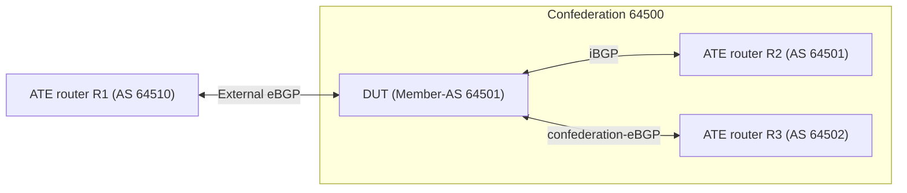

# RT-1.111: BGP Autonomous System Confederations (RFC 5065)

## Summary

This test suite ensures that the router supports BGP Autonomous System
Confederations (RFC 5065) for IPv4 and IPv6 unicast:

*   Confederation configuration and state (`identifier` and `member-as`)
*   External eBGP, iBGP, and confederation-eBGP session establishment
*   `AS_PATH` (`AS_CONFED_SEQUENCE` and `AS_SEQ`) propagation and traffic
    forwarding across confederation, iBGP, and external eBGP peers

### Testbed type

*   [TESTBED_DUT_ATE_4LINKS](https://github.com/openconfig/featureprofiles/blob/main/topologies/atedut_4.testbed)

### Topology



### DUT and OTG properties

| Device | Port1 IPv4 | Port1 IPv6 | Port2 IPv4 | Port2 IPv6 | Port3 IPv4 | Port3 IPv6 | AS | Confederation ID | Member-AS | Router ID |
| :----- | :--------- | :--------- | :--------- | :--------- | :--------- | :--------- | :- | :--------------- | :-------- | :-------: |
| DUT | 192.0.2.1/30 | 2001:db8::1/126 | 192.0.2.5/30 | 2001:db8::5/126 | 192.0.2.9/30 | 2001:db8::9/126 | 64501 | 64500 | 64502 | 192.0.2.254 |
| ATE R1 | 192.0.2.2/30 | 2001:db8::2/126 | N/A | N/A | N/A | N/A | 64510 | N/A | N/A | 192.0.2.2 |
| ATE R2 | N/A | N/A | 192.0.2.6/30 | 2001:db8::6/126 | N/A | N/A | 64501 | 64500 | 64502 | 192.0.2.6 |
| ATE R3 | N/A | N/A | N/A | N/A | 192.0.2.10/30 | 2001:db8::a/126 | 64502 | 64500 | 64501 | 192.0.2.10 |

All advertised BGP routes on OTG have the below specs:

| Name | ATE Port | IPv4 Prefix | IPv6 Prefix | AS_PATH |
| :--- | :------- | :---------- | :---------- | :------ |
| EXT | Port 1 | 203.0.113.0/26 | 2001:db8:100::/48 | AS_SEQ [64510] |
| IBGP | Port 2 | 198.51.100.0/26 | 2001:db8:200::/48 | empty |
| CONFED | Port 3 | 198.51.100.64/26 | 2001:db8:300::/48 | AS_CONFED_SEQUENCE [64502] |

### Procedure

#### Initial Setup:

*   Connect DUT port-1, port-2, and port-3 to OTG port-1, port-2, and port-3.
*   Configure OTG interfaces, BGP peers (R1 eBGP AS `64510`, R2 iBGP AS `64501`,
    R3 confederation-eBGP AS `64502`), route ranges, and IPv4/IPv6 traffic flows
    per the tables above, and start OTG protocols.
*   Configure DUT interfaces and BGP in the `DEFAULT` network instance with
    global AS `64501`, router ID `192.0.2.254`, confederation identifier
    `64500`, member-as `[64502]`, and IPv4/IPv6 unicast neighbors for R1, R2,
    and R3.

### RT-1.111.1: Confederation configuration, state and session establishment

*   Verify DUT BGP global AS (`64501`), confederation identifier (`64500`), and
    member-as (`[64502]`).
*   Verify all 6 IPv4 and IPv6 BGP sessions are `ESTABLISHED`.

### RT-1.111.2: Confederation peer to iBGP peer route propagation

*   Advertise `CONFED` from ATE R3 (port-3).
*   Verify in the DUT `loc-rib` and on ATE R2 (port-2) that `CONFED` is received
    with `AS_CONFED_SEQUENCE [64502]`.
*   Verify IPv4 and IPv6 traffic from port-2 to port-3 passes without loss.

### RT-1.111.3: iBGP peer to confederation peer route propagation

*   Advertise `IBGP` from ATE R2 (port-2).
*   Verify on ATE R3 (port-3) that `IBGP` is received with
    `AS_CONFED_SEQUENCE [64501]`.
*   Verify IPv4 and IPv6 traffic from port-3 to port-2 passes without loss.

### RT-1.111.4: Confederation routes to external eBGP peer

*   Verify ATE R1 (port-1) receives `CONFED` and `IBGP` with `AS_SEQ [64500]`
    (`AS_CONFED_SEQUENCE` removed).
*   Verify IPv4 and IPv6 traffic from port-1 to port-2 and port-3 passes
    without loss.

### RT-1.111.5: External route to confederation and iBGP peers

*   Advertise `EXT` from ATE R1 (port-1).
*   Verify ATE R3 (port-3) receives `EXT` with
    `AS_CONFED_SEQUENCE [64501], AS_SEQ [64510]` and ATE R2 (port-2) receives
    `EXT` with `AS_SEQ [64510]`.
*   Verify IPv4 and IPv6 traffic from port-2 and port-3 to port-1 passes
    without loss.

#### Testing steps

*   Verify BGP confederation state and session establishment on the DUT
*   Advertise the BGP route ranges from OTG and collect the RIB and learned
    route attributes on the DUT and OTG
*   Start traffic flows, wait 30 seconds, stop traffic flows, and collect RX/TX
    packet counts

#### Test pass fail criteria

*   If any of the below conditions are not met, test should be declared as a
    "FAIL":
    1.  Count of BGP sessions in the `ESTABLISHED` state is less than 6
    2.  DUT confederation state (`as`, `identifier`, `member-as`) or received
        `AS_PATH` attributes do not match the expected values in `RT-1.111.1`
        through `RT-1.111.5`
    3.  Traffic flow packet loss is greater than 1%

### Cleanup

*   Remove BGP and interface configurations from the DUT and stop OTG protocols
    to restore the baseline state.

## Canonical OC

```json
{
  "network-instances": {
    "network-instance": [
      {
        "config": {
          "name": "DEFAULT",
          "type": "openconfig-network-instance-types:DEFAULT_INSTANCE"
        },
        "name": "DEFAULT",
        "protocols": {
          "protocol": [
            {
              "bgp": {
                "global": {
                  "confederation": {
                    "config": {
                      "identifier": 64500,
                      "member-as": [
                        64502
                      ]
                    }
                  },
                  "config": {
                    "as": 64501,
                    "router-id": "192.0.2.254"
                  }
                }
              },
              "config": {
                "identifier": "openconfig-policy-types:BGP",
                "name": "BGP"
              },
              "identifier": "openconfig-policy-types:BGP",
              "name": "BGP"
            }
          ]
        }
      }
    ]
  }
}
```

## OpenConfig Path and RPC Coverage

```yaml
paths:
  ## Config Parameter Coverage
  /network-instances/network-instance/protocols/protocol/bgp/global/config/as:
  /network-instances/network-instance/protocols/protocol/bgp/global/config/router-id:
  /network-instances/network-instance/protocols/protocol/bgp/global/confederation/config/identifier:
  /network-instances/network-instance/protocols/protocol/bgp/global/confederation/config/member-as:

  ## Telemetry Parameter Coverage
  /network-instances/network-instance/protocols/protocol/bgp/global/state/as:
  /network-instances/network-instance/protocols/protocol/bgp/global/confederation/state/identifier:
  /network-instances/network-instance/protocols/protocol/bgp/global/confederation/state/member-as:
  /network-instances/network-instance/protocols/protocol/bgp/neighbors/neighbor/state/session-state:
  /network-instances/network-instance/protocols/protocol/bgp/rib/afi-safis/afi-safi/ipv4-unicast/loc-rib/routes/route/state/prefix:
  /network-instances/network-instance/protocols/protocol/bgp/rib/afi-safis/afi-safi/ipv4-unicast/loc-rib/routes/route/state/attr-index:
  /network-instances/network-instance/protocols/protocol/bgp/rib/afi-safis/afi-safi/ipv6-unicast/loc-rib/routes/route/state/prefix:
  /network-instances/network-instance/protocols/protocol/bgp/rib/afi-safis/afi-safi/ipv6-unicast/loc-rib/routes/route/state/attr-index:
  /network-instances/network-instance/protocols/protocol/bgp/rib/attr-sets/attr-set/as-path/as-segment/state/type:
  /network-instances/network-instance/protocols/protocol/bgp/rib/attr-sets/attr-set/as-path/as-segment/state/member:

rpcs:
  gnmi:
    gNMI.Set:
      replace: true
      delete: true
    gNMI.Subscribe:
      on_change: true
```

## Minimum DUT platform requirement

*   FFF
