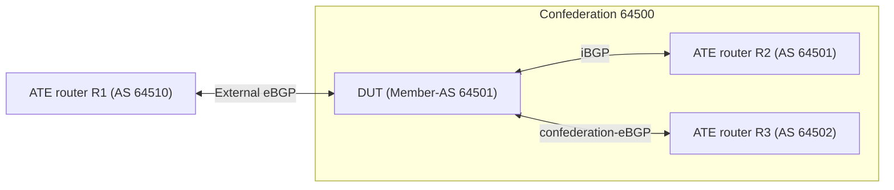

# RT-1.111: BGP Autonomous System Confederations (RFC 5065)

## Summary

This test suite ensures that the router supports BGP Autonomous System
Confederations (RFC 5065) for IPv4 and IPv6 unicast:

*   Confederation configuration and state (`identifier` and `member-as`)
*   External eBGP, iBGP, and confederation-eBGP session establishment
*   `AS_PATH` (`AS_CONFED_SEQUENCE` and `AS_SEQ`), `LOCAL_PREF`, `MED`, and
    `NEXT_HOP` propagation across confederation, iBGP, and external eBGP peers
*   AS loop detection for the local Member-AS and confederation identifier

### Testbed type

*   [TESTBED_DUT_ATE_4LINKS](https://github.com/openconfig/featureprofiles/blob/main/topologies/atedut_4.testbed)

### Topology



### DUT and OTG properties

| Device | Port1 IPv4 | Port1 IPv6 | Port2 IPv4 | Port2 IPv6 | Port3 IPv4 | Port3 IPv6 | AS | Confederation ID | Member-AS | Router ID |
| :----- | :--------- | :--------- | :--------- | :--------- | :--------- | :--------- | :- | :--------------- | :-------- | :-------: |
| DUT | 192.0.2.1/30 | 2001:db8::1/126 | 192.0.2.5/30 | 2001:db8::5/126 | 192.0.2.9/30 | 2001:db8::9/126 | 64501 | 64500 | 64502 | 192.0.2.254 |
| ATE R1 | 192.0.2.2/30 | 2001:db8::2/126 | N/A | N/A | N/A | N/A | 64510 | N/A | N/A | 192.0.2.2 |
| ATE R2 | N/A | N/A | 192.0.2.6/30 | 2001:db8::6/126 | N/A | N/A | 64501 | N/A | N/A | 192.0.2.6 |
| ATE R3 | N/A | N/A | N/A | N/A | 192.0.2.10/30 | 2001:db8::a/126 | 64502 | N/A | N/A | 192.0.2.10 |

All advertised BGP routes on OTG have the below specs:

| Name | ATE Port | IPv4 Prefix | IPv6 Prefix | AS_PATH | LOCAL_PREF | MED |
| :--- | :------- | :---------- | :---------- | :------ | :--------- | :-: |
| EXT | Port 1 | 203.0.113.0/26 | 2001:db8:100::/48 | AS_SEQ [64510] | - | - |
| IBGP | Port 2 | 198.51.100.0/26 | 2001:db8:200::/48 | empty | 200 | 50 |
| IBGP-CONFED | Port 2 | 198.51.100.192/26 | 2001:db8:201::/48 | AS_CONFED_SEQUENCE [64503] | 100 | - |
| CONFED | Port 3 | 198.51.100.64/26 | 2001:db8:300::/48 | AS_CONFED_SEQUENCE [64502] | 150 | - |
| CONFED-TRANSIT | Port 3 | 203.0.113.128/26 | 2001:db8:302::/48 | AS_CONFED_SEQUENCE [64502], AS_SEQ [64511] | - | - |
| CONFED-LOOP | Port 3 | 198.51.100.128/26 | 2001:db8:301::/48 | AS_CONFED_SEQUENCE [64502, 64501] | - | - |
| EXT-LOOP | Port 1 | 203.0.113.64/26 | 2001:db8:101::/48 | AS_SEQ [64510, 64500] | - | - |

### Procedure

#### Initial Setup:

*   Connect DUT port-1, port-2, and port-3 to OTG port-1, port-2, and port-3
    respectively
*   Configure OTG:
    1.  Create emulated routers R1 (port-1), R2 (port-2), and R3 (port-3) with
        Ethernet interfaces
    2.  Configure IPv4 and IPv6 addresses on R1, R2, and R3
    3.  Configure BGP on R1 (AS 64510, eBGP), R2 (AS 64501, iBGP), and R3
        (AS 64502, confederation-eBGP) for IPv4 and IPv6
    4.  Configure the BGP route ranges on R1, R2, and R3 as listed in the table
        above
    5.  Create IPv4 and IPv6 traffic flows between the advertised prefixes on
        port-1, port-2, and port-3
    6.  Push configuration to OTG
*   Start protocols on OTG
*   Configure DUT:
    1.  Configure the default network instance and interface IPv4/IPv6 addresses
        on port-1, port-2, and port-3
    2.  Configure routing policy `ALLOW` to accept all routes
    3.  Configure BGP for DUT:
        *   Create BGP instance under the default routing instance
        *   Set global AS to 64501 and router ID to 192.0.2.254
        *   Set confederation identifier to 64500 and member-as to 64502
        *   Enable IPv4-unicast and IPv6-unicast address families
        *   Create peer-groups `EBGP-EXT` (peer-as 64510), `IBGP-MEMBER`
            (peer-as 64501), and `CONFED-EBGP` (peer-as 64502) with
            import/export policy `ALLOW`
        *   Configure the IPv4 and IPv6 BGP neighbors and push the configuration
            to the DUT
*   Confirm that DUT has 6 BGP sessions in the `ESTABLISHED` state

### RT-1.111.1: Confederation configuration, state and session establishment

*   Verify DUT BGP global AS (`64501`), confederation identifier (`64500`), and
    member-as (`[64502]`).
*   Verify all 6 IPv4 and IPv6 BGP sessions are `ESTABLISHED`.

### RT-1.111.2: Confederation peer to iBGP peer route propagation

*   Advertise `CONFED` and `CONFED-TRANSIT` from ATE R3 (port-3).
*   Verify in the DUT RIB (`loc-rib` / `adj-rib-in-post`) and on ATE R2
    (port-2) that both routes are received with `AS_PATH` and `LOCAL_PREF`
    (`150`) unchanged.
*   Verify IPv4 and IPv6 traffic from port-2 to port-3 passes without loss.

### RT-1.111.3: iBGP peer to confederation peer route propagation

*   Advertise `IBGP` and `IBGP-CONFED` from ATE R2 (port-2).
*   Verify in the DUT `adj-rib-out-post` (toward R3) and on ATE R3 (port-3) that
    `IBGP` is advertised with `AS_CONFED_SEQUENCE [64501]` and `IBGP-CONFED`
    with `AS_CONFED_SEQUENCE [64501, 64503]`, with `LOCAL_PREF` (`200` / `100`)
    and `MED` (`50`) preserved.
*   Verify IPv4 and IPv6 traffic from port-3 to port-2 passes without loss.

### RT-1.111.4: Confederation routes to external eBGP peer

*   Verify ATE R1 (port-1) receives `CONFED`, `IBGP`, and `IBGP-CONFED` with
    `AS_SEQ [64500]`, and `CONFED-TRANSIT` with `AS_SEQ [64500, 64511]` (all
    confederation segments removed and `NEXT_HOP` set to DUT port-1).
*   Verify IPv4 and IPv6 traffic from port-1 to port-2 and port-3 passes
    without loss.

### RT-1.111.5: External route to confederation and iBGP peers

*   Advertise `EXT` from ATE R1 (port-1).
*   Verify ATE R3 (port-3) receives `EXT` with
    `AS_CONFED_SEQUENCE [64501], AS_SEQ [64510]` and ATE R2 (port-2) receives
    `EXT` with `AS_SEQ [64510]`.
*   Verify IPv4 and IPv6 traffic from port-2 and port-3 to port-1 passes
    without loss.

### RT-1.111.6: AS loop detection

*   Advertise `CONFED-LOOP` from ATE R3 (port-3) and `EXT-LOOP` from ATE R1
    (port-1), then withdraw them after verification.
*   Verify the looped routes are rejected and not installed in the DUT `loc-rib`
    or advertised to any peer, and all BGP sessions remain `ESTABLISHED`.

#### Testing steps

*   Verify BGP confederation state and session establishment on the DUT
*   Advertise the BGP route ranges from OTG and collect the RIB and learned
    route attributes on the DUT and OTG
*   Start traffic flows
*   Wait for 30 seconds
*   Stop traffic flows
*   Collect the number of RX and TX traffic flow packets
*   Advertise and withdraw the looped route ranges and verify route rejection
    and session stability

#### Test pass fail criteria

*   If any of the below conditions are not met, test should be declared as a
    "FAIL":
    1.  Count of BGP sessions in the `ESTABLISHED` state is less than 6
    2.  DUT confederation state (`as`, `identifier`, `member-as`) or received
        `AS_PATH`, `LOCAL_PREF`, `MED`, or `NEXT_HOP` attributes do not match
        the expected values in `RT-1.111.1` through `RT-1.111.5`
    3.  Looped (`CONFED-LOOP`, `EXT-LOOP`) routes are installed or propagated,
        or cause any BGP session reset
    4.  Traffic flow packet loss is greater than 1%

### Cleanup

*   Remove BGP, routing policy, and interface configurations from the DUT and
    stop OTG protocols to restore the baseline state.

## Canonical OC

```json
{
  "network-instances": {
    "network-instance": [
      {
        "config": {
          "name": "DEFAULT",
          "type": "openconfig-network-instance-types:DEFAULT_INSTANCE"
        },
        "name": "DEFAULT",
        "protocols": {
          "protocol": [
            {
              "bgp": {
                "global": {
                  "confederation": {
                    "config": {
                      "identifier": 64500,
                      "member-as": [
                        64502
                      ]
                    }
                  },
                  "config": {
                    "as": 64501,
                    "router-id": "192.0.2.254"
                  }
                }
              },
              "config": {
                "identifier": "openconfig-policy-types:BGP",
                "name": "BGP"
              },
              "identifier": "openconfig-policy-types:BGP",
              "name": "BGP"
            }
          ]
        }
      }
    ]
  }
}
```

## OpenConfig Path and RPC Coverage

```yaml
paths:
  ## Config Parameter Coverage
  /network-instances/network-instance/protocols/protocol/bgp/global/config/as:
  /network-instances/network-instance/protocols/protocol/bgp/global/config/router-id:
  /network-instances/network-instance/protocols/protocol/bgp/global/afi-safis/afi-safi/config/enabled:
  /network-instances/network-instance/protocols/protocol/bgp/global/confederation/config/identifier:
  /network-instances/network-instance/protocols/protocol/bgp/global/confederation/config/member-as:
  /network-instances/network-instance/protocols/protocol/bgp/neighbors/neighbor/config/enabled:
  /network-instances/network-instance/protocols/protocol/bgp/neighbors/neighbor/config/neighbor-address:
  /network-instances/network-instance/protocols/protocol/bgp/neighbors/neighbor/config/peer-as:
  /network-instances/network-instance/protocols/protocol/bgp/neighbors/neighbor/config/peer-group:
  /network-instances/network-instance/protocols/protocol/bgp/neighbors/neighbor/afi-safis/afi-safi/config/enabled:
  /network-instances/network-instance/protocols/protocol/bgp/peer-groups/peer-group/config/peer-as:
  /network-instances/network-instance/protocols/protocol/bgp/peer-groups/peer-group/config/peer-group-name:
  /network-instances/network-instance/protocols/protocol/bgp/peer-groups/peer-group/afi-safis/afi-safi/config/enabled:
  /network-instances/network-instance/protocols/protocol/bgp/peer-groups/peer-group/afi-safis/afi-safi/apply-policy/config/import-policy:
  /network-instances/network-instance/protocols/protocol/bgp/peer-groups/peer-group/afi-safis/afi-safi/apply-policy/config/export-policy:
  /routing-policy/policy-definitions/policy-definition/config/name:
  /routing-policy/policy-definitions/policy-definition/statements/statement/config/name:
  /routing-policy/policy-definitions/policy-definition/statements/statement/actions/config/policy-result:

  ## Telemetry Parameter Coverage
  /network-instances/network-instance/protocols/protocol/bgp/global/state/as:
  /network-instances/network-instance/protocols/protocol/bgp/global/confederation/state/identifier:
  /network-instances/network-instance/protocols/protocol/bgp/global/confederation/state/member-as:
  /network-instances/network-instance/protocols/protocol/bgp/neighbors/neighbor/state/session-state:
  /network-instances/network-instance/protocols/protocol/bgp/neighbors/neighbor/state/established-transitions:
  /network-instances/network-instance/protocols/protocol/bgp/neighbors/neighbor/state/messages/sent/last-notification-error-code:
  /network-instances/network-instance/protocols/protocol/bgp/neighbors/neighbor/state/messages/received/last-notification-error-code:
  /network-instances/network-instance/protocols/protocol/bgp/rib/afi-safis/afi-safi/ipv4-unicast/loc-rib/routes/route/state/prefix:
  /network-instances/network-instance/protocols/protocol/bgp/rib/afi-safis/afi-safi/ipv4-unicast/loc-rib/routes/route/state/attr-index:
  /network-instances/network-instance/protocols/protocol/bgp/rib/afi-safis/afi-safi/ipv6-unicast/loc-rib/routes/route/state/prefix:
  /network-instances/network-instance/protocols/protocol/bgp/rib/afi-safis/afi-safi/ipv6-unicast/loc-rib/routes/route/state/attr-index:
  /network-instances/network-instance/protocols/protocol/bgp/rib/afi-safis/afi-safi/ipv4-unicast/neighbors/neighbor/adj-rib-in-post/routes/route/state/prefix:
  /network-instances/network-instance/protocols/protocol/bgp/rib/afi-safis/afi-safi/ipv4-unicast/neighbors/neighbor/adj-rib-in-post/routes/route/state/attr-index:
  /network-instances/network-instance/protocols/protocol/bgp/rib/afi-safis/afi-safi/ipv6-unicast/neighbors/neighbor/adj-rib-in-post/routes/route/state/prefix:
  /network-instances/network-instance/protocols/protocol/bgp/rib/afi-safis/afi-safi/ipv6-unicast/neighbors/neighbor/adj-rib-in-post/routes/route/state/attr-index:
  /network-instances/network-instance/protocols/protocol/bgp/rib/afi-safis/afi-safi/ipv4-unicast/neighbors/neighbor/adj-rib-in-pre/routes/route/state/attr-index:
  /network-instances/network-instance/protocols/protocol/bgp/rib/afi-safis/afi-safi/ipv6-unicast/neighbors/neighbor/adj-rib-in-pre/routes/route/state/attr-index:
  /network-instances/network-instance/protocols/protocol/bgp/rib/afi-safis/afi-safi/ipv4-unicast/neighbors/neighbor/adj-rib-out-post/routes/route/state/attr-index:
  /network-instances/network-instance/protocols/protocol/bgp/rib/afi-safis/afi-safi/ipv6-unicast/neighbors/neighbor/adj-rib-out-post/routes/route/state/attr-index:
  /network-instances/network-instance/protocols/protocol/bgp/rib/attr-sets/attr-set/state/local-pref:
  /network-instances/network-instance/protocols/protocol/bgp/rib/attr-sets/attr-set/state/med:
  /network-instances/network-instance/protocols/protocol/bgp/rib/attr-sets/attr-set/state/next-hop:
  /network-instances/network-instance/protocols/protocol/bgp/rib/attr-sets/attr-set/as-path/as-segment/state/index:
  /network-instances/network-instance/protocols/protocol/bgp/rib/attr-sets/attr-set/as-path/as-segment/state/type:
  /network-instances/network-instance/protocols/protocol/bgp/rib/attr-sets/attr-set/as-path/as-segment/state/member:
  /network-instances/network-instance/afts/ipv4-unicast/ipv4-entry/state/prefix:
  /network-instances/network-instance/afts/ipv6-unicast/ipv6-entry/state/prefix:

rpcs:
  gnmi:
    gNMI.Set:
      replace: true
      delete: true
    gNMI.Subscribe:
      on_change: true
```

## Minimum DUT platform requirement

*   FFF
