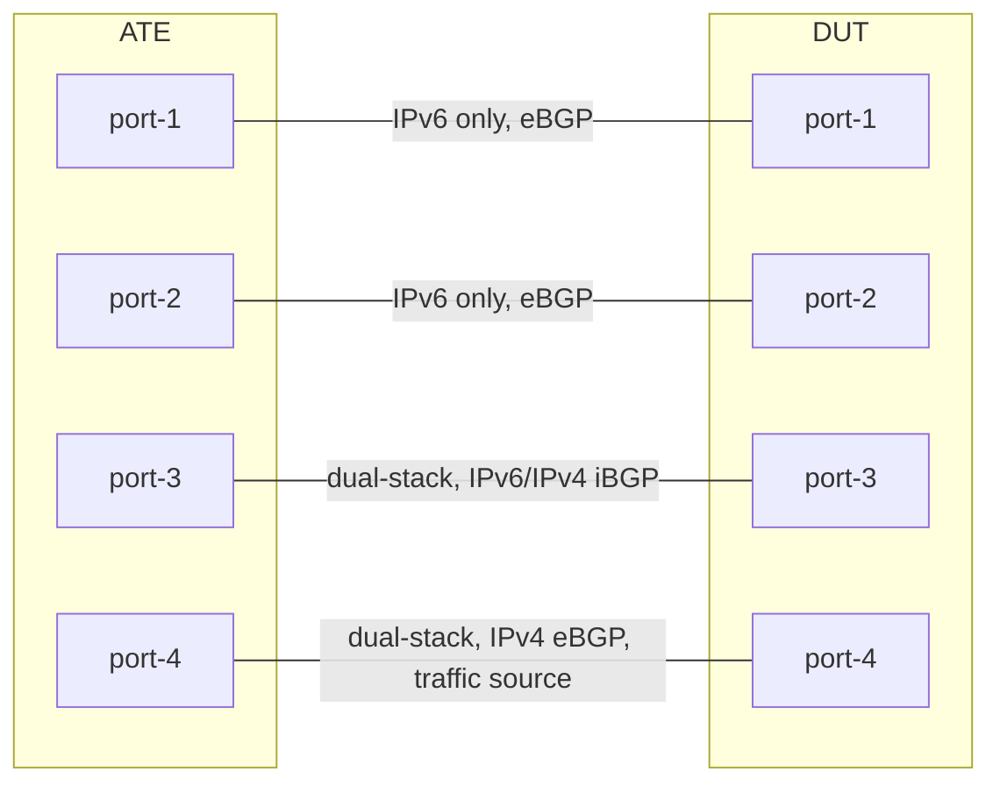

# RT-1.112: BGP Extended Next-Hop Encoding

## Summary

BGP extended next-hop encoding (RFC 8950) lets IPv4 routes carry an IPv6
next-hop, so one IPv6 BGP session can carry IPv4 and IPv6 routes and IPv4
traffic can be forwarded over links without IPv4 addresses.

This test verifies that the DUT:

*   negotiates extended next-hop encoding on eBGP and iBGP sessions over IPv6
*   installs IPv4 routes with IPv6 next-hops and forwards IPv4 traffic to them
*   advertises IPv4 routes learned with IPv6 next-hops to iBGP peers over IPv6
    and over an IPv4 session with extended next-hop encoding enabled with the
    next-hop unchanged, and to eBGP peers with its own IPv6 address, or its own
    IPv4 address on an IPv4 session without extended next-hop encoding
*   load-balances IPv4 traffic over IPv6 next-hops in proportion to the BGP
    link-bandwidth extended community
*   neither installs nor advertises IPv4 routes with IPv6 next-hops for a peer
    with extended next-hop encoding disabled

## Testbed type

*   [`featureprofiles/topologies/atedut_4.testbed`](https://github.com/openconfig/featureprofiles/blob/main/topologies/atedut_4.testbed)

## Procedure

### Test environment setup



| Port   | DUT IPv4        | DUT IPv6          | ATE IPv4        | ATE IPv6          | ATE AS | ATE router ID |
| ------ | --------------- | ----------------- | --------------- | ----------------- | ------ | ------------- |
| port-1 | none            | `2001:db8::1/126` | none            | `2001:db8::2/126` | 64501  | `198.18.0.2`  |
| port-2 | none            | `2001:db8::5/126` | none            | `2001:db8::6/126` | 64502  | `198.18.0.3`  |
| port-3 | `192.0.2.9/30`  | `2001:db8::9/126` | `192.0.2.10/30` | `2001:db8::a/126` | 64500  | `198.18.0.4`  |
| port-4 | `192.0.2.13/30` | `2001:db8::d/126` | `192.0.2.14/30` | `2001:db8::e/126` | 64503  | `198.18.0.5`  |

*   Configure the DUT and ATE interfaces as in the table. Enable IPv4 on DUT
    port-1 and DUT port-2 without an IPv4 address.
*   Configure BGP on the DUT with AS 64500 and router ID `198.18.0.1`, and one
    IPv6 neighbor for each of ATE port-1 to port-3 and one IPv4 eBGP neighbor
    for ATE port-4, with the ATE address and AS from the table.
*   Enable `IPV4_UNICAST` and `IPV6_UNICAST` globally and on the IPv6 neighbors,
    and enable extended next-hop encoding for `IPV4_UNICAST` only on the IPv6
    neighbors. On the IPv4 neighbor, enable only `IPV4_UNICAST`, without
    extended next-hop encoding.
*   Apply an accept-all import and export policy to all neighbors.
*   Do not configure next-hop-self.
*   ATE port-1 to port-3 each run one BGP peer toward the DUT over IPv6, with
    `IPV4_UNICAST`, `IPV6_UNICAST` and the extended next-hop encoding
    capability. ATE port-4 runs one BGP peer toward the DUT over IPv4 with only
    `IPV4_UNICAST` and without extended next-hop encoding, and advertises no
    routes.
*   Each route below is advertised from the first subtest that uses it, with the
    global IPv6 address of the advertising port as next-hop and without a
    link-local next-hop:

| Prefix              | Advertised by             | Next-hop                     | Used in                |
| ------------------- | ------------------------- | ---------------------------- | ---------------------- |
| `198.51.100.0/25`   | ATE port-1                | `2001:db8::2`                | RT-1.112.1, .2, .7, .8 |
| `2001:db8:100::/64` | ATE port-1                | `2001:db8::2`                | RT-1.112.1             |
| `203.0.113.0/24`    | ATE port-3                | `2001:db8::a`                | RT-1.112.3, .4, .7     |
| `198.51.100.128/25` | ATE port-1 and ATE port-2 | `2001:db8::2`, `2001:db8::6` | RT-1.112.5 to .7       |

Traffic is sent from ATE port-4 for 30 seconds at 1,000 packets per second and
is counted per receiving ATE port. Subtests run in order. A subtest passes only
if all its checks hold and each flow has less than 2% loss.

### RT-1.112.1 - eBGP: receive IPv4 routes with an IPv6 next-hop

*   ATE port-1 advertises `198.51.100.0/25` and `2001:db8:100::/64`.
*   Verify that the sessions to ATE port-1, port-2 and port-3 are
    `ESTABLISHED`, that `IPV4_UNICAST` and `IPV6_UNICAST` are active, and that
    extended next-hop encoding is enabled and `EXTENDED_NEXTHOP_ENCODING` is a
    negotiated capability.
*   Verify that the DUT reports 1 received and 1 installed IPv4 prefix from
    ATE port-1.
*   Verify that the DUT Loc-RIB and AFT have `198.51.100.0/25`, and the AFT has
    `2001:db8:100::/64`, each with the single next-hop `2001:db8::2` via DUT
    port-1.
*   Send IPv4 traffic to `198.51.100.1` and IPv6 traffic to `2001:db8:100::1`;
    verify that ATE port-1 receives both flows.

### RT-1.112.2 - eBGP to iBGP: next-hop unchanged

*   Verify that the DUT reports at least 1 IPv4 prefix sent to ATE port-3, and
    that ATE port-3 receives `198.51.100.0/25` with next-hop `2001:db8::2`. The
    next-hop is not changed toward an iBGP peer (RFC 4271).

### RT-1.112.3 - iBGP to eBGP: DUT IPv6 address as next-hop

*   ATE port-3 advertises `203.0.113.0/24`.
*   Verify that the DUT Loc-RIB and AFT have `203.0.113.0/24` with next-hop
    `2001:db8::a` via DUT port-3.
*   Verify that ATE port-1 receives `203.0.113.0/24` with next-hop
    `2001:db8::1` and ATE port-2 with `2001:db8::5`; an additional link-local
    next-hop is allowed. Toward an eBGP peer the DUT uses its own address on
    the link (RFC 4271).
*   Send IPv4 traffic to `203.0.113.1`; verify that ATE port-3 receives it.

### RT-1.112.4 - iBGP to eBGP over IPv4: DUT IPv4 address as next-hop

*   Verify that the session to ATE port-4 is `ESTABLISHED`, with `IPV4_UNICAST`
    active and extended next-hop encoding not negotiated.
*   Verify that ATE port-4 receives `203.0.113.0/24` with next-hop `192.0.2.13`,
    the DUT's IPv4 address on the link. Without extended next-hop encoding on
    this session, the DUT must use its own IPv4 address.

### RT-1.112.5 - Weighted ECMP over IPv6 next-hops (2:1)

*   On the DUT, enable eBGP multipath for `IPV4_UNICAST` with up to 2 paths from
    different ASes, and link-bandwidth based load balancing, as in the Canonical
    OC.
*   ATE port-1 and ATE port-2 advertise `198.51.100.128/25` with the same
    ORIGIN and AS-path length, and with `link-bandwidth:64501:20M` and
    `link-bandwidth:64502:10M`.
*   Verify that the DUT AFT has `198.51.100.128/25` with exactly two next-hops,
    `2001:db8::2` via DUT port-1 and `2001:db8::6` via DUT port-2, with a
    weight ratio between 1.9 and 2.1.
*   Send IPv4 traffic to `198.51.100.129` with random UDP source and
    destination ports in each packet; verify that ATE port-1 receives 66.7% and
    ATE port-2 33.3% of it, each within 5 percentage points.

### RT-1.112.6 - Weighted ECMP with equal link bandwidth (1:1)

*   ATE port-1 re-advertises `198.51.100.128/25` with
    `link-bandwidth:64501:10M`.
*   Repeat the checks of RT-1.112.5, expecting a weight ratio between 0.95 and
    1.05 and 50% of the traffic on each port.

### RT-1.112.7 - Extended next-hop encoding disabled for one peer

*   ATE port-1 is not changed and still advertises the capability.
*   On the DUT, disable extended next-hop encoding for `IPV4_UNICAST` of the ATE
    port-1 neighbor, then reset the session: disable the neighbor, wait until
    the session is not `ESTABLISHED`, and enable it again.
*   Verify that the encoding is reported as disabled for the neighbor. The
    session may stay down or reset; if it is `ESTABLISHED`, verify that the
    capability is not negotiated. A capability is used only when both peers
    advertise it (RFC 5492).
*   Verify that the DUT installs no IPv4 route from ATE port-1:
    `198.51.100.0/25` is not in the AFT, `198.51.100.128/25` has only the
    next-hop `2001:db8::6`, and the installed IPv4 prefix count for the
    neighbor is 0 or not reported.
*   Verify that ATE port-1 receives no IPv4 route with an IPv6 next-hop,
    including an IPv4-mapped one. Routes with an IPv4 next-hop are allowed.
*   Send the flow of RT-1.112.5; verify that ATE port-2 receives at least 98%
    of it.
*   Re-enable the encoding and reset the session in the same way. Verify that
    the session and AFT checks of RT-1.112.1 for ATE port-1 and
    `198.51.100.0/25`, the ATE port-1 check of RT-1.112.3, and RT-1.112.6 pass
    again.

### RT-1.112.8 - eBGP to iBGP over IPv4: extended next-hop encoding

> **Scope:** Arista DUTs only (non-Arista vendors skip this subtest).

*   On the DUT, add an IPv4 iBGP neighbor for ATE port-3 (`192.0.2.10`, AS
    64500) with `IPV4_UNICAST` enabled, `extended-next-hop-encoding` set to
    `true` for `IPV4_UNICAST` (do not configure `IPV6_UNICAST` on this IPv4
    neighbor), and the `ACCEPT-ALL` import and export policies applied.
*   On ATE port-3, add a second BGP peer toward the DUT over IPv4 (`192.0.2.9`,
    AS 64500, iBGP) with `IPV4_UNICAST` and the extended next-hop encoding
    capability enabled (and `IPV6_UNICAST` capability disabled).
*   Verify that the IPv4 iBGP session `192.0.2.10` is `ESTABLISHED`,
    `IPV4_UNICAST` is active, `extended-next-hop-encoding` is enabled, and
    `EXTENDED_NEXTHOP_ENCODING` is a negotiated capability.
*   Verify that the DUT reports at least 1 IPv4 prefix sent to `192.0.2.10`, and
    that the ATE port-3 IPv4 iBGP peer receives `198.51.100.0/25` with next-hop
    `2001:db8::2` unchanged (an IPv6 next-hop and no IPv4 next-hop).

### Cleanup

*   Stop the ATE protocols and remove all DUT configuration added by the test.

## Canonical OC

Shows DUT port-1, its BGP neighbor and the multipath configuration of
RT-1.112.5; the other ports and neighbors follow Test environment setup.

```json
{
  "openconfig-interfaces:interfaces": {
    "interface": [
      {
        "name": "port1",
        "config": {
          "name": "port1",
          "type": "iana-if-type:ethernetCsmacd"
        },
        "subinterfaces": {
          "subinterface": [
            {
              "index": 0,
              "config": {
                "index": 0
              },
              "openconfig-if-ip:ipv4": {
                "config": {
                  "enabled": true
                }
              },
              "openconfig-if-ip:ipv6": {
                "config": {
                  "enabled": true
                },
                "addresses": {
                  "address": [
                    {
                      "ip": "2001:db8::1",
                      "config": {
                        "ip": "2001:db8::1",
                        "prefix-length": 126
                      }
                    }
                  ]
                }
              }
            }
          ]
        }
      }
    ]
  },
  "openconfig-network-instance:network-instances": {
    "network-instance": [
      {
        "name": "DEFAULT",
        "protocols": {
          "protocol": [
            {
              "identifier": "openconfig-policy-types:BGP",
              "name": "BGP",
              "config": {
                "identifier": "openconfig-policy-types:BGP",
                "name": "BGP"
              },
              "bgp": {
                "global": {
                  "config": {
                    "as": 64500,
                    "router-id": "198.18.0.1"
                  },
                  "afi-safis": {
                    "afi-safi": [
                      {
                        "afi-safi-name": "openconfig-bgp-types:IPV4_UNICAST",
                        "config": {
                          "afi-safi-name": "openconfig-bgp-types:IPV4_UNICAST",
                          "enabled": true
                        },
                        "use-multiple-paths": {
                          "config": {
                            "enabled": true
                          },
                          "ebgp": {
                            "config": {
                              "allow-multiple-as": true,
                              "maximum-paths": 2
                            },
                            "link-bandwidth-ext-community": {
                              "config": {
                                "enabled": true
                              }
                            }
                          }
                        }
                      },
                      {
                        "afi-safi-name": "openconfig-bgp-types:IPV6_UNICAST",
                        "config": {
                          "afi-safi-name": "openconfig-bgp-types:IPV6_UNICAST",
                          "enabled": true
                        }
                      }
                    ]
                  }
                },
                "neighbors": {
                  "neighbor": [
                    {
                      "neighbor-address": "2001:db8::2",
                      "config": {
                        "neighbor-address": "2001:db8::2",
                        "peer-as": 64501
                      },
                      "afi-safis": {
                        "afi-safi": [
                          {
                            "afi-safi-name": "openconfig-bgp-types:IPV4_UNICAST",
                            "config": {
                              "afi-safi-name": "openconfig-bgp-types:IPV4_UNICAST",
                              "enabled": true
                            },
                            "ipv4-unicast": {
                              "config": {
                                "extended-next-hop-encoding": true
                              }
                            }
                          },
                          {
                            "afi-safi-name": "openconfig-bgp-types:IPV6_UNICAST",
                            "config": {
                              "afi-safi-name": "openconfig-bgp-types:IPV6_UNICAST",
                              "enabled": true
                            }
                          }
                        ]
                      }
                    }
                  ]
                }
              }
            }
          ]
        }
      }
    ]
  }
}
```

## OpenConfig Path and RPC Coverage

```yaml
paths:
  ## Config parameter coverage
  /interfaces/interface/subinterfaces/subinterface/ipv4/config/enabled:
  /interfaces/interface/subinterfaces/subinterface/ipv6/config/enabled:
  /network-instances/network-instance/protocols/protocol/bgp/global/config/as:
  /network-instances/network-instance/protocols/protocol/bgp/global/config/router-id:
  /network-instances/network-instance/protocols/protocol/bgp/global/afi-safis/afi-safi/config/enabled:
  /network-instances/network-instance/protocols/protocol/bgp/neighbors/neighbor/config/neighbor-address:
  /network-instances/network-instance/protocols/protocol/bgp/neighbors/neighbor/config/peer-as:
  /network-instances/network-instance/protocols/protocol/bgp/neighbors/neighbor/config/enabled:
  /network-instances/network-instance/protocols/protocol/bgp/neighbors/neighbor/afi-safis/afi-safi/config/enabled:
  /network-instances/network-instance/protocols/protocol/bgp/neighbors/neighbor/afi-safis/afi-safi/ipv4-unicast/config/extended-next-hop-encoding:
  /network-instances/network-instance/protocols/protocol/bgp/global/afi-safis/afi-safi/use-multiple-paths/config/enabled:
  /network-instances/network-instance/protocols/protocol/bgp/global/afi-safis/afi-safi/use-multiple-paths/ebgp/config/maximum-paths:
  /network-instances/network-instance/protocols/protocol/bgp/global/afi-safis/afi-safi/use-multiple-paths/ebgp/config/allow-multiple-as:
  /network-instances/network-instance/protocols/protocol/bgp/global/afi-safis/afi-safi/use-multiple-paths/ebgp/link-bandwidth-ext-community/config/enabled:

  ## Telemetry parameter coverage
  /network-instances/network-instance/protocols/protocol/bgp/neighbors/neighbor/state/session-state:
  /network-instances/network-instance/protocols/protocol/bgp/neighbors/neighbor/state/supported-capabilities:
  /network-instances/network-instance/protocols/protocol/bgp/neighbors/neighbor/afi-safis/afi-safi/state/active:
  /network-instances/network-instance/protocols/protocol/bgp/neighbors/neighbor/afi-safis/afi-safi/ipv4-unicast/state/extended-next-hop-encoding:
  /network-instances/network-instance/protocols/protocol/bgp/neighbors/neighbor/afi-safis/afi-safi/state/prefixes/received:
  /network-instances/network-instance/protocols/protocol/bgp/neighbors/neighbor/afi-safis/afi-safi/state/prefixes/installed:
  /network-instances/network-instance/protocols/protocol/bgp/neighbors/neighbor/afi-safis/afi-safi/state/prefixes/sent:
  /network-instances/network-instance/protocols/protocol/bgp/rib/afi-safis/afi-safi/ipv4-unicast/loc-rib/routes/route/state/attr-index:
  /network-instances/network-instance/protocols/protocol/bgp/rib/attr-sets/attr-set/state/next-hop:
  /network-instances/network-instance/afts/ipv4-unicast/ipv4-entry/state/next-hop-group:
  /network-instances/network-instance/afts/ipv6-unicast/ipv6-entry/state/next-hop-group:
  /network-instances/network-instance/afts/next-hop-groups/next-hop-group/next-hops/next-hop/state/index:
  /network-instances/network-instance/afts/next-hop-groups/next-hop-group/next-hops/next-hop/state/weight:
  /network-instances/network-instance/afts/next-hops/next-hop/state/ip-address:
  /network-instances/network-instance/afts/next-hops/next-hop/interface-ref/state/interface:

rpcs:
  gnmi:
    gNMI.Set:
    gNMI.Subscribe:
```
