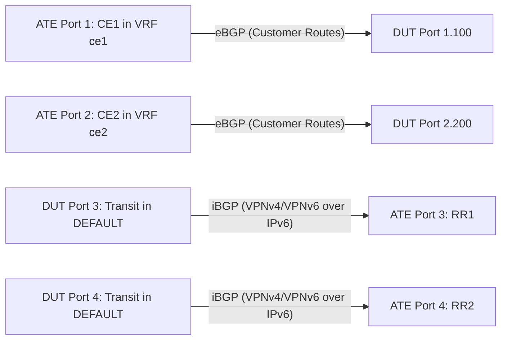

# RT-1.107: BGP FIB Isolation and Peer Soft Drain

## Summary

Validate that customer eBGP routes learned on the DUT in tenant VRFs are maintained in the BGP control plane and advertised to core iBGP route reflectors (RR) as L3VPN (`vpn-ipv4` / `vpn-ipv6`) routes via `advertise-inactive-routes`, but are isolated and suppressed from installation into the local VRF forwarding table (FIB) by a per-address-family "skip RIB install" setting. Furthermore, validate graceful soft-drain and undrain operations per tenant peer session, applied through the per-attachment export policy bound to the customer neighbor, without traffic disruption to neighboring tenants.

## Testbed type

* `TESTBED_DUT_ATE_4LINKS` (ATE Port 1/2 simulating Customer Edge CE1/CE2; ATE Port 3/4 simulating Core Route Reflector RR1/RR2).

## Topology



* Connect ATE Port 1 to DUT Port 1 (configured with subinterface VLAN 100 in VRF `ce1`, IP `192.0.2.1/30`).
* Connect ATE Port 2 to DUT Port 2 (configured with subinterface VLAN 200 in VRF `ce2`, IP `192.0.2.5/30`).
* Connect ATE Port 3 to DUT Port 3 (configured with IPv6 transit peering `2001:db8:3::1/64` to RR1 `2001:db8:3::2` in the `DEFAULT` network instance).
* Connect ATE Port 4 to DUT Port 4 (configured with IPv6 transit peering `2001:db8:4::1/64` to RR2 `2001:db8:4::2` in the `DEFAULT` network instance).

## Procedure

### Test environment setup

1. Configure two tenant network instances (`ce1`, `ce2`) on the DUT with distinct Route Distinguishers (RD) and Route Targets (RT).
2. Configure eBGP sessions under VRF `ce1` (with ATE CE1 `192.0.2.2`, AS 65001) and VRF `ce2` (with ATE CE2 `192.0.2.6`, AS 65002).
3. Configure iBGP sessions towards ATE RR1 (`2001:db8:3::2`) and ATE RR2 (`2001:db8:4::2`) in the `DEFAULT` network instance with `L3VPN_IPV4_UNICAST` and `L3VPN_IPV6_UNICAST` address families enabled; VRFs `ce1`/`ce2` export their routes with their respective RTs.
4. Configure route install suppression on DUT: routes learned via customer eBGP in tenant VRFs must be kept in the BGP RIB but **not** downloaded to the VRF RIB/FIB, configured per VRF address family (vendor example: `bgp skip rib-install` under `address-family ipv4|ipv6` of the VRF). There is currently no OpenConfig configuration leaf for this behaviour (see TODO).
5. Enable `/network-instances/network-instance/protocols/protocol/bgp/global/route-selection-options/config/advertise-inactive-routes` (`true`) on the DUT BGP process so that valid BGP routes not installed in the FIB continue to be advertised to iBGP peers.
6. Bind a per-attachment export policy to each customer neighbor (e.g. `TO_CE_PO1_100` for CE1, `TO_CE_PO2_200` for CE2) at `/network-instances/network-instance/protocols/protocol/bgp/neighbors/neighbor/afi-safis/afi-safi/apply-policy/config/export-policy`; in steady state the policy is a pass-through (`set-med +0`). Soft drain is performed by modifying this policy, never by resetting the session.
7. Configure a static default route in each tenant VRF pointing at a next-hop-group (the only forwarding entries expected in the VRF AFT besides connected subnets).

### RT-1.107.1 - Multi-Tenant FIB Routing Isolation

* **Step 1**: ATE CE1 advertises prefix `198.51.100.0/24` (IPv4) and `2001:db8:100::/64` (IPv6) to DUT in VRF `ce1`.
* **Step 2**: ATE CE2 advertises prefix `203.0.113.0/24` (IPv4) and `2001:db8:200::/64` (IPv6) to DUT in VRF `ce2`.
* **Step 3**: Verify via AFT telemetry `/network-instances/network-instance[name=ce1]/afts/` that VRF `ce1` contains no forwarding entries for `203.0.113.0/24` or `2001:db8:200::/64`, and that the only IPv4/IPv6 entries present are the connected subnets and the static default routes (`0.0.0.0/0`, `::/0`) via the configured next-hop-group.
* **Step 4**: Verify VRF `ce2` contains no forwarding entries for `198.51.100.0/24` or `2001:db8:100::/64` (same expected AFT content as Step 3).
* **Step 5**: Send bidirectional data plane probe packets from ATE CE1 destined to `203.0.113.0/24` and `2001:db8:200::/64`; verify traffic is dropped on the DUT and does not leak cross-VRF.

### RT-1.107.2 - FIB Suppression (No-Install to Forwarding Table)

* **Step 1**: Verify IPv4 prefix `198.51.100.0/24` and IPv6 prefix `2001:db8:100::/64` are present in the DUT BGP RIB under `/network-instances/network-instance[name=ce1]/protocols/protocol[identifier=openconfig-policy-types:BGP][name=BGP]/bgp/rib/afi-safis/afi-safi[afi-safi-name=openconfig-bgp-types:IPV4_UNICAST]/ipv4-unicast/loc-rib/routes/route/state/prefix` and `.../afi-safi[afi-safi-name=openconfig-bgp-types:IPV6_UNICAST]/ipv6-unicast/loc-rib/routes/route/state/prefix`.
* **Step 2**: Query the DUT AFT forwarding state at `/network-instances/network-instance[name=ce1]/afts/ipv4-unicast/ipv4-entry[prefix=198.51.100.0/24]/state/prefix` and `/network-instances/network-instance[name=ce1]/afts/ipv6-unicast/ipv6-entry[prefix=2001:db8:100::/64]/state/prefix`.
* **Step 3**: Verify that neither route is installed in the hardware FIB table (or state leaf reflects `not-installed` / transit-only suppression), and that `/network-instances/network-instance[name=ce1]/protocols/protocol[identifier=openconfig-policy-types:BGP][name=BGP]/bgp/neighbors/neighbor[neighbor-address=192.0.2.2]/afi-safis/afi-safi/state/prefixes/installed` reports `0` while `.../state/prefixes/received` reports the advertised count.
* **Step 4**: Verify that core transit traffic passing through DUT does not attempt local host termination for suppressed customer prefixes.

### RT-1.107.3 - Advertise Inactive Routes to iBGP Peers

* **Step 1**: Confirm `/network-instances/network-instance[name=DEFAULT]/protocols/protocol[identifier=openconfig-policy-types:BGP][name=BGP]/bgp/global/route-selection-options/state/advertise-inactive-routes` is `true` and monitor the iBGP advertisements sent from DUT Port 3 to ATE RR1 (`2001:db8:3::2`).
* **Step 2**: Verify that ATE RR1 receives `198.51.100.0/24` (IPv4) and `2001:db8:100::/64` (IPv6) as VPNv4/VPNv6 updates carrying the `ce1` RD/RT.
* **Step 3**: Verify that `/network-instances/network-instance[name=DEFAULT]/protocols/protocol[identifier=openconfig-policy-types:BGP][name=BGP]/bgp/neighbors/neighbor[neighbor-address=2001:db8:3::2]/afi-safis/afi-safi[afi-safi-name=openconfig-bgp-types:L3VPN_IPV4_UNICAST]/state/prefixes/sent` and the `L3VPN_IPV6_UNICAST` equivalent reflect the advertised `198.51.100.0/24` and `2001:db8:100::/64` prefixes. (Adj-RIB-Out verification for L3VPN address families is pending the model TODO below; until then, use the VRF-scoped `loc-rib` paths to confirm the routes are valid but inactive.)

### RT-1.107.4 - Tenant eBGP Soft Drain

* **Step 1**: Establish steady-state traffic between ATE CE1 and ATE RR1.
* **Step 2**: Apply a soft drain on DUT for the ATE CE1 peer by modifying the policies bound to that neighbor (import policy deprecating `local-pref` to `10` for routes re-advertised towards core iBGP peers; export policy `TO_CE_PO1_100` prepending AS-Path `64500 64500 64500` towards CE1) without resetting TCP transport. Verify `/network-instances/network-instance[name=ce1]/protocols/protocol[identifier=openconfig-policy-types:BGP][name=BGP]/bgp/neighbors/neighbor[neighbor-address=192.0.2.2]/afi-safis/afi-safi/apply-policy/state/export-policy` still reports `TO_CE_PO1_100` and the session stays `ESTABLISHED`.
* **Step 3**: Verify via `/network-instances/network-instance[name=ce1]/protocols/protocol[identifier=openconfig-policy-types:BGP][name=BGP]/bgp/rib/attr-sets/attr-set/state/local-pref` and ATE RR1 BGP RIB that `198.51.100.0/24` and `2001:db8:100::/64` are re-advertised towards ATE RR1 with deprecated `local-pref` (`10`) and towards ATE CE1 with prepended AS-Path (`[64500, 64500, 64500]`), gracefully draining traffic away from the link without hard route withdrawal.
* **Step 4**: Verify that neighbor ATE CE2 in VRF `ce2` maintains its active BGP session (`/network-instances/network-instance[name=ce2]/protocols/protocol[identifier=openconfig-policy-types:BGP][name=BGP]/bgp/neighbors/neighbor[neighbor-address=192.0.2.6]/state/session-state` = `ESTABLISHED`) and experiences 0% packet loss during CE1 drain.

### RT-1.107.5 - Reconvergence on Undrain

* **Step 1**: Restore the pass-through content of the policies bound to ATE CE1 on DUT (the bindings themselves are unchanged).
* **Step 2**: Verify that the BGP session seamlessly resumes normal route advertisement with default `local-pref` (`100`) and unprepended AS-Path without session flapping.
* **Step 3**: Measure convergence latency: verify routes `198.51.100.0/24` and `2001:db8:100::/64` are re-advertised with restored attributes to ATE RR1 in less than 5 seconds.

## Canonical OC

```json
{
  "network-instances": {
    "network-instance": [
      {
        "name": "ce1",
        "config": {
          "name": "ce1",
          "type": "openconfig-network-instance-types:L3VRF",
          "route-distinguisher": "64500:100"
        },
        "protocols": {
          "protocol": [
            {
              "identifier": "openconfig-policy-types:BGP",
              "name": "BGP",
              "bgp": {
                "global": {
                  "config": {
                    "as": 64500
                  },
                  "route-selection-options": {
                    "config": {
                      "advertise-inactive-routes": true
                    }
                  }
                },
                "neighbors": {
                  "neighbor": [
                    {
                      "neighbor-address": "192.0.2.2",
                      "config": {
                        "neighbor-address": "192.0.2.2",
                        "peer-as": 65001
                      },
                      "afi-safis": {
                        "afi-safi": [
                          {
                            "afi-safi-name": "openconfig-bgp-types:IPV4_UNICAST",
                            "config": {
                              "afi-safi-name": "openconfig-bgp-types:IPV4_UNICAST",
                              "enabled": true
                            },
                            "apply-policy": {
                              "config": {
                                "export-policy": ["TO_CE_PO1_100"]
                              }
                            }
                          }
                        ]
                      }
                    }
                  ]
                }
              }
            }
          ]
        }
      }
    ]
  }
}
```

## OpenConfig Path and RPC Coverage

** TODO: Update openconfig public data models to add l3vpn-ipv4-unicast and l3vpn-ipv6-unicast to the [/network-instances/network-instance/protocols/protocol/bgp/rib/afi-safis/afi-safi](https://openconfig.net/projects/models/schemadocs/yangdoc/openconfig-network-instance.html#network-instances-network-instance-protocols-protocol-bgp-rib-afi-safis-afi-safi) container.

** TODO: There is no OpenConfig configuration leaf for per-address-family "keep in BGP RIB but do not install into the network-instance RIB/FIB" (vendor example: `bgp skip rib-install`); request a model addition under `.../bgp/global/afi-safis/afi-safi` or `route-selection-options`.

```yaml
paths:
  # TODO: Update openconfig public data models to add l3vpn-ipv4-unicast and l3vpn-ipv6-unicast to the /network-instances/network-instance/protocols/protocol/bgp/rib/afi-safis/afi-safi container.
  # BGP Route Selection and Advertised Prefixes
  /network-instances/network-instance/protocols/protocol/bgp/global/route-selection-options/config/advertise-inactive-routes:
  /network-instances/network-instance/protocols/protocol/bgp/global/route-selection-options/state/advertise-inactive-routes:
  /network-instances/network-instance/protocols/protocol/bgp/neighbors/neighbor/afi-safis/afi-safi/state/prefixes/sent:
  # BGP RIB and Attributes
  /network-instances/network-instance/protocols/protocol/bgp/rib/afi-safis/afi-safi/ipv4-unicast/loc-rib/routes/route/state/prefix:
  /network-instances/network-instance/protocols/protocol/bgp/rib/afi-safis/afi-safi/ipv6-unicast/loc-rib/routes/route/state/prefix:
  /network-instances/network-instance/protocols/protocol/bgp/rib/afi-safis/afi-safi/ipv4-unicast/neighbors/neighbor/adj-rib-out-post/routes/route/state/prefix:
  /network-instances/network-instance/protocols/protocol/bgp/rib/afi-safis/afi-safi/ipv6-unicast/neighbors/neighbor/adj-rib-out-post/routes/route/state/prefix:
  /network-instances/network-instance/protocols/protocol/bgp/rib/attr-sets/attr-set/state/local-pref:
  # Forwarding Table (AFT)
  /network-instances/network-instance/afts/ipv4-unicast/ipv4-entry/state/prefix:
  /network-instances/network-instance/afts/ipv6-unicast/ipv6-entry/state/prefix:
  # Prefix counters and per-neighbor policy binding
  /network-instances/network-instance/protocols/protocol/bgp/neighbors/neighbor/afi-safis/afi-safi/state/prefixes/received:
  /network-instances/network-instance/protocols/protocol/bgp/neighbors/neighbor/afi-safis/afi-safi/state/prefixes/installed:
  /network-instances/network-instance/protocols/protocol/bgp/neighbors/neighbor/afi-safis/afi-safi/apply-policy/config/export-policy:
  /network-instances/network-instance/protocols/protocol/bgp/neighbors/neighbor/afi-safis/afi-safi/apply-policy/state/export-policy:
  # Session State
  /network-instances/network-instance/protocols/protocol/bgp/neighbors/neighbor/state/session-state:

rpcs:
  gnmi:
    gNMI.Get:
    gNMI.Set:
    gNMI.Subscribe:
```

## Required DUT platform

* FFF
