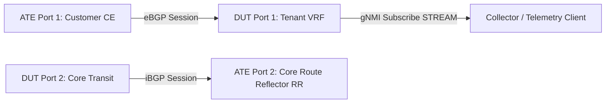

# RT-1.109: BGP Streaming Telemetry and Operational State Verification

## Summary

Validate continuous and event-driven OpenConfig gNMI streaming telemetry for BGP operational state on the DUT. Verify telemetry accuracy and subscription latency for session transitions (`ESTABLISHED`, `IDLE`), prefix telemetry counters (`received`, `received-pre-policy`, `sent`, `installed`) for dual-stack tenant-VRF eBGP peers, max-prefix teardown events including the NOTIFICATION error code/subcode, per-neighbor policy binding and local-AS state, and multiprotocol L3VPN state exports (dynamic core peers) for streaming telemetry collectors.

## Testbed type

* `TESTBED_DUT_ATE_2LINKS` (ATE Port 1 simulating Customer CE peer; ATE Port 2 simulating Core iBGP peer).

## Topology



## Procedure

### Test environment setup

1. Configure tenant VRF `ce1` (router-id `192.0.2.1`) and establish dual-stack eBGP sessions on DUT Port 1 (`192.0.2.1/30`, `2001:db8:1::1/64`) with ATE Port 1 (`192.0.2.2` and `2001:db8:1::2`, AS 65001). Configure `local-as 64510` (no-prepend, replace-as) and `send-community-type [STANDARD, EXTENDED]` on both neighbors, bind import policy `TAG_CE_PO1_100_V4` / `TAG_CE_PO1_100_V6` and export policy `TO_CE_PO1_100` per address family.
2. Configure per-neighbor max-prefix limit on DUT for both ATE CE sessions in VRF `ce1`: `max-prefixes 5000` on `IPV4_UNICAST` and `IPV6_UNICAST`.
3. Configure "skip RIB install" for customer routes in VRF `ce1` (routes stay in the BGP RIB, are advertised with `advertise-inactive-routes`, but are not installed into the VRF FIB — see RT-1.107). Consequently `prefixes/installed` is expected to be `0`.
4. Establish iBGP session on DUT Port 2 with ATE Port 2 (core RR) in `DEFAULT` as a **dynamic** peer (listen range, peer-group `RM_DYNAMIC_PEERS`) with `L3VPN_IPV4_UNICAST` / `L3VPN_IPV6_UNICAST` and export policy `VPNV4_NEXTHOP_OUT` / `VPNV6_NEXTHOP_OUT` (see RT-1.103, RT-1.108).
5. Establish gNMI `Subscribe` session in `STREAM` mode with `SAMPLE` and `ON_CHANGE` subscription modes targeting:
   - `/network-instances/network-instance/protocols/protocol/bgp/neighbors/neighbor/state/`
   - `/network-instances/network-instance/protocols/protocol/bgp/neighbors/neighbor/afi-safis/afi-safi/state/prefixes/`
   - `/network-instances/network-instance/protocols/protocol/bgp/neighbors/neighbor/afi-safis/afi-safi/apply-policy/state/`
   - `/network-instances/network-instance/protocols/protocol/bgp/neighbors/neighbor/afi-safis/afi-safi/ipv4-unicast/prefix-limit/state/` and `.../ipv6-unicast/prefix-limit/state/`
   - `/network-instances/network-instance/protocols/protocol/bgp/global/state/` (per network instance)

### RT-1.109.1 - Session Operational State & Transition Counters

* **Step 1**: Establish BGP session with ATE CE.
* **Step 2**: Subscribe to `/network-instances/network-instance[name=ce1]/protocols/protocol[identifier=openconfig-policy-types:BGP][name=BGP]/bgp/neighbors/neighbor[neighbor-address=192.0.2.2]/state/session-state`.
* **Step 3**: Verify initial stream update reports `ESTABLISHED`.
* **Step 4**: Simulate peer flap by administrative shutdown on ATE CE.
* **Step 5**: Verify event-driven `ON_CHANGE` gNMI update is streamed with `session-state: IDLE` in less than **10 seconds**.
* **Step 6**: Verify `established-transitions` and `last-established` timestamps update accurately.

### RT-1.109.2 - Prefix Counters Streaming

* **Step 1**: ATE CE advertises 2500 IPv4 `/32` routes (from the `198.18.0.0/15` block) on the IPv4 session and 25 IPv6 routes (`2001:db8:100::/48` block) on the IPv6 session, while DUT advertises 10 IPv4 routes (`203.0.113.0/24` block) to ATE CE.
* **Step 2**: Subscribe to `/network-instances/network-instance[name=ce1]/protocols/protocol[identifier=openconfig-policy-types:BGP][name=BGP]/bgp/neighbors/neighbor[neighbor-address=192.0.2.2]/afi-safis/afi-safi[afi-safi-name=openconfig-bgp-types:IPV4_UNICAST]/state/prefixes/received`, `.../state/prefixes/received-pre-policy`, `.../state/prefixes/sent`, and `.../state/prefixes/installed`, and the equivalent leaves for neighbor `2001:db8:1::2` / `IPV6_UNICAST`.
* **Step 3**: Verify telemetry reports for the IPv4 session `received: 2500`, `received-pre-policy: 2500`, `installed: 0` (skip RIB install), and `sent: 10`; for the IPv6 session `received: 25`, `installed: 0`.
* **Step 4**: ATE CE advertises 1000 additional IPv4 routes (total 3500 routes).
* **Step 5**: Verify telemetry stream updates promptly to `received: 3500` while `installed` remains `0`.
* **Step 6**: Verify the core-side counters on the dynamic peer in `DEFAULT`: `.../neighbor[neighbor-address=<RR>]/afi-safis/afi-safi[afi-safi-name=openconfig-bgp-types:L3VPN_IPV4_UNICAST]/state/prefixes/sent` = `3500` and `L3VPN_IPV6_UNICAST` `sent` = `25`.

### RT-1.109.3 - Max-Prefix Teardown Telemetry

* **Step 1**: ATE CE advertises 1550 additional IPv4 routes (total 5050 routes, exceeding the hard limit of 5000 prefixes).
* **Step 2**: Verify the DUT tears down the IPv4 BGP session and sends a Notification (Cease / Maximum Number of Prefixes Reached, error code `6`, subcode `1`).
* **Step 3**: Verify telemetry stream emits `session-state: IDLE`, `/network-instances/network-instance[name=ce1]/protocols/protocol[identifier=openconfig-policy-types:BGP][name=BGP]/bgp/neighbors/neighbor[neighbor-address=192.0.2.2]/afi-safis/afi-safi[afi-safi-name=openconfig-bgp-types:IPV4_UNICAST]/ipv4-unicast/prefix-limit/state/prefix-limit-exceeded` = `true`, `.../neighbor[neighbor-address=192.0.2.2]/state/last-prefix-limit-exceeded` timestamp updated, and `.../neighbor[neighbor-address=192.0.2.2]/state/messages/sent/last-notification-error-code` = `6` with `.../last-notification-error-subcode` = `1`.
* **Step 4**: Verify the IPv6 session (`2001:db8:1::2`) is unaffected and remains `ESTABLISHED` (independent per-AFI limits).
* **Step 5**: Withdraw the excess routes from ATE CE (below 5000), clear/reset the BGP neighbor session if required, and verify the session returns to `session-state: ESTABLISHED`, `prefix-limit-exceeded` = `false`, restoring the DUT to its baseline operational state.
* **Step 6**: Repeat Steps 1–5 on the IPv6 session using `ipv6-unicast/prefix-limit/state/prefix-limit-exceeded`.

### RT-1.109.4 - Policy Binding, Local-AS and Dynamic-Peer State

* **Step 1**: Subscribe (`ON_CHANGE`) to `/network-instances/network-instance[name=ce1]/protocols/protocol[identifier=openconfig-policy-types:BGP][name=BGP]/bgp/neighbors/neighbor[neighbor-address=192.0.2.2]/afi-safis/afi-safi[afi-safi-name=openconfig-bgp-types:IPV4_UNICAST]/apply-policy/state/import-policy` and `.../export-policy`; verify they report `TAG_CE_PO1_100_V4` and `TO_CE_PO1_100` (IPv6 neighbor: `TAG_CE_PO1_100_V6` / `TO_CE_PO1_100`).
* **Step 2**: Verify `/network-instances/network-instance[name=DEFAULT]/protocols/protocol[identifier=openconfig-policy-types:BGP][name=BGP]/bgp/peer-groups/peer-group[peer-group-name=RM_DYNAMIC_PEERS]/afi-safis/afi-safi[afi-safi-name=openconfig-bgp-types:L3VPN_IPV4_UNICAST]/apply-policy/state/export-policy` reports `VPNV4_NEXTHOP_OUT` (and `VPNV6_NEXTHOP_OUT` for `L3VPN_IPV6_UNICAST`).
* **Step 3**: Replace the export policy bound to the CE neighbor and verify an `ON_CHANGE` update for `apply-policy/state/export-policy` is streamed in less than 10 seconds; restore the original binding.
* **Step 4**: Verify `.../neighbor[neighbor-address=192.0.2.2]/state/local-as` = `64510`, `.../state/peer-as` = `65001`, `.../state/send-community-type` = `[STANDARD, EXTENDED]`, and `/network-instances/network-instance[name=ce1]/protocols/protocol[identifier=openconfig-policy-types:BGP][name=BGP]/bgp/global/state/router-id` = `192.0.2.1` (VRF-scoped router-id).
* **Step 5**: Verify the core RR peer in `DEFAULT` reports `.../state/dynamically-configured` = `true` and `.../state/peer-group` = `RM_DYNAMIC_PEERS`, while the CE neighbors report `dynamically-configured` = `false`.
* **Step 6**: Verify `.../neighbor[neighbor-address=192.0.2.2]/afi-safis/afi-safi[afi-safi-name=openconfig-bgp-types:IPV4_UNICAST]/ipv4-unicast/prefix-limit/state/max-prefixes` = `5000` (and the IPv6 equivalent).

### Cleanup

*   Close the gNMI `Subscribe` sessions.
*   Remove the prefix limits, policy bindings, `local-as` / community settings
    and the eBGP neighbors from `ce1`, the dynamic peer-group / listen range and
    iBGP peering from `DEFAULT`, the "skip RIB install" setting and the tenant
    VRF `ce1`.
*   Stop all ATE BGP emulations and route advertisements; verify the DUT returns
    to its baseline operational state (no residual sessions in telemetry).

## Canonical OC

```json
{
  "network-instances": {
    "network-instance": [
      {
        "name": "ce1",
        "protocols": {
          "protocol": [
            {
              "identifier": "openconfig-policy-types:BGP",
              "name": "BGP",
              "bgp": {
                "global": {
                  "config": {
                    "router-id": "192.0.2.1"
                  }
                },
                "neighbors": {
                  "neighbor": [
                    {
                      "neighbor-address": "192.0.2.2",
                      "config": {
                        "neighbor-address": "192.0.2.2",
                        "peer-as": 65001,
                        "local-as": 64510,
                        "send-community-type": ["STANDARD", "EXTENDED"]
                      },
                      "afi-safis": {
                        "afi-safi": [
                          {
                            "afi-safi-name": "openconfig-bgp-types:IPV4_UNICAST",
                            "config": {
                              "afi-safi-name": "openconfig-bgp-types:IPV4_UNICAST",
                              "enabled": true
                            },
                            "apply-policy": {
                              "config": {
                                "import-policy": ["TAG_CE_PO1_100_V4"],
                                "export-policy": ["TO_CE_PO1_100"]
                              }
                            },
                            "ipv4-unicast": {
                              "prefix-limit": {
                                "config": {
                                  "max-prefixes": 5000
                                }
                              }
                            }
                          }
                        ]
                      }
                    },
                    {
                      "neighbor-address": "2001:db8:1::2",
                      "config": {
                        "neighbor-address": "2001:db8:1::2",
                        "peer-as": 65001,
                        "local-as": 64510,
                        "send-community-type": ["STANDARD", "EXTENDED"]
                      },
                      "afi-safis": {
                        "afi-safi": [
                          {
                            "afi-safi-name": "openconfig-bgp-types:IPV6_UNICAST",
                            "config": {
                              "afi-safi-name": "openconfig-bgp-types:IPV6_UNICAST",
                              "enabled": true
                            },
                            "apply-policy": {
                              "config": {
                                "import-policy": ["TAG_CE_PO1_100_V6"],
                                "export-policy": ["TO_CE_PO1_100"]
                              }
                            },
                            "ipv6-unicast": {
                              "prefix-limit": {
                                "config": {
                                  "max-prefixes": 5000
                                }
                              }
                            }
                          }
                        ]
                      }
                    }
                  ]
                }
              }
            }
          ]
        }
      }
    ]
  }
}
```

## OpenConfig Path and RPC Coverage

```yaml
paths:
  # Operational State
  /network-instances/network-instance/protocols/protocol/bgp/neighbors/neighbor/state/session-state:
  /network-instances/network-instance/protocols/protocol/bgp/neighbors/neighbor/state/last-established:
  /network-instances/network-instance/protocols/protocol/bgp/neighbors/neighbor/state/established-transitions:
  /network-instances/network-instance/protocols/protocol/bgp/neighbors/neighbor/state/last-prefix-limit-exceeded:
  /network-instances/network-instance/protocols/protocol/bgp/neighbors/neighbor/afi-safis/afi-safi/ipv4-unicast/prefix-limit/state/prefix-limit-exceeded:
  /network-instances/network-instance/protocols/protocol/bgp/neighbors/neighbor/afi-safis/afi-safi/ipv6-unicast/prefix-limit/state/prefix-limit-exceeded:
  /network-instances/network-instance/protocols/protocol/bgp/neighbors/neighbor/afi-safis/afi-safi/ipv4-unicast/prefix-limit/state/max-prefixes:
  /network-instances/network-instance/protocols/protocol/bgp/neighbors/neighbor/afi-safis/afi-safi/ipv6-unicast/prefix-limit/state/max-prefixes:
  /network-instances/network-instance/protocols/protocol/bgp/neighbors/neighbor/state/messages/sent/last-notification-error-code:
  /network-instances/network-instance/protocols/protocol/bgp/neighbors/neighbor/state/messages/sent/last-notification-error-subcode:
  # Prefix Counters
  /network-instances/network-instance/protocols/protocol/bgp/neighbors/neighbor/afi-safis/afi-safi/state/prefixes/received:
  /network-instances/network-instance/protocols/protocol/bgp/neighbors/neighbor/afi-safis/afi-safi/state/prefixes/received-pre-policy:
  /network-instances/network-instance/protocols/protocol/bgp/neighbors/neighbor/afi-safis/afi-safi/state/prefixes/sent:
  /network-instances/network-instance/protocols/protocol/bgp/neighbors/neighbor/afi-safis/afi-safi/state/prefixes/installed:
  # Policy Binding, Local-AS, Communities, Dynamic Peers, Router-ID
  /network-instances/network-instance/protocols/protocol/bgp/neighbors/neighbor/afi-safis/afi-safi/apply-policy/state/import-policy:
  /network-instances/network-instance/protocols/protocol/bgp/neighbors/neighbor/afi-safis/afi-safi/apply-policy/state/export-policy:
  /network-instances/network-instance/protocols/protocol/bgp/peer-groups/peer-group/afi-safis/afi-safi/apply-policy/state/export-policy:
  /network-instances/network-instance/protocols/protocol/bgp/neighbors/neighbor/state/local-as:
  /network-instances/network-instance/protocols/protocol/bgp/neighbors/neighbor/state/peer-as:
  /network-instances/network-instance/protocols/protocol/bgp/neighbors/neighbor/state/send-community-type:
  /network-instances/network-instance/protocols/protocol/bgp/neighbors/neighbor/state/dynamically-configured:
  /network-instances/network-instance/protocols/protocol/bgp/neighbors/neighbor/state/peer-group:
  /network-instances/network-instance/protocols/protocol/bgp/global/state/router-id:

rpcs:
  gnmi:
    gNMI.Subscribe:
```

## Required DUT platform

* FFF
