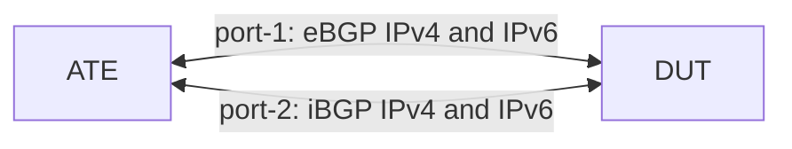

# RT-1.22: BGP TCP MSS

## Summary

This test validates that the router supports the TCP maximum segment size (MSS)
setting for BGP sessions:

*   Configuration and state of the TCP MSS (`transport/config/tcp-mss` and
    `transport/state/tcp-mss`) at the neighbor level and at the peer-group
    level
*   A value set on a neighbor overrides the peer-group value for that neighbor
    only. The other neighbors in the peer group keep the peer-group value.
*   IPv4 and IPv6 eBGP and iBGP sessions
*   `transport/state/tcp-mss` reports the configured MSS (the applied
    configuration, including a value inherited from the peer group), in the
    same way as `timers/state/hold-time`. When no MSS is configured, it may
    instead report the MSS in use on the TCP session.
*   BGP UPDATE messages that add up to several times the MSS are received
    correctly, and the MSS is applied on the wire: the DUT advertises the
    configured MSS, and no TCP segment exceeds it.

Path MTU discovery (PMTUD) is covered by RT-1.21.

### Testbed type

*   [TESTBED_DUT_ATE_2LINKS](https://github.com/openconfig/featureprofiles/blob/main/topologies/atedut_2.testbed)

### Topology



### DUT and OTG properties

| Device | Port   | IPv4         | IPv6                    | AS    |
| :----- | :----- | :----------- | :---------------------- | :---- |
| DUT    | Port 1 | 192.0.2.1/30 | 2001:db8::192:0:2:1/126 | 64500 |
| DUT    | Port 2 | 192.0.2.5/30 | 2001:db8::192:0:2:5/126 | 64500 |
| ATE    | Port 1 | 192.0.2.2/30 | 2001:db8::192:0:2:2/126 | 64501 |
| ATE    | Port 2 | 192.0.2.6/30 | 2001:db8::192:0:2:6/126 | 64500 |

### Procedure

#### Initial Setup:

*   Connect ATE port-1 to DUT port-1, and ATE port-2 to DUT port-2.
*   Configure the DUT and ATE interfaces per the table above.
*   Configure a routing policy that accepts all routes.
*   Configure BGP on the DUT (AS `64500`) with two peer groups, which both use
    the routing policy as their import and export policy:
    *   `EBGP-PEERS` (peer AS `64501`) containing the IPv4 and IPv6 eBGP
        neighbors on ATE port-1.
    *   `IBGP-PEERS` (peer AS `64500`) containing the IPv4 and IPv6 iBGP
        neighbors on ATE port-2.
*   Configure the matching BGP peers on the ATE, and verify that all four
    sessions are `ESTABLISHED`.

### RT-1.22.1: TCP MSS at the neighbor and peer-group levels

*   If the DUT reports `transport/state/tcp-mss` for the neighbors before an
    MSS is configured, verify that the value is at least the TCP default MSS
    (536 for IPv4 and 1220 for IPv6) and at most the MTU of the DUT port minus
    40 bytes for IPv4 or 60 bytes for IPv6 (1460 and 1440 for a 1500-byte MTU).
*   Set the MTU of DUT port-1, DUT port-2, ATE port-1 and ATE port-2 to 5040
    bytes, and verify that all four sessions are `ESTABLISHED`.
*   Neighbor level:
    *   Record `state/established-transitions` for all four neighbors.
    *   Configure `transport/config/tcp-mss` to 4096 on all four neighbors.
    *   Record whether applying the MSS reset the sessions, that is, whether
        `state/established-transitions` increased or `state/session-state`
        left `ESTABLISHED` within 30 seconds of the change. This shows whether
        the configuration change is disruptive. It is reported only and is not
        a pass/fail criterion.
    *   Start a packet capture on ATE port-1 and ATE port-2.
    *   Re-establish the four sessions, for example by restarting the ATE BGP
        peers.
    *   Verify that all four sessions are `ESTABLISHED`, and that
        `transport/state/tcp-mss` equals `transport/config/tcp-mss` (4096) for
        all four neighbors.
    *   Advertise 2000 IPv4 prefixes (`100.64.0.0/24` onwards) from the IPv4
        eBGP peer and 2000 IPv6 prefixes (`2001:db8:1::/64` onwards) from the
        IPv6 eBGP peer on ATE port-1, all with the same path attributes. The
        UPDATE messages then add up to several times the MSS, so they span
        many TCP segments.
    *   Verify that the DUT reports 2000 prefixes in
        `afi-safis/afi-safi/state/prefixes/received` for the IPv4 and the IPv6
        eBGP neighbors, that the iBGP peers on ATE port-2 receive all 2000 IPv4
        and 2000 IPv6 prefixes from the DUT, and that all four sessions are
        still `ESTABLISHED`.
    *   Stop the capture, and verify in it that:
        *   The MSS option in the TCP SYN or SYN-ACK that the DUT sends to each
            of the four ATE peers is 4096.
        *   No TCP segment between the DUT and the ATE, in either direction,
            has more than 4096 bytes of payload.
    *   Withdraw the prefixes.
    *   Remove `transport/config/tcp-mss` from the four neighbors.
*   Peer-group level:
    *   Set `transport/config/tcp-mss` to 4000 on the peer groups `EBGP-PEERS`
        and `IBGP-PEERS`, with no MSS configured on the neighbors.
    *   Re-establish the four sessions.
    *   Verify that all four sessions are `ESTABLISHED`, that
        `transport/state/tcp-mss` is 4000 for both peer groups, and that all
        four neighbors inherit it (`transport/state/tcp-mss` is 4000).
    *   Neighbor-level override: keep the peer-group MSS, and set
        `transport/config/tcp-mss` to 1400 on one neighbor in each peer group
        (the IPv4 neighbors 192.0.2.2 and 192.0.2.6).
    *   Re-establish the four sessions.
    *   Verify that all four sessions are `ESTABLISHED`, that
        `transport/state/tcp-mss` is 1400 for the two IPv4 neighbors, and that
        it is still 4000 for the two IPv6 neighbors and both peer groups.
    *   Remove `transport/config/tcp-mss` from the two IPv4 neighbors and from
        both peer groups.
*   Remove the MTU configuration from the four ports so that they return to the
    default MTU.

#### Canonical OC

The block below shows the neighbor-level override step: the peer groups use
an MSS of 4000, and the IPv4 neighbors override it with 1400. In the
neighbor-level step, the four neighbors use 4096 instead, and the peer groups
have no MSS.

```json
{
  "interfaces": {
    "interface": [
      {
        "name": "port1",
        "config": {
          "name": "port1",
          "type": "iana-if-type:ethernetCsmacd",
          "mtu": 5040
        }
      },
      {
        "name": "port2",
        "config": {
          "name": "port2",
          "type": "iana-if-type:ethernetCsmacd",
          "mtu": 5040
        }
      }
    ]
  },
  "network-instances": {
    "network-instance": [
      {
        "name": "DEFAULT",
        "config": {
          "name": "DEFAULT"
        },
        "protocols": {
          "protocol": [
            {
              "identifier": "BGP",
              "name": "BGP",
              "config": {
                "identifier": "BGP",
                "name": "BGP"
              },
              "bgp": {
                "peer-groups": {
                  "peer-group": [
                    {
                      "peer-group-name": "EBGP-PEERS",
                      "config": {
                        "peer-group-name": "EBGP-PEERS",
                        "peer-as": 64501
                      },
                      "transport": {
                        "config": {
                          "tcp-mss": 4000
                        }
                      }
                    },
                    {
                      "peer-group-name": "IBGP-PEERS",
                      "config": {
                        "peer-group-name": "IBGP-PEERS",
                        "peer-as": 64500
                      },
                      "transport": {
                        "config": {
                          "tcp-mss": 4000
                        }
                      }
                    }
                  ]
                },
                "neighbors": {
                  "neighbor": [
                    {
                      "neighbor-address": "192.0.2.2",
                      "config": {
                        "neighbor-address": "192.0.2.2",
                        "peer-group": "EBGP-PEERS"
                      },
                      "transport": {
                        "config": {
                          "tcp-mss": 1400
                        }
                      }
                    },
                    {
                      "neighbor-address": "2001:db8::192:0:2:2",
                      "config": {
                        "neighbor-address": "2001:db8::192:0:2:2",
                        "peer-group": "EBGP-PEERS"
                      }
                    },
                    {
                      "neighbor-address": "192.0.2.6",
                      "config": {
                        "neighbor-address": "192.0.2.6",
                        "peer-group": "IBGP-PEERS"
                      },
                      "transport": {
                        "config": {
                          "tcp-mss": 1400
                        }
                      }
                    },
                    {
                      "neighbor-address": "2001:db8::192:0:2:6",
                      "config": {
                        "neighbor-address": "2001:db8::192:0:2:6",
                        "peer-group": "IBGP-PEERS"
                      }
                    }
                  ]
                }
              }
            }
          ]
        }
      }
    ]
  }
}
```

#### Test pass fail criteria

*   If any of the below conditions occur, the test should be declared as a
    "FAIL":
    1.  A BGP session is not `ESTABLISHED` after it is re-established
    2.  `transport/state/tcp-mss` is not 4096 for a neighbor at the neighbor
        level, not 1400 for a neighbor with the override, or not 4000 for a
        peer group or any other neighbor at the peer-group level
    3.  A `transport/state/tcp-mss` reported before any MSS is configured is
        outside the range given in `RT-1.22.1`
    4.  At the neighbor level, the DUT does not report all 2000 IPv4 and 2000
        IPv6 prefixes received from the eBGP peers, the iBGP peers on ATE
        port-2 do not receive all of them, or a session does not stay
        `ESTABLISHED`
    5.  The capture has a TCP SYN or SYN-ACK from the DUT whose MSS option is
        not 4096, or a TCP segment with more than 4096 bytes of payload

### Cleanup

*   Remove the BGP, routing policy and MTU configurations from the DUT and stop
    OTG protocols to restore the baseline state.

## OpenConfig Path and RPC Coverage

```yaml
paths:
  ## Config Parameter Coverage
  /network-instances/network-instance/protocols/protocol/bgp/neighbors/neighbor/transport/config/tcp-mss:
  /network-instances/network-instance/protocols/protocol/bgp/peer-groups/peer-group/transport/config/tcp-mss:

  ## Telemetry Parameter Coverage
  /network-instances/network-instance/protocols/protocol/bgp/neighbors/neighbor/transport/state/tcp-mss:
  /network-instances/network-instance/protocols/protocol/bgp/peer-groups/peer-group/transport/state/tcp-mss:
  /network-instances/network-instance/protocols/protocol/bgp/neighbors/neighbor/afi-safis/afi-safi/state/prefixes/received:

rpcs:
  gnmi:
    gNMI.Set:
      replace: true
      delete: true
    gNMI.Subscribe:
      on_change: true
```

## Minimum DUT platform requirement

N/A
