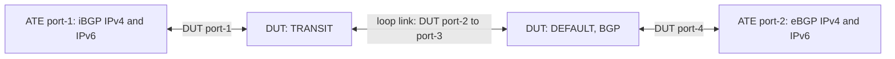

# RT-1.21: BGP TCP MSS and PMTUD

## Summary

This test validates that the router supports the TCP maximum segment size (MSS)
and path MTU discovery (PMTUD) settings for BGP sessions:

*   Configuration and state of the TCP MSS (`transport/config/tcp-mss` and
    `transport/state/tcp-mss`) and of PMTUD (`transport/config/mtu-discovery`
    and `transport/state/mtu-discovery`), at the neighbor level and at the
    peer-group level
*   A value set on a neighbor overrides the peer-group value for that neighbor
    only. The other neighbors in the peer group keep the peer-group value.
*   IPv4 and IPv6 eBGP and iBGP sessions
*   `transport/state/tcp-mss` reports the configured MSS (the applied
    configuration, including a value inherited from the peer group), in the
    same way as `timers/state/hold-time`. When no MSS is configured, it may
    instead report the MSS in use on the TCP session.
*   PMTUD lowers the TCP segment size when a router between the BGP peers
    reports, with an ICMP Fragmentation Needed or Packet Too Big message, that
    a packet is too big for its next link. To have such a router with one DUT,
    a loop link joins two network instances of the DUT: BGP runs in the
    `DEFAULT` network instance, and the network instance `TRANSIT` is the
    router between the DUT BGP speaker and ATE port-1.
*   TODO: The current test code configures TCP MD5 authentication on the
    iBGP neighbor. Remove it when the code is updated to this README; BGP
    MD5 authentication is covered by RT-1.1.

### Testbed type

*   [TESTBED_DUT_1_LOOP_2_ATE](https://github.com/openconfig/featureprofiles/blob/main/topologies/dut_1_loop_2_ate.testbed)

### Topology



### DUT and OTG properties

| Device | Port   | Instance | IPv4          | IPv6                    | AS    |
| :----- | :----- | :------- | :------------ | :---------------------- | :---- |
| ATE    | Port 1 |          | 192.0.2.2/30  | 2001:db8::192:0:2:2/126 | 64500 |
| DUT    | Port 1 | TRANSIT  | 192.0.2.1/30  | 2001:db8::192:0:2:1/126 |       |
| DUT    | Port 2 | TRANSIT  | 192.0.2.9/30  | 2001:db8::192:0:2:9/126 |       |
| DUT    | Port 3 | DEFAULT  | 192.0.2.10/30 | 2001:db8::192:0:2:a/126 | 64500 |
| DUT    | Port 4 | DEFAULT  | 192.0.2.5/30  | 2001:db8::192:0:2:5/126 | 64500 |
| ATE    | Port 2 |          | 192.0.2.6/30  | 2001:db8::192:0:2:6/126 | 64501 |

### Procedure

#### Initial Setup:

*   Connect ATE port-1 to DUT port-1, DUT port-2 to DUT port-3, and DUT port-4
    to ATE port-2. The loop link from DUT port-2 to DUT port-3 can be a cable
    or a cross-connect through an optical circuit switch (OCS).
*   Configure the DUT and ATE interfaces per the table above. DUT port-1 and
    port-2 are in the network instance `TRANSIT` of type `L3VRF`, which has no
    routing protocol and routes between its two ports. DUT port-3 and port-4
    are in the `DEFAULT` network instance.
*   In the `DEFAULT` network instance, configure static routes to the ATE
    port-1 subnets `192.0.2.0/30` and `2001:db8::192:0:2:0/126`, with the DUT
    port-2 addresses `192.0.2.9` and `2001:db8::192:0:2:9` as next hops.
    Packets to ATE port-1 then leave on DUT port-3, cross the loop link, and
    are routed by `TRANSIT`.
*   Configure a routing policy that accepts all routes.
*   Configure BGP on the DUT (AS `64500`) in the `DEFAULT` network instance
    with two peer groups, which both use the routing policy as their import
    and export policy:
    *   `EBGP-PEERS` (peer AS `64501`) containing the IPv4 and IPv6 eBGP
        neighbors on ATE port-2, which are directly connected to DUT port-4.
    *   `IBGP-PEERS` (peer AS `64500`) containing the IPv4 and IPv6 iBGP
        neighbors on ATE port-1. These sessions run between the DUT port-3
        addresses and the ATE port-1 addresses, through `TRANSIT`.
*   Configure the matching BGP peers on the ATE. The ATE port-1 peers use the
    DUT port-3 addresses as their peer addresses and DUT port-1 as their
    gateway. Verify that all four sessions are `ESTABLISHED`.

### RT-1.21.1: TCP MSS at the neighbor and peer-group levels

*   If the DUT reports `transport/state/tcp-mss` for the neighbors before an
    MSS is configured, verify that the value is at least the TCP default MSS
    (536 for IPv4 and 1220 for IPv6) and at most the MTU of the DUT port
    towards the neighbor (port-3 or port-4) minus 40 bytes for IPv4 or 60
    bytes for IPv6 (1460 and 1440 for a 1500-byte MTU).
*   Set the MTU of the four DUT ports and the two ATE ports to 5040 bytes, and
    verify that all four sessions are `ESTABLISHED`.
*   Neighbor level:
    *   Record `state/established-transitions` for all four neighbors.
    *   Configure `transport/config/tcp-mss` to 4096 on all four neighbors.
    *   Record whether applying the MSS reset the sessions, that is, whether
        `state/established-transitions` increased or `state/session-state`
        left `ESTABLISHED` within 30 seconds of the change. This shows whether
        the configuration change is disruptive. It is reported only and is not
        a pass/fail criterion.
    *   Re-establish the four sessions, for example by restarting the ATE BGP
        peers.
    *   Verify that all four sessions are `ESTABLISHED`, and that
        `transport/state/tcp-mss` equals `transport/config/tcp-mss` (4096) for
        all four neighbors.
    *   Remove `transport/config/tcp-mss` from the four neighbors.
*   Peer-group level:
    *   Set `transport/config/tcp-mss` to 4000 on the peer groups `EBGP-PEERS`
        and `IBGP-PEERS`, with no MSS configured on the neighbors.
    *   Re-establish the four sessions.
    *   Verify that all four sessions are `ESTABLISHED`, that
        `transport/state/tcp-mss` is 4000 for both peer groups, and that all
        four neighbors inherit it (`transport/state/tcp-mss` is 4000).
    *   Neighbor-level override: keep the peer-group MSS, and set
        `transport/config/tcp-mss` to 1400 on one neighbor in each peer group
        (the IPv4 neighbors 192.0.2.2 and 192.0.2.6).
    *   Re-establish the four sessions.
    *   Verify that all four sessions are `ESTABLISHED`, that
        `transport/state/tcp-mss` is 1400 for the two IPv4 neighbors, and that
        it is still 4000 for the two IPv6 neighbors and both peer groups.
    *   Remove `transport/config/tcp-mss` from the two IPv4 neighbors and from
        both peer groups.
*   Remove the MTU configuration from the six ports so that they return to
    the default MTU.

#### Canonical OC

The block below shows the neighbor-level override step: the peer groups use
an MSS of 4000, and the IPv4 neighbors override it with 1400. In the
neighbor-level step, the four neighbors use 4096 instead, and the peer groups
have no MSS.

```json
{
  "interfaces": {
    "interface": [
      {
        "name": "port1",
        "config": {
          "name": "port1",
          "type": "iana-if-type:ethernetCsmacd",
          "mtu": 5040
        }
      },
      {
        "name": "port2",
        "config": {
          "name": "port2",
          "type": "iana-if-type:ethernetCsmacd",
          "mtu": 5040
        }
      },
      {
        "name": "port3",
        "config": {
          "name": "port3",
          "type": "iana-if-type:ethernetCsmacd",
          "mtu": 5040
        }
      },
      {
        "name": "port4",
        "config": {
          "name": "port4",
          "type": "iana-if-type:ethernetCsmacd",
          "mtu": 5040
        }
      }
    ]
  },
  "network-instances": {
    "network-instance": [
      {
        "name": "DEFAULT",
        "config": {
          "name": "DEFAULT"
        },
        "protocols": {
          "protocol": [
            {
              "identifier": "BGP",
              "name": "BGP",
              "config": {
                "identifier": "BGP",
                "name": "BGP"
              },
              "bgp": {
                "peer-groups": {
                  "peer-group": [
                    {
                      "peer-group-name": "EBGP-PEERS",
                      "config": {
                        "peer-group-name": "EBGP-PEERS",
                        "peer-as": 64501
                      },
                      "transport": {
                        "config": {
                          "tcp-mss": 4000
                        }
                      }
                    },
                    {
                      "peer-group-name": "IBGP-PEERS",
                      "config": {
                        "peer-group-name": "IBGP-PEERS",
                        "peer-as": 64500
                      },
                      "transport": {
                        "config": {
                          "tcp-mss": 4000
                        }
                      }
                    }
                  ]
                },
                "neighbors": {
                  "neighbor": [
                    {
                      "neighbor-address": "192.0.2.2",
                      "config": {
                        "neighbor-address": "192.0.2.2",
                        "peer-group": "IBGP-PEERS"
                      },
                      "transport": {
                        "config": {
                          "tcp-mss": 1400
                        }
                      }
                    },
                    {
                      "neighbor-address": "2001:db8::192:0:2:2",
                      "config": {
                        "neighbor-address": "2001:db8::192:0:2:2",
                        "peer-group": "IBGP-PEERS"
                      }
                    },
                    {
                      "neighbor-address": "192.0.2.6",
                      "config": {
                        "neighbor-address": "192.0.2.6",
                        "peer-group": "EBGP-PEERS"
                      },
                      "transport": {
                        "config": {
                          "tcp-mss": 1400
                        }
                      }
                    },
                    {
                      "neighbor-address": "2001:db8::192:0:2:6",
                      "config": {
                        "neighbor-address": "2001:db8::192:0:2:6",
                        "peer-group": "EBGP-PEERS"
                      }
                    }
                  ]
                }
              }
            }
          ]
        }
      }
    ]
  }
}
```

### RT-1.21.2: PMTUD at the neighbor and peer-group levels

No MSS is configured in this subtest, and all ports use the default MTU unless
a step sets it.

*   Neighbor level:
    *   Set the IPv4 and IPv6 MTU of DUT port-1 to 1400 bytes. The MTU of ATE
        port-1 is 1500 bytes, so the iBGP sessions use an MSS for 1500-byte
        packets, which are too big for the link from `TRANSIT` to ATE port-1.
    *   Set `transport/config/mtu-discovery` to `true` on all four neighbors.
    *   Re-establish the four sessions.
    *   Verify that all four sessions are `ESTABLISHED` and that
        `transport/state/mtu-discovery` is `true` for all four neighbors.
    *   Start a packet capture on ATE port-1. Advertise 2000 IPv4 prefixes
        (`100.64.0.0/24` onwards) and 2000 IPv6 prefixes (`2001:db8:1::/64`
        onwards), all with the same path attributes, from the eBGP peers on
        ATE port-2. The DUT then sends BGP UPDATE messages of more than 1400
        bytes to the iBGP peers on ATE port-1.
    *   Verify that the iBGP peers on ATE port-1 receive all 2000 IPv4
        prefixes and all 2000 IPv6 prefixes, and that all four sessions are
        still `ESTABLISHED`. The DUT can only deliver them if it lowers its
        segment size after `TRANSIT` reports the 1400-byte MTU.
    *   Verify in the capture that the DUT (`192.0.2.10` and
        `2001:db8::192:0:2:a`) sent IPv4 and IPv6 packets of more than 1280
        bytes, which shows that it uses the 1400-byte path MTU and not a
        smaller default, and that none of its IPv4 packets is an IP fragment.
    *   Withdraw the prefixes, and remove the MTU configuration from DUT
        port-1.
    *   Remove `transport/config/mtu-discovery` from the four neighbors.
*   Peer-group level:
    *   Set `transport/config/mtu-discovery` to `true` on the peer groups
        `EBGP-PEERS` and `IBGP-PEERS`.
    *   Re-establish the four sessions.
    *   Verify that all four sessions are `ESTABLISHED`, that
        `transport/state/mtu-discovery` is `true` for both peer groups, and
        that all four neighbors inherit it.
    *   Neighbor-level override: keep PMTUD enabled on the peer groups, and
        set `transport/config/mtu-discovery` to `false` on one neighbor in
        each peer group (the IPv4 neighbors 192.0.2.2 and 192.0.2.6).
    *   Re-establish the four sessions.
    *   Verify that all four sessions are `ESTABLISHED`, that
        `transport/state/mtu-discovery` is `false` for the two IPv4 neighbors,
        and that it is still `true` for the two IPv6 neighbors and both peer
        groups.
    *   Remove `transport/config/mtu-discovery` from the two IPv4 neighbors and
        from both peer groups.

#### Canonical OC

The block below shows the neighbor-level override step: PMTUD is enabled on
the peer groups and disabled on the IPv4 neighbors. In the neighbor-level
step, it is enabled on the four neighbors instead, and not configured on the
peer groups.

```json
{
  "network-instances": {
    "network-instance": [
      {
        "name": "DEFAULT",
        "config": {
          "name": "DEFAULT"
        },
        "protocols": {
          "protocol": [
            {
              "identifier": "BGP",
              "name": "BGP",
              "config": {
                "identifier": "BGP",
                "name": "BGP"
              },
              "bgp": {
                "peer-groups": {
                  "peer-group": [
                    {
                      "peer-group-name": "EBGP-PEERS",
                      "config": {
                        "peer-group-name": "EBGP-PEERS",
                        "peer-as": 64501
                      },
                      "transport": {
                        "config": {
                          "mtu-discovery": true
                        }
                      }
                    },
                    {
                      "peer-group-name": "IBGP-PEERS",
                      "config": {
                        "peer-group-name": "IBGP-PEERS",
                        "peer-as": 64500
                      },
                      "transport": {
                        "config": {
                          "mtu-discovery": true
                        }
                      }
                    }
                  ]
                },
                "neighbors": {
                  "neighbor": [
                    {
                      "neighbor-address": "192.0.2.2",
                      "config": {
                        "neighbor-address": "192.0.2.2",
                        "peer-group": "IBGP-PEERS"
                      },
                      "transport": {
                        "config": {
                          "mtu-discovery": false
                        }
                      }
                    },
                    {
                      "neighbor-address": "2001:db8::192:0:2:2",
                      "config": {
                        "neighbor-address": "2001:db8::192:0:2:2",
                        "peer-group": "IBGP-PEERS"
                      }
                    },
                    {
                      "neighbor-address": "192.0.2.6",
                      "config": {
                        "neighbor-address": "192.0.2.6",
                        "peer-group": "EBGP-PEERS"
                      },
                      "transport": {
                        "config": {
                          "mtu-discovery": false
                        }
                      }
                    },
                    {
                      "neighbor-address": "2001:db8::192:0:2:6",
                      "config": {
                        "neighbor-address": "2001:db8::192:0:2:6",
                        "peer-group": "EBGP-PEERS"
                      }
                    }
                  ]
                }
              }
            }
          ]
        }
      }
    ]
  }
}
```

#### Test pass fail criteria

*   If any of the below conditions occur, the test should be declared as a
    "FAIL":
    1.  A BGP session is not `ESTABLISHED` after it is re-established
    2.  In `RT-1.21.1`, `transport/state/tcp-mss` is not 4096 for a neighbor at
        the neighbor level, not 1400 for a neighbor with the override, or not
        4000 for a peer group or any other neighbor at the peer-group level
    3.  In `RT-1.21.2`, `transport/state/mtu-discovery` is not `false` for a
        neighbor with the override, or not `true` for a peer group or any
        other neighbor
    4.  In `RT-1.21.2`, with the 1400-byte MTU on DUT port-1, an iBGP peer on
        ATE port-1 does not receive all the prefixes, or a session does not
        stay `ESTABLISHED`
    5.  In `RT-1.21.2`, the capture on ATE port-1 has no IPv4 or no IPv6
        packet of more than 1280 bytes from the DUT, or has an IPv4 fragment
        from the DUT
    6.  A `transport/state/tcp-mss` reported before any MSS is configured is
        outside the range given in `RT-1.21.1`

### Cleanup

*   Remove the BGP, routing policy, static route, network instance and MTU
    configurations from the DUT and stop OTG protocols to restore the
    baseline state.

## OpenConfig Path and RPC Coverage

```yaml
paths:
  ## Config Parameter Coverage
  /network-instances/network-instance/protocols/protocol/bgp/neighbors/neighbor/transport/config/tcp-mss:
  /network-instances/network-instance/protocols/protocol/bgp/neighbors/neighbor/transport/config/mtu-discovery:
  /network-instances/network-instance/protocols/protocol/bgp/peer-groups/peer-group/transport/config/tcp-mss:
  /network-instances/network-instance/protocols/protocol/bgp/peer-groups/peer-group/transport/config/mtu-discovery:

  ## Telemetry Parameter Coverage
  /network-instances/network-instance/protocols/protocol/bgp/neighbors/neighbor/transport/state/tcp-mss:
  /network-instances/network-instance/protocols/protocol/bgp/neighbors/neighbor/transport/state/mtu-discovery:
  /network-instances/network-instance/protocols/protocol/bgp/peer-groups/peer-group/transport/state/tcp-mss:
  /network-instances/network-instance/protocols/protocol/bgp/peer-groups/peer-group/transport/state/mtu-discovery:

rpcs:
  gnmi:
    gNMI.Set:
      replace: true
      delete: true
    gNMI.Subscribe:
      on_change: true
```

## Minimum DUT platform requirement

N/A
