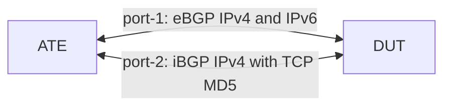

# RT-1.21: BGP TCP MSS and PMTUD

## Summary

This test validates that the router supports the TCP maximum segment size (MSS)
and path MTU discovery (PMTUD) settings for BGP sessions:

*   Configuration and state of the TCP MSS on IPv4 and IPv6 eBGP neighbors
    (`transport/config/tcp-mss` and `transport/state/tcp-mss`)
*   Configuration and state of PMTUD on an iBGP neighbor with TCP MD5
    authentication (`transport/config/mtu-discovery` and
    `transport/state/mtu-discovery`)
*   `transport/state/tcp-mss` reports the configured MSS (the applied
    configuration), in the same way as `timers/state/hold-time`. When no MSS
    is configured, it may instead report the MSS in use on the TCP session.

### Testbed type

*   [TESTBED_DUT_ATE_2LINKS](https://github.com/openconfig/featureprofiles/blob/main/topologies/atedut_2.testbed)

### Topology



### DUT and OTG properties

| Device | Port   | IPv4         | IPv6                    | AS    |
| :----- | :----- | :----------- | :---------------------- | :---- |
| DUT    | Port 1 | 192.0.2.1/30 | 2001:db8::192:0:2:1/126 | 64500 |
| DUT    | Port 2 | 192.0.2.5/30 | N/A                     | 64500 |
| ATE    | Port 1 | 192.0.2.2/30 | 2001:db8::192:0:2:2/126 | 64501 |
| ATE    | Port 2 | 192.0.2.6/30 | N/A                     | 64500 |

### Procedure

#### Initial Setup:

*   Connect ATE port-1 to DUT port-1, and ATE port-2 to DUT port-2.
*   Configure the DUT and ATE interfaces per the table above.

### RT-1.21.1: TCP MSS on eBGP sessions

*   Establish IPv4 and IPv6 eBGP sessions between ATE port-1 (AS `64501`) and
    DUT port-1 (AS `64500`).
*   If the DUT reports `transport/state/tcp-mss` for the eBGP neighbors before
    an MSS is configured, verify that the value is at least the TCP default MSS
    (536 for IPv4 and 1220 for IPv6) and at most the MTU of DUT port-1 minus 40
    bytes for IPv4 or 60 bytes for IPv6 (1460 and 1440 for a 1500-byte MTU).
*   Set the MTU of DUT port-1 and ATE port-1 to 5040 bytes.
*   Configure `transport/config/tcp-mss` to 4096 on the IPv4 and IPv6 eBGP
    neighbors on the DUT.
*   Re-establish the eBGP sessions, for example by restarting the ATE BGP
    peers.
*   Verify that both sessions are `ESTABLISHED` and that
    `transport/state/tcp-mss` equals `transport/config/tcp-mss` (4096) for both
    neighbors.

#### Canonical OC

```json
{
  "interfaces": {
    "interface": [
      {
        "name": "port1",
        "config": {
          "name": "port1",
          "type": "iana-if-type:ethernetCsmacd",
          "mtu": 5040
        }
      }
    ]
  },
  "network-instances": {
    "network-instance": [
      {
        "name": "DEFAULT",
        "config": {
          "name": "DEFAULT"
        },
        "protocols": {
          "protocol": [
            {
              "identifier": "BGP",
              "name": "BGP",
              "config": {
                "identifier": "BGP",
                "name": "BGP"
              },
              "bgp": {
                "neighbors": {
                  "neighbor": [
                    {
                      "neighbor-address": "192.0.2.2",
                      "config": {
                        "neighbor-address": "192.0.2.2"
                      },
                      "transport": {
                        "config": {
                          "tcp-mss": 4096
                        }
                      }
                    },
                    {
                      "neighbor-address": "2001:db8::192:0:2:2",
                      "config": {
                        "neighbor-address": "2001:db8::192:0:2:2"
                      },
                      "transport": {
                        "config": {
                          "tcp-mss": 4096
                        }
                      }
                    }
                  ]
                }
              }
            }
          ]
        }
      }
    ]
  }
}
```

### RT-1.21.2: PMTUD on an iBGP session with TCP MD5

*   Establish an IPv4 iBGP session with TCP MD5 authentication between ATE
    port-2 (AS `64500`) and DUT port-2 (AS `64500`).
*   Set the MTU of DUT port-2 to 5040 bytes, and leave ATE port-2 at 1500
    bytes, so that the ATE side of the link has the smaller MTU.
*   Set `transport/config/mtu-discovery` to `true` on the iBGP neighbor on the
    DUT.
*   Re-establish the iBGP session.
*   Verify that the session is `ESTABLISHED` and that
    `transport/state/mtu-discovery` is `true`.
*   If the DUT reports `transport/state/tcp-mss` for the iBGP neighbor (no MSS
    is configured), verify that the value is at least 536 and at most 1460,
    which shows that the MSS in use fits the 1500-byte MTU of ATE port-2.

#### Canonical OC

```json
{
  "interfaces": {
    "interface": [
      {
        "name": "port2",
        "config": {
          "name": "port2",
          "type": "iana-if-type:ethernetCsmacd",
          "mtu": 5040
        }
      }
    ]
  },
  "network-instances": {
    "network-instance": [
      {
        "name": "DEFAULT",
        "config": {
          "name": "DEFAULT"
        },
        "protocols": {
          "protocol": [
            {
              "identifier": "BGP",
              "name": "BGP",
              "config": {
                "identifier": "BGP",
                "name": "BGP"
              },
              "bgp": {
                "neighbors": {
                  "neighbor": [
                    {
                      "neighbor-address": "192.0.2.6",
                      "config": {
                        "neighbor-address": "192.0.2.6",
                        "peer-as": 64500,
                        "auth-password": "md5-test-password"
                      },
                      "transport": {
                        "config": {
                          "mtu-discovery": true
                        }
                      }
                    }
                  ]
                }
              }
            }
          ]
        }
      }
    ]
  }
}
```

#### Test pass fail criteria

*   If any of the below conditions are not met, test should be declared as a
    "FAIL":
    1.  A BGP session is not `ESTABLISHED` after it is re-established
    2.  `transport/state/tcp-mss` does not equal `transport/config/tcp-mss`
        (4096) for the eBGP neighbors in `RT-1.21.1`
    3.  A reported `transport/state/tcp-mss` is outside the range given in
        `RT-1.21.1` or `RT-1.21.2`
    4.  `transport/state/mtu-discovery` is not `true` in `RT-1.21.2`

### Cleanup

*   Remove the BGP and MTU configurations from the DUT and stop OTG protocols
    to restore the baseline state.

## OpenConfig Path and RPC Coverage

```yaml
paths:
  ## Config Parameter Coverage
  /network-instances/network-instance/protocols/protocol/bgp/neighbors/neighbor/transport/config/tcp-mss:
  /network-instances/network-instance/protocols/protocol/bgp/neighbors/neighbor/transport/config/mtu-discovery:

  ## Telemetry Parameter Coverage
  /network-instances/network-instance/protocols/protocol/bgp/neighbors/neighbor/transport/state/tcp-mss:
  /network-instances/network-instance/protocols/protocol/bgp/neighbors/neighbor/transport/state/mtu-discovery:

rpcs:
  gnmi:
    gNMI.Set:
      replace: true
      delete: true
    gNMI.Subscribe:
      on_change: true
```

## Minimum DUT platform requirement

N/A
