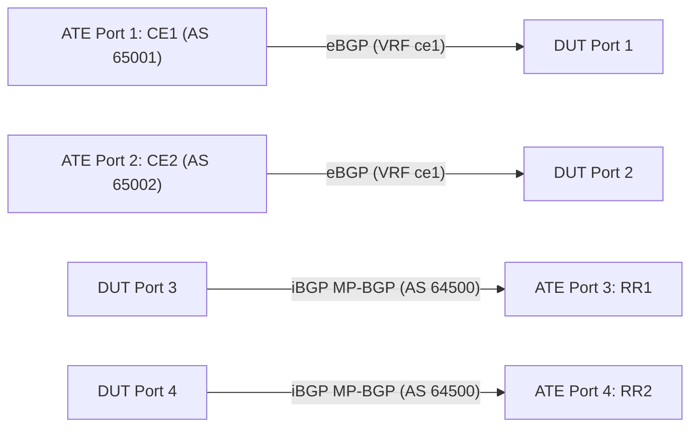

# RT-1.108: Two-Tier BGP Route Propagation and Attribute Transparency

## Summary

Validate end-to-end route propagation across a two-tier BGP routing architecture: Customer Edge (CE) $\leftrightarrow$ Provider Edge Router (DUT) $\leftrightarrow$ Core Route Reflector (RR). Verify full path attribute transparency across boundaries, including preservation of customer Multi-Exit Discriminator (MED), passing of core priority metrics to customer peers via metric-preservation policies, standard/extended community transparency, AS-Path integrity under per-neighbor `local-as` substitution, and restoration of the customer next-hop (with removal of the internal Site-of-Origin marker) on the L3VPN updates sent to the RR.

## Testbed type

* `TESTBED_DUT_ATE_4LINKS` (ATE Port 1 simulating Customer CE1; ATE Port 2 simulating Customer CE2; ATE Port 3 simulating Core Route Reflector RR1; ATE Port 4 simulating Core Route Reflector RR2).

## Topology



## Procedure

### Test environment setup

1. Configure tenant VRF `ce1` on DUT with assigned Route Distinguisher (e.g. `64500:100`) and Route Targets (`target:64500:100`).
2. Establish eBGP peering on DUT Port 1 (`192.0.2.1/30`) with ATE CE1 (`192.0.2.2`, AS 65001) in VRF `ce1`, with `local-as 64510` (no-prepend, replace-as) and `send-community-type [STANDARD, EXTENDED]` on the DUT neighbor.
3. Establish eBGP peering on DUT Port 2 (`192.0.2.5/30`) with ATE CE2 (`192.0.2.6`, AS 65002) in VRF `ce1`, with the same `local-as` / `send-community-type` settings.
4. Establish dynamic or static iBGP peering over IPv6 transit on DUT Port 3/4 with ATE RR1/RR2 in default/transit VRF with `vpn-ipv4` and `vpn-ipv6` enabled, `send-community-type [STANDARD, EXTENDED]` and `add-paths send` on both L3VPN address families.
5. Apply the per-attachment policies on DUT (names follow the attachment: `PO<port>_<vlan>`):
   - Ingress eBGP (`TAG_CE_PO1_100_V4` / `TAG_CE_PO1_100_V6`, import policy on the CE1 neighbor): preserve customer-signaled MED and attach a Site-of-Origin (SoO) extended community that identifies the attachment (e.g. `route-origin:64500:5196`) to routes whose next-hop is the CE address.
   - Egress eBGP (`TO_CE_PO1_100`, export policy on the CE1 neighbor): pass received core MED to customer CE via metric preservation (`set-med +0`).
   - L3VPN export towards RRs (`VPNV4_NEXTHOP_OUT` / `VPNV6_NEXTHOP_OUT`, export policy on the RR peer-group L3VPN address families): for routes carrying the attachment SoO, set the next-hop to the originating CE address (`192.0.2.2`) and remove the SoO extended community.
6. Configure the VRF `ce1` import of RR-learned VPN routes to rewrite the next-hop to a locally resolvable address (e.g. `198.51.100.1` / `2001:db8:ff::1`) that is covered by a static default route in the VRF, so imported routes resolve without an MPLS transport label.

### RT-1.108.1 - Ingress Route Propagation (Customer CE to Core Route Reflector)

* **Step 1**: ATE CE1 advertises IPv4 prefix `198.51.100.0/24` with AS-Path `[65001]` and IPv6 prefix `2001:db8:10::/64` with AS-Path `[65001]`.
* **Step 2**: Verify DUT receives routes in VRF `ce1` Adj-RIB-In.
* **Step 3**: Verify DUT encapsulates routes into MP-BGP L3VPN updates and transmits them over iBGP to ATE RR1.
* **Step 4**: Verify ATE RR1 receives both prefixes with:
  - Preserved AS-Path: `[65001]`.
  - Correct RD: `64500:100`.
  - Matching Route Target: `target:64500:100`.
  - **Next-hop equal to the originating CE address** (`192.0.2.2` for IPv4, the CE1 IPv6 link address for IPv6), not the DUT loopback (`VPNV4_NEXTHOP_OUT` / `VPNV6_NEXTHOP_OUT`).
  - **No SoO extended community** (`route-origin:64500:5196` must have been removed).
* **Step 5**: Verify on DUT that the routes in `VRF ce1` Adj-RIB-In-Post **do** carry the SoO extended community `route-origin:64500:5196` (attached by `TAG_CE_PO1_100_V4/V6`), using `/network-instances/network-instance[name=ce1]/protocols/protocol[identifier=openconfig-policy-types:BGP][name=BGP]/bgp/rib/afi-safis/afi-safi[afi-safi-name=openconfig-bgp-types:IPV4_UNICAST]/ipv4-unicast/neighbors/neighbor[neighbor-address=192.0.2.2]/adj-rib-in-post/routes/route/state/ext-community-index` and the referenced `.../bgp/rib/ext-communities/ext-community/state/ext-community` entry.
* **Step 6**: Verify `/network-instances/network-instance[name=ce1]/protocols/protocol[identifier=openconfig-policy-types:BGP][name=BGP]/bgp/neighbors/neighbor[neighbor-address=192.0.2.2]/afi-safis/afi-safi/apply-policy/state/import-policy` reports `TAG_CE_PO1_100_V4` (and the IPv6 neighbor `TAG_CE_PO1_100_V6`).

### RT-1.108.2 - Egress Route Propagation (Core Route Reflector to Customer CE)

* **Step 1**: ATE RR1 advertises core network prefix `203.0.113.0/24` and `2001:db8:250::/64` with RD `64500:100` and RT `target:64500:100` to DUT over iBGP.
* **Step 2**: Verify DUT imports the VPN routes into tenant VRF `ce1` with the next-hop rewritten to the locally resolvable import address (`198.51.100.1` / `2001:db8:ff::1`) and that the routes are valid (next-hop resolved via the VRF static default route).
* **Step 3**: Verify DUT advertises `203.0.113.0/24` and `2001:db8:250::/64` to ATE CE1 over eBGP with next-hop = DUT interface address (`192.0.2.1`), i.e. the internal import next-hop is not leaked to the customer.
* **Step 4**: Verify ATE CE1 receives the prefix with the DUT **`local-as` (`64510`)** prepended to the AS-Path; the DUT global AS (`64500`) must **not** appear (`replace-as`, `no-prepend`).
* **Step 5**: Verify `/network-instances/network-instance[name=ce1]/protocols/protocol[identifier=openconfig-policy-types:BGP][name=BGP]/bgp/neighbors/neighbor[neighbor-address=192.0.2.2]/afi-safis/afi-safi/apply-policy/state/export-policy` reports `TO_CE_PO1_100`.

### RT-1.108.3 - Customer MED Preservation (eBGP to iBGP)

* **Step 1**: ATE CE1 advertises prefix `198.51.100.0/25` and `2001:db8::cafe/128` with explicit **MED = 200**.
* **Step 2**: Query DUT telemetry at `/network-instances/network-instance[name=ce1]/protocols/protocol[identifier=openconfig-policy-types:BGP][name=BGP]/bgp/rib/attr-sets/attr-set/state/med` (referenced by route entry under `/network-instances/network-instance[name=ce1]/protocols/protocol[identifier=openconfig-policy-types:BGP][name=BGP]/bgp/rib/afi-safis/afi-safi[afi-safi-name=openconfig-bgp-types:IPV4_UNICAST]/ipv4-unicast/neighbors/neighbor[neighbor-address=192.0.2.2]/adj-rib-in-post/routes/route/state/attr-index`); verify MED value is `200`.
* **Step 3**: Monitor MP-BGP L3VPN update received at ATE RR1; verify the MED attribute value `200` is retained unaltered in the update.

### RT-1.108.4 - Core Priority (MED) Passing to Customer (iBGP to eBGP)

* **Step 1**: ATE RR1 advertises IPv4 prefix `203.0.113.0/24` and IPv6 prefix `2001:db8:250::/64` with **MED = 123** representing core route reflector active/backup priority.
* **Step 2**: Verify DUT receives MED `123` on the iBGP session for both IPv4 and IPv6 prefixes.
* **Step 3**: Verify DUT propagates both IPv4 and IPv6 updates to ATE CE1 retaining **MED = 123** on the egress eBGP updates (preventing reset to 0).

### RT-1.108.5 - Multiple Paths / Add-Paths with Disparate AS Paths

* **Step 1**: ATE CE1 advertises prefix `198.51.100.128/25` with AS-Path `[65001, 65010]`.
* **Step 2**: ATE CE2 advertises the same prefix `198.51.100.128/25` with alternate AS-Path `[65002, 65020, 65030]`.
* **Step 3**: Verify DUT holds both paths in the VRF `ce1` BGP RIB.
* **Step 3a**: With `add-paths send` enabled on the L3VPN address families towards the RRs, verify ATE RR1 receives **both** paths for `198.51.100.128/25` with distinct path-ids, each with next-hop set to its originating CE (`192.0.2.2` and `192.0.2.6`) and without the SoO marker.
* **Step 4**: Verify best-path selection favors CE1 (shorter AS-Path length).
* **Step 5**: Send continuous data plane traffic destined to `198.51.100.128/25` and withdraw the prefix from ATE CE1; validate sub-second cutover to the CE2 path by measuring packet loss and verifying total traffic loss duration is less than 1 second.

### RT-1.108.6 - Standard and Extended Community Transparency

* **Step 1**: ATE CE1 advertises `198.51.100.0/24` with standard community `65001:100` and extended community `route-target:65001:1` (a customer-set RT-typed community, distinct from the VRF RT).
* **Step 2**: Verify ATE RR1 receives the VPNv4 route carrying `65001:100`, `route-target:65001:1` **and** the VRF export RT `target:64500:100`, with the SoO marker removed (`send-community-type [STANDARD, EXTENDED]` on both legs).
* **Step 3**: ATE RR1 advertises `203.0.113.0/24` (RD `64500:100`, RT `target:64500:100`) with standard community `64500:999`.
* **Step 4**: Verify ATE CE1 receives `203.0.113.0/24` with `64500:999` intact.
* **Step 5**: Verify `/network-instances/network-instance/protocols/protocol/bgp/neighbors/neighbor/state/send-community-type` = `[STANDARD, EXTENDED]` for the CE neighbors and for the RR peers.

### Cleanup

*   Remove the policy bindings and the policy definitions
    (`TAG_CE_PO1_100_V4/V6`, `TO_CE_PO1_100`, `VPNV4_NEXTHOP_OUT`,
    `VPNV6_NEXTHOP_OUT`) and the ext-community set `CE_PO1_100_MARK`.
*   Remove the eBGP neighbors in `ce1`, the iBGP RR peering in the transit
    instance, the VRF import next-hop rewrite and static default route, and
    the tenant VRF `ce1` with its RD/RT.
*   Stop all ATE BGP emulations and traffic flows; verify the DUT returns to its
    baseline operational state.

## Canonical OC

```json
{
  "routing-policy": {
    "policy-definitions": {
      "policy-definition": [
        {
          "name": "TAG_CE_PO1_100_V4",
          "config": {
            "name": "TAG_CE_PO1_100_V4"
          },
          "statements": {
            "statement": [
              {
                "name": "tag-soo",
                "config": {
                  "name": "tag-soo"
                },
                "actions": {
                  "bgp-actions": {
                    "set-ext-community": {
                      "config": {
                        "method": "REFERENCE",
                        "options": "ADD"
                      },
                      "reference": {
                        "config": {
                          "ext-community-set-ref": "CE_PO1_100_MARK"
                        }
                      }
                    }
                  },
                  "config": {
                    "policy-result": "ACCEPT_ROUTE"
                  }
                }
              }
            ]
          }
        },
        {
          "name": "TO_CE_PO1_100",
          "config": {
            "name": "TO_CE_PO1_100"
          },
          "statements": {
            "statement": [
              {
                "name": "pass-med",
                "config": {
                  "name": "pass-med"
                },
                "actions": {
                  "bgp-actions": {
                    "config": {
                      "set-med": "+0"
                    }
                  },
                  "config": {
                    "policy-result": "ACCEPT_ROUTE"
                  }
                }
              }
            ]
          }
        },
        {
          "name": "VPNV4_NEXTHOP_OUT",
          "config": {
            "name": "VPNV4_NEXTHOP_OUT"
          },
          "statements": {
            "statement": [
              {
                "name": "restore-ce1-nexthop",
                "config": {
                  "name": "restore-ce1-nexthop"
                },
                "conditions": {
                  "bgp-conditions": {
                    "match-ext-community-set": {
                      "config": {
                        "ext-community-set": "CE_PO1_100_MARK",
                        "match-set-options": "ANY"
                      }
                    }
                  }
                },
                "actions": {
                  "bgp-actions": {
                    "config": {
                      "set-next-hop": "192.0.2.2"
                    },
                    "set-ext-community": {
                      "config": {
                        "method": "REFERENCE",
                        "options": "REMOVE"
                      },
                      "reference": {
                        "config": {
                          "ext-community-set-ref": "CE_PO1_100_MARK"
                        }
                      }
                    }
                  },
                  "config": {
                    "policy-result": "ACCEPT_ROUTE"
                  }
                }
              }
            ]
          }
        }
      ]
    },
    "defined-sets": {
      "bgp-defined-sets": {
        "ext-community-sets": {
          "ext-community-set": [
            {
              "ext-community-set-name": "CE_PO1_100_MARK",
              "config": {
                "ext-community-set-name": "CE_PO1_100_MARK",
                "ext-community-member": ["route-origin:64500:5196"]
              }
            }
          ]
        }
      }
    }
  },
  "network-instances": {
    "network-instance": [
      {
        "name": "ce1",
        "config": {
          "name": "ce1",
          "type": "openconfig-network-instance-types:L3VRF",
          "route-distinguisher": "64500:100"
        },
        "protocols": {
          "protocol": [
            {
              "identifier": "openconfig-policy-types:BGP",
              "name": "BGP",
              "bgp": {
                "global": {
                  "config": {
                    "as": 64500
                  }
                },
                "neighbors": {
                  "neighbor": [
                    {
                      "neighbor-address": "192.0.2.2",
                      "config": {
                        "neighbor-address": "192.0.2.2",
                        "peer-as": 65001,
                        "local-as": 64510,
                        "send-community-type": ["STANDARD", "EXTENDED"]
                      },
                      "afi-safis": {
                        "afi-safi": [
                          {
                            "afi-safi-name": "openconfig-bgp-types:IPV4_UNICAST",
                            "config": {
                              "afi-safi-name": "openconfig-bgp-types:IPV4_UNICAST",
                              "enabled": true
                            },
                            "apply-policy": {
                              "config": {
                                "import-policy": ["TAG_CE_PO1_100_V4"],
                                "export-policy": ["TO_CE_PO1_100"]
                              }
                            }
                          }
                        ]
                      }
                    }
                  ]
                }
              }
            }
          ]
        }
      }
    ]
  }
}
```

## OpenConfig Path and RPC Coverage

```yaml
paths:
  # BGP RIB Attributes and Routes
  /network-instances/network-instance/protocols/protocol/bgp/rib/afi-safis/afi-safi/ipv4-unicast/loc-rib/routes/route/state/prefix:
  /network-instances/network-instance/protocols/protocol/bgp/rib/afi-safis/afi-safi/ipv6-unicast/loc-rib/routes/route/state/prefix:
  /network-instances/network-instance/protocols/protocol/bgp/rib/afi-safis/afi-safi/ipv4-unicast/neighbors/neighbor/adj-rib-in-post/routes/route/state/prefix:
  /network-instances/network-instance/protocols/protocol/bgp/rib/afi-safis/afi-safi/ipv4-unicast/neighbors/neighbor/adj-rib-out-post/routes/route/state/prefix:
  /network-instances/network-instance/protocols/protocol/bgp/rib/attr-sets/attr-set/as-path/as-segment/state/member:
  /network-instances/network-instance/protocols/protocol/bgp/rib/attr-sets/attr-set/state/med:
  /network-instances/network-instance/protocols/protocol/bgp/rib/attr-sets/attr-set/state/next-hop:
  /network-instances/network-instance/protocols/protocol/bgp/rib/afi-safis/afi-safi/ipv4-unicast/neighbors/neighbor/adj-rib-in-post/routes/route/state/ext-community-index:
  /network-instances/network-instance/protocols/protocol/bgp/rib/ext-communities/ext-community/state/ext-community:
  /network-instances/network-instance/protocols/protocol/bgp/rib/afi-safis/afi-safi/ipv4-unicast/neighbors/neighbor/adj-rib-in-post/routes/route/state/community-index:
  /network-instances/network-instance/protocols/protocol/bgp/rib/communities/community/state/community:
  # Neighbor Local-AS, Communities and Policy Binding
  /network-instances/network-instance/protocols/protocol/bgp/neighbors/neighbor/config/local-as:
  /network-instances/network-instance/protocols/protocol/bgp/neighbors/neighbor/state/local-as:
  /network-instances/network-instance/protocols/protocol/bgp/neighbors/neighbor/config/send-community-type:
  /network-instances/network-instance/protocols/protocol/bgp/neighbors/neighbor/state/send-community-type:
  /network-instances/network-instance/protocols/protocol/bgp/neighbors/neighbor/afi-safis/afi-safi/apply-policy/config/import-policy:
  /network-instances/network-instance/protocols/protocol/bgp/neighbors/neighbor/afi-safis/afi-safi/apply-policy/config/export-policy:
  /network-instances/network-instance/protocols/protocol/bgp/neighbors/neighbor/afi-safis/afi-safi/apply-policy/state/import-policy:
  /network-instances/network-instance/protocols/protocol/bgp/neighbors/neighbor/afi-safis/afi-safi/apply-policy/state/export-policy:
  /network-instances/network-instance/protocols/protocol/bgp/peer-groups/peer-group/afi-safis/afi-safi/apply-policy/config/export-policy:
  /network-instances/network-instance/protocols/protocol/bgp/peer-groups/peer-group/afi-safis/afi-safi/add-paths/config/send:
  # Routing Policy Definitions
  /routing-policy/policy-definitions/policy-definition/config/name:
  /routing-policy/policy-definitions/policy-definition/statements/statement/actions/bgp-actions/config/set-med:
  /routing-policy/policy-definitions/policy-definition/statements/statement/actions/bgp-actions/config/set-next-hop:
  /routing-policy/policy-definitions/policy-definition/statements/statement/actions/bgp-actions/set-ext-community/config/method:
  /routing-policy/policy-definitions/policy-definition/statements/statement/actions/bgp-actions/set-ext-community/config/options:
  /routing-policy/policy-definitions/policy-definition/statements/statement/actions/bgp-actions/set-ext-community/reference/config/ext-community-set-ref:
  /routing-policy/policy-definitions/policy-definition/statements/statement/conditions/bgp-conditions/match-ext-community-set/config/ext-community-set:
  /routing-policy/defined-sets/bgp-defined-sets/ext-community-sets/ext-community-set/config/ext-community-member:

rpcs:
  gnmi:
    gNMI.Get:
    gNMI.Subscribe:
```

## TODO

* OpenConfig has no `replace-as` / `no-prepend` leaves for `local-as` (vendor CLI only); the Canonical OC therefore carries `local-as` alone and the AS-Path expectations in RT-1.108.2 assume replace-as/no-prepend semantics on the DUT.
* OpenConfig has no policy condition matching on the **received next-hop** of a route (needed to attach the SoO only to routes whose next-hop is the CE address when several CEs share a VRF); vendor policy languages provide this. Request a `bgp-conditions` addition.
* Adj-RIB-Out verification for `L3VPN_IPV4_UNICAST` / `L3VPN_IPV6_UNICAST` depends on the pending addition of L3VPN address families to `/network-instances/network-instance/protocols/protocol/bgp/rib/afi-safis/afi-safi` (see RT-1.107).

## Required DUT platform

* FFF
