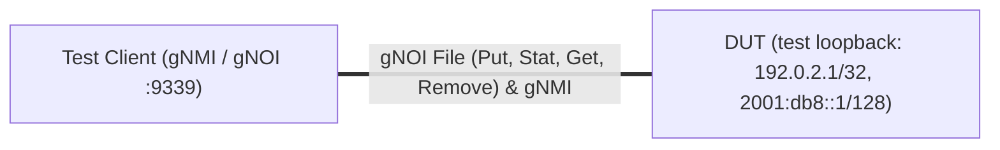

# gNOI-5.4: gNOI File Put and Stat Protocol Conformance

## Summary

*   **Objective**: Validate OpenConfig `gnoi.file.File` (`Put`, `Stat`, `Get`,
    `Remove`, and `TransferToRemote`) protocol conformance, mandatory trailing
    `types.HashType` stream validation (`SHA256`, `MD5`, and rejection of
    `UNSPECIFIED`), fixed-length unsigned hex digest formatting across high-bit
    (`>= 0x80`) and low-nibble (`< 0x10`) byte values, multi-chunk / multi-file
    scaling, and storage/session stability on the Device Under Test (DUT).
*   **Interfaces Used**: `gNOI` (`file.File.Put`, `file.File.Stat`,
    `file.File.Get`, `file.File.Remove`, `file.File.TransferToRemote`), `gNMI`
    (`gNMI.Set`, `gNMI.Get`, `gNMI.Subscribe`).
*   **Expected Outcome Summary**:
    *   Closing a `gnoi.file.File.Put` client stream (`END_STREAM`) without the
        mandatory trailing `PutRequest{hash}` message or with a mismatched
        `types.HashType` digest returns a clear non-OK gRPC error (for example
        `INVALID_ARGUMENT`, `ABORTED`, `FAILED_PRECONDITION`, or `UNKNOWN`) and
        removes the incomplete temporary staging file (`File.Stat` returns a
        non-OK gRPC error, for example `NOT_FOUND`).
    *   The DUT's gNOI and gNMI servers remain stable across 50+ sequential
        RPCs without AAA/PAM session exhaustion, and existing committed files in
        the scratch directory remain unaffected when subsequent negative
        `File.Put` streams fail.
    *   `File.Get` trailing `HashType` digests and any diagnostic hash strings
        in error messages are rendered as fixed-length unsigned hex (two
        lowercase hex digits per unsigned byte: 64 hex characters for `SHA256`
        and 32 hex characters for `MD5`) without `ffffff` signed-char
        sign-extension on bytes `>= 0x80` or omitted leading zeros on bytes
        `< 0x10`.
    *   Storage mount-point telemetry
        (`/system/mount-points/mount-point/state/size`, `available`, and
        `utilized`) is accurately reported via gNMI.

## Testbed type

*   [`dut.testbed`](https://github.com/openconfig/featureprofiles/blob/main/topologies/dut.testbed)
    (`TESTBED_DUT`)

### Topology

This test runs on a standalone DUT topology (`TESTBED_DUT`) where the test
client communicates with the DUT's gNMI and gNOI servers over the management /
control-plane transport channel. To ensure dual-stack configuration and
validation coverage, a dedicated non-management test loopback interface (for
example `Loopback10`) is configured with RFC-compliant IPv4 (`192.0.2.1/32`,
RFC 5737) and IPv6 (`2001:db8::1/128`, RFC 3849) addresses, and test file
payloads incorporate both IPv4 and IPv6 control plane records. The in-band
management loopback (for example `Loopback0` / `lo0`) and the DUT's existing
hostname are never changed by this test. On platforms whose loopback naming
only supports index `0`, the test addresses are added to an existing non-zero
subinterface of that loopback instead, without changing the loopback's
interface-level `type`, `description`, or `enabled` settings; if no such
subinterface exists, the test loopback configuration is skipped, since the
gNOI File checks do not depend on it.



## Procedure

### Test environment setup

#### Explicit Test Parameters, OC Paths, and Payload Specifications

*   **DUT System Configuration**:
    *   Read the DUT's current hostname from `/system/state/hostname` (falling
        back to `/system/config/hostname`) and re-apply the same value to
        `/system/config/hostname`, so the DUT's inventory hostname is preserved.
    *   Verified state leaf: `/system/state/hostname` equals the re-applied
        hostname.
    *   Verified timestamp leaf: `/system/state/current-datetime` (non-empty)
*   **DUT Dual-Stack Test Loopback Interface Configuration (for example
    `Loopback10`)**:
    *   `/interfaces/interface/config/name` = `"Loopback10"` (platform-specific
        name of loopback index `10`)
    *   `/interfaces/interface/config/type` = `"iana-if-type:softwareLoopback"`
    *   `/interfaces/interface/config/enabled` = `true`
    *   `/interfaces/interface/config/description` =
        `"gNOI File Conformance Test Loopback"`
    *   `/interfaces/interface/subinterfaces/subinterface/config/index` = `0`
    *   `/interfaces/interface/subinterfaces/subinterface/ipv4/addresses/address/config/ip`
        = `"192.0.2.1"`
    *   `/interfaces/interface/subinterfaces/subinterface/ipv4/addresses/address/config/prefix-length`
        = `32`
    *   `/interfaces/interface/subinterfaces/subinterface/ipv6/addresses/address/config/ip`
        = `"2001:db8::1"`
    *   `/interfaces/interface/subinterfaces/subinterface/ipv6/addresses/address/config/prefix-length`
        = `128`
*   **Target Scratch Directory (`<scratch_dir>`)**:
    *   A platform-resolved writable scratch directory on the DUT. Probe the
        candidate directories `"harddisk:"`, `"harddisk:/"`, `"/misc/disk1"`,
        `"/tmp"` (default), `"/var/tmp"`, and `"/mnt/flash"` in order. A
        candidate is selected only if `gnoi.file.File.Stat` on it succeeds and
        a small probe file (`<scratch_dir>/gnoi_conformance_scratch_probe.txt`)
        can be written with `gnoi.file.File.Put` and then removed with
        `gnoi.file.File.Remove`; fall back to `"/tmp"` if no candidate
        qualifies. A write probe is used because some platforms accept
        `File.Stat` on a directory that they do not accept as a `File.Put`
        destination.
    *   All test file paths below are relative to `<scratch_dir>` and are
        written as `<scratch_dir>/<filename>`.
    *   **Path construction**: When `<scratch_dir>` ends with `":"` (for
        example `"harddisk:"`), each file path is formed as
        `<scratch_dir><filename>` with no extra `/` (for example
        `"harddisk:gnoi_conformance_roundtrip_sha256.txt"`). Otherwise
        `<scratch_dir>` and `<filename>` are joined with a single `/` (for
        example `"/tmp/gnoi_conformance_roundtrip_sha256.txt"` or
        `"harddisk:/gnoi_conformance_roundtrip_sha256.txt"`).
*   **Storage Mount-Point Telemetry**:
    *   Verified via `/system/mount-points/mount-point/state/name`, `size`,
        `available`, and `utilized`.
*   **gNOI RPC Timeout**:
    *   Every `gnoi.file.File` RPC (each unary call, and each complete client-
        or server-streaming exchange) is bounded by a client-side deadline of
        `2` minutes.
    *   A DUT that does not complete an RPC within this deadline fails the
        step. A client-side `DEADLINE_EXCEEDED` is never accepted as a valid
        rejection for any negative case.
    *   A `File.Stat` result of `UNAVAILABLE`, `UNIMPLEMENTED`,
        `PERMISSION_DENIED`, or `UNAUTHENTICATED` indicates a server or
        session failure and is not accepted as a valid file-absent result.
*   **Permissions Encoding**:
    *   Per `gnoi/file/file.proto`, `PutRequest.Details.permissions` and
        `StatInfo.permissions` carry the octal permission digits directly in
        the `uint32` field with no base conversion (for example, UNIX mode
        `0644` is carried as the value `644`, not `420`).
*   **Deterministic Payload Definitions**:
    *   **Payload A (`SHA256` Single-Chunk Baseline)**:
        *   Target Path: `"<scratch_dir>/gnoi_conformance_roundtrip_sha256.txt"`
            (`"harddisk:gnoi_conformance_roundtrip_sha256.txt"` when
            `<scratch_dir>` is `"harddisk:"`)
        *   Permissions: `644` (UNIX mode `0644`)
        *   ASCII Content (`25` bytes): `"payload-with-wrong-sha256"`
        *   Hash Method: `types.HashType_SHA256` (`1`)
        *   Expected 32-Byte Digest (64 lowercase hex chars):
            `00d3573788b8879253860be8c1894fbea1a995fc6c5d55cc9be77658b2d72b3b`
            (exercises `< 0x10` bytes `0x00` and `0x0b`, and 19 high-bit bytes
            `>= 0x80`: `0xd3`, `0x88`, `0xb8`, `0x87`, `0x92`, `0x86`, `0xe8`,
            `0xc1`, `0x89`, `0xbe`, `0xa1`, `0xa9`, `0x95`, `0xfc`, `0xcc`,
            `0x9b`, `0xe7`, `0xb2`, `0xd7`).
    *   **Payload B (`MD5` Single-Chunk Baseline)**:
        *   Target Path: `"<scratch_dir>/gnoi_conformance_roundtrip_md5.txt"`
            (`"harddisk:gnoi_conformance_roundtrip_md5.txt"` when
            `<scratch_dir>` is `"harddisk:"`)
        *   Permissions: `640` (UNIX mode `0640`)
        *   ASCII Content (`43` bytes):
            `"gnoi-conformance-md5-192.0.2.1-2001:db8::1\n"`
        *   Hash Method: `types.HashType_MD5` (`2`)
        *   Expected 16-Byte Digest (32 lowercase hex chars):
            `5488fc814e0791d457dc8953b529ed7d` (exercises `< 0x10` byte `0x07`
            and 9 high-bit bytes `>= 0x80`: `0x88`, `0xfc`, `0x81`, `0x91`,
            `0xd4`, `0xdc`, `0x89`, `0xb5`, `0xed`).
    *   **Payload C (`SHA256` Multi-Chunk `256 KB` Streaming Payload)**:
        *   Target Path: `"<scratch_dir>/gnoi_conformance_multichunk_256k.bin"`
            (`"harddisk:gnoi_conformance_multichunk_256k.bin"` when
            `<scratch_dir>` is `"harddisk:"`)
        *   Permissions: `644` (UNIX mode `0644`)
        *   Content (`262144` bytes = `256 KB`): Constructed by repeating the
            64-byte dual-stack record
            `"gnoi-64k-chunk-block-ipv4-192.0.2.1-ipv6-2001:db8::1-padding-01\n"`
            exactly `4096` times and transmitted across **4 sequential
            `PutRequest{contents}` chunks of `65536` bytes (`64 KB`) each** to
            exercise the 64 KB chunk boundary defined in `gnoi/file/file.proto`.
        *   Hash Method: `types.HashType_SHA256` (`1`)
        *   Expected 32-Byte Digest (64 lowercase hex chars):
            `5437d7315570842dec1cc16a4cc3968538047bdc4a0f640ec5bffe41b3b6881c`
        *   Expected 16-Byte MD5 Digest (used when the DUT returns an `MD5`
            trailing `GetResponse{hash}`; 32 lowercase hex chars):
            `b2ac06500bae108061e445f5b6f46751` (exercises `< 0x10` bytes
            `0x06`, `0x0b` and high-bit bytes `>= 0x80`: `0xb2`, `0xac`,
            `0xae`, `0x80`, `0xe4`, `0xf5`, `0xb6`, `0xf4`).

#### Setup Execution Steps

*   **Step 1 - Push Baseline DUT Configuration via `gNMI.Set`**:
    *   Register the deferred cleanup routine (see `Cleanup`) before pushing any
        configuration, so the DUT is restored even if setup fails.
    *   Re-apply the DUT's existing hostname to `/system/config/hostname` using
        `gNMI.Set` `REPLACE`.
    *   Configure the dedicated test loopback with `192.0.2.1/32` and
        `2001:db8::1/128` (see `## Canonical OC`) using `gNMI.Set` `UPDATE`
        (merge), so no unrelated interface configuration is replaced.
*   **Step 2 - Event-Driven State Convergence via `gNMI.Subscribe`
    (`ON_CHANGE`) — No Static Sleeps**:
    *   Do **not** use static sleeps or fixed wait timers. Use `gNMI.Subscribe`
        (`ON_CHANGE` mode) with a bounded timeout to confirm configuration and
        programming convergence:
        1.  Await `/system/state/hostname` equals the re-applied hostname and
            verify `/system/state/current-datetime` via `gNMI.Get` is
            non-empty.
        2.  Await `/interfaces/interface/state/oper-status` == `UP` on the test
            loopback (falling back to `/interfaces/interface/state/enabled` ==
            `true` on platforms that do not stream loopback `oper-status`).
        3.  Await
            `/interfaces/interface/subinterfaces/subinterface/ipv4/addresses/address/state/ip`
            == `"192.0.2.1"` (`prefix-length` == `32`) and
            `/interfaces/interface/subinterfaces/subinterface/ipv6/addresses/address/state/ip`
            == `"2001:db8::1"` (`prefix-length` == `128`) on the test loopback
            subinterface.
        4.  Query `/system/mount-points/mount-point/state/name`,
            `/system/mount-points/mount-point/state/size`,
            `/system/mount-points/mount-point/state/available`, and
            `/system/mount-points/mount-point/state/utilized` via `gNMI.Get` /
            `gNMI.Subscribe` (`ONCE`) to record baseline storage capacity,
            verify `utilized` and `available` do not exceed `size`, and confirm
            at least one mount point reports non-zero `size` and `available`.
*   **Step 3 - Pre-Test Scratch File Hygiene**:
    *   For all test paths
        (`<scratch_dir>/gnoi_conformance_roundtrip_sha256.txt`,
        `<scratch_dir>/gnoi_conformance_roundtrip_md5.txt`,
        `<scratch_dir>/gnoi_conformance_multichunk_256k.bin`,
        `<scratch_dir>/gnoi_conformance_incomplete_no_hash.txt`,
        `<scratch_dir>/gnoi_conformance_hash_mismatch.txt`, and
        `<scratch_dir>/gnoi_conformance_scale_01.txt` through
        `<scratch_dir>/gnoi_conformance_scale_10.txt`; each formed per the
        `<scratch_dir>` path construction rule), issue
        `gnoi.file.File.Remove` (ignoring `NOT_FOUND`) and verify via
        `gnoi.file.File.Stat` that each path returns a non-OK gRPC error (for
        example `NOT_FOUND`).

### gNOI-5.4.1 - Positive Single-Chunk and Multi-Chunk gNOI File.Put, File.Stat, and File.Get Baseline with SHA-256 and MD5 Digest Verification

This subtest establishes the committed baseline files in `<scratch_dir>` using
both single-chunk and multi-chunk (`4 x 64 KB`) `gnoi.file.File.Put` streams
across `SHA256` and `MD5`, verifies their metadata via `gnoi.file.File.Stat`
and their streamed contents and trailing `types.HashType` digests via
`gnoi.file.File.Get`, and **retains the committed files on disk** so subsequent
subtests (`gNOI-5.4.2` through `gNOI-5.4.5`) build sequentially upon this
state.

*   **Step 1 - Upload Baseline Files via Client-Streaming
    `gnoi.file.File.Put`**:
    *   Open sequential `gnoi.file.File.Put` client streams for Payload A
        (`<scratch_dir>/gnoi_conformance_roundtrip_sha256.txt`, `25` bytes,
        permissions `644`, `SHA256`), Payload B
        (`<scratch_dir>/gnoi_conformance_roundtrip_md5.txt`, `43` bytes,
        permissions `640`, `MD5`), and Payload C
        (`<scratch_dir>/gnoi_conformance_multichunk_256k.bin`, `262144` bytes
        in `4` chunks of `65536` bytes, permissions `644`, `SHA256`).
    *   For each upload, transmit:
        1.  Initial `PutRequest{open}` with `Details.remote_file` and
            `Details.permissions`.
        2.  One (`Payload A`, `Payload B`) or four (`Payload C`)
            `PutRequest{contents}` messages.
        3.  Final `PutRequest{hash}` with `types.HashType{method, hash}` set to
            the raw 32-byte (`SHA256`) or 16-byte (`MD5`) digest, followed by a
            client half-close (`END_STREAM`) and receipt of the RPC response.
    *   **Validation**: Verify each `gnoi.file.File.Put` call returns
        `StatusCode.OK` (`PutResponse{}`).
*   **Step 2 - Verify File Metadata via `gnoi.file.File.Stat`**:
    *   Invoke `gnoi.file.File.Stat` for each of the 3 file paths and for the
        parent directory `<scratch_dir>`.
    *   **Validation**:
        *   Verify `StatResponse.stats` contains a `StatInfo` entry whose
            `path` matches the target path, `size` equals `25` (Payload A),
            `43` (Payload B), and `262144` (Payload C), and `last_modified` is
            non-zero.
        *   Verify `permissions` equals the requested value (`644` or `640`,
            octal digits with no base conversion) or, if the DUT applies its
            file creation mask, the requested permissions with the reported
            `umask` applied (`permissions & ~umask`). `umask` is not required
            to be non-zero; a gNOI server running with `umask` `0` legitimately
            reports `0`.
        *   Verify all 3 files appear in the directory `File.Stat` response for
            `<scratch_dir>`.
*   **Step 3 - Verify Streamed Payload and Fixed-Length Unsigned Digest via
    `gnoi.file.File.Get`**:
    *   Invoke server-streaming `gnoi.file.File.Get` for each of the 3 baseline
        files, reassembling all `GetResponse{contents}` chunks until the final
        `GetResponse{hash}` message and the end of the response stream.
    *   **Validation**:
        *   Verify the reassembled bytes match the uploaded payload
            byte-for-byte (`25`, `43`, and `262144` bytes respectively).
        *   Verify the trailing `GetResponse{hash}` has `method` equal to
            `SHA256` (`32` raw bytes) or `MD5` (`16` raw bytes), and when
            rendered as fixed-length lowercase hex produces the exact
            64-character
            (`00d3573788b8879253860be8c1894fbea1a995fc6c5d55cc9be77658b2d72b3b`
            for Payload A,
            `5437d7315570842dec1cc16a4cc3968538047bdc4a0f640ec5bffe41b3b6881c`
            for Payload C) or 32-character (`5488fc814e0791d457dc8953b529ed7d`
            for Payload B) digest string with no `ffffff` sign-extension on
            bytes `>= 0x80` and no dropped leading zero on bytes `< 0x10`.
    *   **State Retention**: Do **not** remove the 3 baseline files at the end
        of `gNOI-5.4.1`; keep them committed in `<scratch_dir>` for
        `gNOI-5.4.2` through `gNOI-5.4.5`.

### gNOI-5.4.2 - Negative gNOI File.Put Stream Closed Without Trailing HashType Message and Existing-File Preservation

Building upon the 3 committed baseline files from `gNOI-5.4.1`, this subtest
validates `gnoi/file/file.proto` conformance when a `File.Put` client stream
closes (`END_STREAM`) without sending the mandatory final `PutRequest{hash}`
message, ensuring both a non-OK gRPC error and temporary file cleanup while
confirming existing committed files remain untouched.

*   **Step 1 - Close `gnoi.file.File.Put` Stream Without Trailing `HashType` on
    a New Path**:
    *   Open a client-streaming `gnoi.file.File.Put` RPC for
        `"<scratch_dir>/gnoi_conformance_incomplete_no_hash.txt"`.
    *   Send `PutRequest{open}` (`remote_file`:
        `"<scratch_dir>/gnoi_conformance_incomplete_no_hash.txt"`,
        `permissions`: `644`).
    *   Send `PutRequest{contents}` with the 53-byte payload
        `"incomplete-stream-without-hash-192.0.2.1-2001:db8::1\n"`.
    *   Immediately half-close the client stream (`END_STREAM`) **without**
        sending `PutRequest{hash}`, and wait up to the `2`-minute gNOI RPC
        timeout for the RPC to complete.
*   **Step 2 - Dual Assertion to Prevent False Positives (RPC Error Status AND
    Temporary File Removal)**:
    *   **Validation (Pass/Fail Criteria)**:
        *   **Pass**:
            1.  The `File.Put` RPC completes within the `2`-minute gNOI RPC
                timeout with a non-OK gRPC status code (for example
                `INVALID_ARGUMENT`, `ABORTED`, or `FAILED_PRECONDITION`;
                `StatusCode.OK` is an immediate test failure).
            2.  Subsequent `gnoi.file.File.Stat` and `gnoi.file.File.Get` on
                `"<scratch_dir>/gnoi_conformance_incomplete_no_hash.txt"` both
                return a non-OK gRPC error (for example `NOT_FOUND`).
        *   **Fail**: `File.Put` returns `StatusCode.OK` (`grpc-status: 0`) even
            if the temporary file was deleted, the DUT does not terminate the
            stream within the `2`-minute gNOI RPC timeout after the client
            half-closes it, or `File.Stat` / `File.Get` finds a partial artifact
            on disk.
*   **Step 3 - Verify Existing Committed Baseline Files from `gNOI-5.4.1` Are
    Unaffected**:
    *   Invoke `gnoi.file.File.Stat` and `gnoi.file.File.Get` on the 3 baseline
        files committed in `gNOI-5.4.1`
        (`<scratch_dir>/gnoi_conformance_roundtrip_sha256.txt`,
        `<scratch_dir>/gnoi_conformance_roundtrip_md5.txt`, and
        `<scratch_dir>/gnoi_conformance_multichunk_256k.bin`) and verify their
        sizes and trailing `HashType` digests are unchanged.

### gNOI-5.4.3 - Negative gNOI File.Put Mismatched HashType Digest Rejection and Error Hex Formatting Validation

Building sequentially on `gNOI-5.4.1` and `gNOI-5.4.2`, this subtest verifies
that supplying a mismatched `SHA256` or `MD5` digest in `PutRequest{hash}` is
rejected with a non-OK gRPC error, removes the staging file, renders any hex
digest in the error message as fixed-length unsigned hex, and leaves the
`gNOI-5.4.1` baseline files intact.

*   **Step 1 - Transmit `gnoi.file.File.Put` with Intentionally Mismatched
    `SHA256` Digest**:
    *   Open a `gnoi.file.File.Put` stream for
        `"<scratch_dir>/gnoi_conformance_hash_mismatch.txt"` (`permissions`:
        `644`).
    *   Send `PutRequest{contents}` with `"payload-with-wrong-sha256"` (`25`
        bytes, true SHA-256:
        `00d3573788b8879253860be8c1894fbea1a995fc6c5d55cc9be77658b2d72b3b`).
    *   Send `PutRequest{hash}` with `method: HashType_SHA256` and an all-zero
        32-byte digest (32 bytes of `0x00`), then half-close the stream and
        wait for the RPC to complete.
*   **Step 2 - Validate Error Status and Unsigned Hex Digest Formatting
    (`SHA256`)**:
    *   **Validation (Pass/Fail Criteria)**:
        *   **Pass**:
            1.  `File.Put` returns a non-OK gRPC status code (for example
                `INVALID_ARGUMENT`, `FAILED_PRECONDITION`, `ABORTED`, or
                `UNKNOWN`).
            2.  If any hex digest(s) are included in the gRPC status message
                (the client-supplied all-zero digest and/or the computed file
                digest), each rendered digest is fixed-length unsigned hex: 64
                hex characters for `SHA256` (32 for `MD5`), with no `ffffff`
                signed-char sign-extension (pattern `ffffff[89a-f][0-9a-f]`,
                case-insensitive) and no omitted leading zeros. The
                client-supplied digest therefore renders as 64 (`SHA256`) or 32
                (`MD5`) `0` characters, and the computed file digest equals
                `00d3573788b8879253860be8c1894fbea1a995fc6c5d55cc9be77658b2d72b3b`
                (`SHA256`) or `5488fc814e0791d457dc8953b529ed7d` (`MD5`).
            3.  `gnoi.file.File.Stat` on
                `"<scratch_dir>/gnoi_conformance_hash_mismatch.txt"` returns a
                non-OK gRPC error (for example `NOT_FOUND`).
        *   **Fail**: `File.Put` returns `StatusCode.OK`, does not complete
            within the `2`-minute gNOI RPC timeout, leaves the file on disk, or
            renders a digest in the error message with `ffffff` sign-extension,
            omitted leading zeros, or the wrong length or value.
*   **Step 3 - Transmit `gnoi.file.File.Put` with Intentionally Mismatched
    `MD5` Digest and `HashMethod.UNSPECIFIED(0)`**:
    *   Repeat Steps 1 and 2 for
        `"<scratch_dir>/gnoi_conformance_hash_mismatch.txt"` using Payload B
        (`"gnoi-conformance-md5-192.0.2.1-2001:db8::1\n"`) and
        `method: HashType_MD5` with an all-zero 16-byte digest (16 bytes of
        `0x00`), verifying a non-OK gRPC status, fixed-length 32-character
        unsigned hex for any digest in the error message, and a non-OK
        `File.Stat` gRPC error (for example `NOT_FOUND`).
    *   Repeat with `method: HashType_UNSPECIFIED` (`0`), verifying a non-OK
        gRPC status and a non-OK `File.Stat` gRPC error (for example
        `NOT_FOUND`).
*   **Step 4 - Confirm `gNOI-5.4.1` Baseline Files Remain Intact**:
    *   Verify via `gnoi.file.File.Stat` that all 3 baseline files from
        `gNOI-5.4.1` remain present with their exact byte sizes.

### gNOI-5.4.4 - Modest Scale: Multi-File Batch Staging (10 Files), Directory File.Stat, and Mount-Point Telemetry

Building on the 3 committed files from `gNOI-5.4.1`, this subtest adds modest
scale by staging 10 additional files (`5` `SHA256` and `5` `MD5`, for `13`
concurrent test files in `<scratch_dir>` and `50+` cumulative gNOI RPC
invocations) to validate directory-level `File.Stat`, gNMI storage mount-point
telemetry, and gNOI AAA session stability.

*   **Step 1 - Stage 10 Additional Files Across `SHA256` and `MD5`**:
    *   For index `i` from `1` to `10`, upload
        `<scratch_dir>/gnoi_conformance_scale_NN.txt` (where `NN` is `i`
        zero-padded to two decimal digits, `01` through `10`; `permissions`:
        `644`; for example `"harddisk:gnoi_conformance_scale_01.txt"` when
        `<scratch_dir>` is `"harddisk:"`) with the deterministic dual-stack
        ASCII payload
        `gnoi-scale-file-NN-ipv4-198.51.100.<i>-ipv6-2001:db8:100::<h>`
        followed by a newline, where `<i>` is `i` in decimal and `<h>` is `i`
        in lowercase hexadecimal (for example, `i` = `10` produces
        `"gnoi-scale-file-10-ipv4-198.51.100.10-ipv6-2001:db8:100::a\n"`).
    *   Use `HashType_SHA256` for odd `i` (`1, 3, 5, 7, 9`) and `HashType_MD5`
        for even `i` (`2, 4, 6, 8, 10`).
    *   Verify each `gnoi.file.File.Put` returns `StatusCode.OK`.
*   **Step 2 - Verify Directory-Level `gnoi.file.File.Stat` and Streamed
    `gnoi.file.File.Get`**:
    *   Invoke `gnoi.file.File.Stat` on `<scratch_dir>` and verify that all
        `13` committed files (`3` from `gNOI-5.4.1` + `10` from `gNOI-5.4.4`)
        are present in `StatResponse.stats` with exact byte sizes.
    *   Invoke `gnoi.file.File.Get` on each of the 10 scale files and verify
        payload equality and exact 64-char (`SHA256`) or 32-char (`MD5`)
        trailing `HashType` digests.
*   **Step 3 - Verify Storage Mount-Point Telemetry via `gNMI.Get` /
    `gNMI.Subscribe` (`ONCE`)**:
    *   Use `gNMI.Get` / `gNMI.Subscribe` (`ONCE`), as in Setup Step 2.4, on
        `/system/mount-points/mount-point/state/name`,
        `/system/mount-points/mount-point/state/size`,
        `/system/mount-points/mount-point/state/available`, and
        `/system/mount-points/mount-point/state/utilized` to confirm storage
        accounting remains valid and responsive without gNOI/gNMI session errors
        (`UNAVAILABLE` or `RESOURCE_EXHAUSTED`).

### gNOI-5.4.5 - Protocol-Level Mandatory Negative Cases and Final File.Remove Verification

This subtest executes additional mandatory negative protocol checks on the
`gnoi.file.File` service and then removes all `13` committed files created in
`gNOI-5.4.1` and `gNOI-5.4.4`.

*   **Step 1 - Negative Case: Protocol Sequence Violation
    (`PutRequest{contents}` Sent Before `PutRequest{open}`)**:
    *   Open a `gnoi.file.File.Put` stream and immediately send a
        `PutRequest{contents}` message carrying the ASCII bytes
        `"contents-before-open"` as the first message, without sending an
        initial `PutRequest{open}` message, then half-close the stream and wait
        for the RPC to complete.
    *   **Validation**: Verify `File.Put` returns a non-OK gRPC error (for
        example `INVALID_ARGUMENT` or `FAILED_PRECONDITION`).
*   **Step 2 - Negative Case: Invalid `remote_file` in `PutRequest{open}`**:
    *   Per `gnoi/file/file.proto` (*"The remote_file must be an absolute
        path"*), open a separate `gnoi.file.File.Put` stream for each of the
        following `remote_file` values: an empty path (`""`), a relative path
        (`"relative/path/gnoi_invalid_dir.txt"`), and an existing directory
        path (`<scratch_dir>`). For each stream, send `PutRequest{open}`
        (`permissions`: `644`), `PutRequest{contents}` with Payload A, and the
        valid Payload A `PutRequest{hash}`, then half-close the stream and wait
        for the RPC to complete.
    *   A non-existent parent directory is intentionally **not** used as a
        negative case, because `gnoi/file/file.proto` states *"If the path to
        remote_file doesn't exist it will be created"*, so such an upload can
        legitimately succeed on a compliant DUT.
    *   **Validation**: Verify each `File.Put` returns a non-OK gRPC error (for
        example `INVALID_ARGUMENT` or `FAILED_PRECONDITION`), and that
        `gnoi.file.File.Stat` on `<scratch_dir>` still succeeds afterwards
        (the existing directory is not replaced).
*   **Step 3 - Negative Case: `File.Stat`, `File.Get`, `File.Remove`, and
    `File.TransferToRemote` on Non-Existent, Empty, Relative, and Directory
    Paths**:
    *   The non-existent file path below follows the `<scratch_dir>` path
        construction rule (for example
        `"harddisk:gnoi_conformance_nonexistent_file.txt"` when
        `<scratch_dir>` is `"harddisk:"`).
    *   Invoke `gnoi.file.File.Stat` with an empty path (`""`) and a relative
        path (`"relative/path/gnoi_conformance_file.txt"`), verifying both
        return a non-OK gRPC error (for example `INVALID_ARGUMENT` or
        `NOT_FOUND`).
    *   Invoke `gnoi.file.File.Get` on
        `"<scratch_dir>/gnoi_conformance_nonexistent_file.txt"`, an empty path
        (`""`), and a relative path
        (`"relative/path/gnoi_conformance_file.txt"`), verifying each returns a
        non-OK gRPC error (for example `NOT_FOUND` or `INVALID_ARGUMENT`).
    *   Invoke `gnoi.file.File.Remove` on
        `"<scratch_dir>/gnoi_conformance_nonexistent_file.txt"`, an empty path
        (`""`), and the scratch directory itself (`<scratch_dir>`), verifying
        each returns a non-OK gRPC error per `gnoi/file/file.proto` (*"An error
        is returned if the file does not exist, is a directory, or the remove
        operation encounters an error"*), and that `gnoi.file.File.Stat` on
        `<scratch_dir>` still succeeds afterwards.
    *   Invoke `gnoi.file.File.TransferToRemote` with an empty
        `TransferToRemoteRequest{}` and with `local_path` set without
        `remote_download`, verifying both return a non-OK gRPC error (for
        example `INVALID_ARGUMENT`, `NOT_FOUND`, or `UNIMPLEMENTED`).
*   **Step 4 - Final `gnoi.file.File.Remove` Verification Across All 13
    Committed Files**:
    *   Invoke `gnoi.file.File.Remove` for all `3` baseline files from
        `gNOI-5.4.1` and all `10` scale files from `gNOI-5.4.4`, verifying each
        returns `StatusCode.OK`.
    *   Invoke `gnoi.file.File.Stat` for each of the `13` paths and verify each
        returns a non-OK gRPC error (for example `NOT_FOUND`).

### Cleanup

*   Before any configuration is pushed, arrange a cleanup procedure that always
    runs when the test completes (whether it passes or fails) and that:
    1.  Invokes `gnoi.file.File.Remove` (`RemoveRequest{remote_file}`) for all
        `15` test file paths
        (`<scratch_dir>/gnoi_conformance_roundtrip_sha256.txt`,
        `<scratch_dir>/gnoi_conformance_roundtrip_md5.txt`,
        `<scratch_dir>/gnoi_conformance_multichunk_256k.bin`,
        `<scratch_dir>/gnoi_conformance_incomplete_no_hash.txt`,
        `<scratch_dir>/gnoi_conformance_hash_mismatch.txt`, and
        `<scratch_dir>/gnoi_conformance_scale_01.txt` through
        `<scratch_dir>/gnoi_conformance_scale_10.txt`; each formed per the
        `<scratch_dir>` path construction rule, with no extra `/` when
        `<scratch_dir>` ends with `":"`), ignoring `NOT_FOUND` errors, so no
        temporary files remain on the DUT regardless of test outcome.
    2.  Reverts test-specific DUT configuration via `gNMI.Set` to restore the
        DUT to its exact pre-test baseline state:
        *   If the dedicated test loopback existed before the test, its
            original configuration is restored; otherwise the test loopback
            (and its default network-instance binding, where required) is
            deleted.
        *   On platforms where the test reuses an existing loopback
            subinterface, the original subinterface configuration is restored,
            or only the test IPv4/IPv6 addresses are removed.
        *   The DUT's original hostname is re-applied.
    3.  Uses `gNMI.Subscribe` / `gNMI.Get` on `/system/state/current-datetime`
        and `/system/mount-points/mount-point/state/available` to confirm the
        DUT management plane and storage mount points remain healthy after test
        completion.

## Canonical OC

```json
{
  "interfaces": {
    "interface": [
      {
        "config": {
          "description": "gNOI File Conformance Test Loopback",
          "enabled": true,
          "name": "Loopback10",
          "type": "iana-if-type:softwareLoopback"
        },
        "name": "Loopback10",
        "subinterfaces": {
          "subinterface": [
            {
              "config": {
                "index": 0
              },
              "index": 0,
              "ipv4": {
                "addresses": {
                  "address": [
                    {
                      "config": {
                        "ip": "192.0.2.1",
                        "prefix-length": 32
                      },
                      "ip": "192.0.2.1"
                    }
                  ]
                }
              },
              "ipv6": {
                "addresses": {
                  "address": [
                    {
                      "config": {
                        "ip": "2001:db8::1",
                        "prefix-length": 128
                      },
                      "ip": "2001:db8::1"
                    }
                  ]
                }
              }
            }
          ]
        }
      }
    ]
  }
}
```

## OpenConfig Path and RPC Coverage

The below yaml defines the OC paths and gNOI/gNMI RPCs intended to be covered by
this test.

```yaml
paths:
  # System and storage mount-point state verification
  /system/config/hostname:
  /system/state/hostname:
  /system/state/current-datetime:
  /system/mount-points/mount-point/state/name:
  /system/mount-points/mount-point/state/size:
  /system/mount-points/mount-point/state/available:
  /system/mount-points/mount-point/state/utilized:

  # Dual-stack loopback interface configuration and state
  /interfaces/interface/config/description:
  /interfaces/interface/config/enabled:
  /interfaces/interface/config/name:
  /interfaces/interface/config/type:
  /interfaces/interface/state/enabled:
  /interfaces/interface/state/oper-status:
  /interfaces/interface/subinterfaces/subinterface/config/index:
  /interfaces/interface/subinterfaces/subinterface/ipv4/addresses/address/config/ip:
  /interfaces/interface/subinterfaces/subinterface/ipv4/addresses/address/config/prefix-length:
  /interfaces/interface/subinterfaces/subinterface/ipv4/addresses/address/state/ip:
  /interfaces/interface/subinterfaces/subinterface/ipv4/addresses/address/state/prefix-length:
  /interfaces/interface/subinterfaces/subinterface/ipv6/addresses/address/config/ip:
  /interfaces/interface/subinterfaces/subinterface/ipv6/addresses/address/config/prefix-length:
  /interfaces/interface/subinterfaces/subinterface/ipv6/addresses/address/state/ip:
  /interfaces/interface/subinterfaces/subinterface/ipv6/addresses/address/state/prefix-length:

rpcs:
  gnmi:
    gNMI.Get:
    gNMI.Set:
    gNMI.Subscribe:
      on_change: true
  gnoi:
    file.File.Get:
    file.File.Put:
    file.File.Remove:
    file.File.Stat:
    file.File.TransferToRemote:
```

## Required DUT platform

*   FFF
*   MFF
