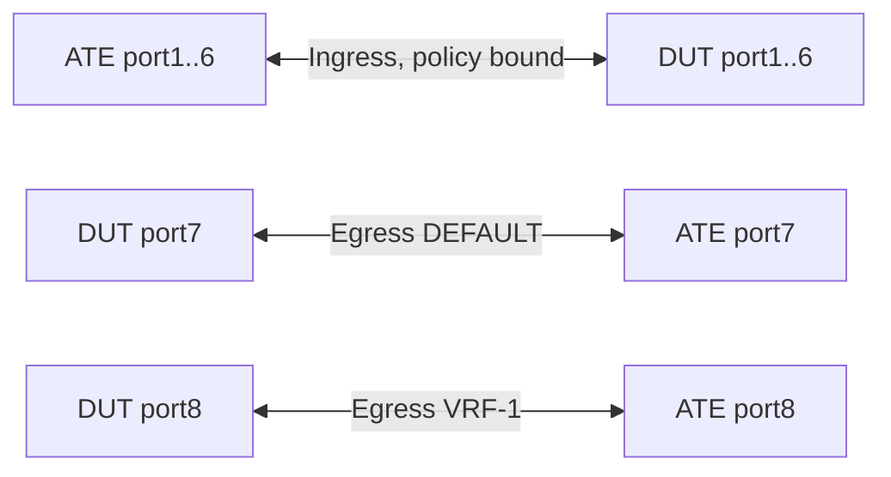

# RT-3.6: VRF Selection Policy Hardware Programming Across Multiple Linecards

## Summary

On a modular DUT, a VRF selection policy bound to ingress interfaces on several
linecards must be programmed into the forwarding hardware of every one of those
linecards. It must still be programmed after the chassis reboots and after a
single linecard reboots while the rest of the chassis stays up. This test binds
one policy to ingress ports on at least two linecards and checks, per ingress
port, that matched traffic is steered into the VRF:

* at baseline (RT-3.6.1),
* after a chassis cold reboot (RT-3.6.2), and
* after a cold reboot of a single ingress linecard (RT-3.6.3), which covers the
  common failure where the control plane does not re-push the existing policy
  to a late-joining linecard.

## Testbed type

* [`featureprofiles/topologies/atedut_8.testbed`](https://github.com/openconfig/featureprofiles/blob/main/topologies/atedut_8.testbed)

An 8-link testbed (6 ingress ports + 2 egress ports, one each for `DEFAULT` and
`VRF-1`) is required so that the ingress ports span at least two distinct
linecards on a modular chassis while keeping dedicated egress ports (ideally on
a linecard not rebooted in RT-3.6.3). A 4-link testbed leaves only 2 ingress
ports, which frequently map onto a single linecard on modular platforms and
cannot exercise multi-linecard hardware programming.

## Procedure

### Test environment setup



* DUT port1..port6 are ingress ports in `DEFAULT`; port7 is the `DEFAULT` egress
  and port8 the `VRF-1` egress.
* For each port N (1..8): DUT `192.0.2.(4N-3)/30` and `2001:db8:0:N::1/126`, ATE
  `192.0.2.(4N-2)` and `2001:db8:0:N::2`. The egress next hops are therefore
  `192.0.2.26` / `2001:db8:0:7::2` (ATE port7) and `192.0.2.30` /
  `2001:db8:0:8::2` (ATE port8).
* Create network instance `VRF-1` (`L3VRF`) and assign subinterface 0 of port8
  to it (`/network-instances/network-instance[name=VRF-1]/interfaces/interface/config/{interface,subinterface}`).
  Subinterface 0 of port1..port7 stays in `DEFAULT`.
* Resolve the parent `LINECARD` of each of port1..port8 (`hardware-port`, then
  `/components/component/state/parent` up to a `LINECARD`). Skip the test unless
  the ingress ports (port1..port6) span at least 2 linecards.
* Static routes:
  * `VRF-1`: `198.51.100.0/24` via `192.0.2.30` and `2001:db8:100::/48` via
    `2001:db8:0:8::2` (ATE port8).
  * `DEFAULT`: `198.51.100.0/24` and `203.0.113.0/24` via `192.0.2.26`,
    `2001:db8:100::/48` and `2001:db8:200::/48` via `2001:db8:0:7::2` (ATE port7).
  * The matched prefixes are routed in both instances, so traffic that bypasses
    the policy is delivered to port7 instead of port8.
* Policy `CLUSTER_FACING_POLICY` (`VRF_SELECTION_POLICY`) in `DEFAULT`:
  * rule `10`: IPv4 `destination-address 198.51.100.0/24` -> `VRF-1`
  * rule `20`: IPv6 `destination-address 2001:db8:100::/48` -> `VRF-1`
* Bind the policy with `apply-vrf-selection-policy` to subinterface 0 of port1..6.
* Devices that do not support IPv4 and IPv6 rules in one
  `VRF_SELECTION_POLICY` (deviation `mixed_af_policy_forwarding_unsupported`)
  configure rule `10` only. On them the `IPV6-MATCH` flows follow the
  `DEFAULT` route and are expected on port7, rule `20` is not checked in state,
  and the expected totals become 60,000 on port8 and 180,000 on port7.

#### Canonical OC

```json
{
  "interfaces": {
    "interface": [
      {
        "config": { "enabled": true, "name": "port1", "type": "iana-if-type:ethernetCsmacd" },
        "name": "port1",
        "subinterfaces": {
          "subinterface": [
            {
              "config": { "index": 0 },
              "index": 0
            }
          ]
        }
      },
      {
        "config": { "enabled": true, "name": "port8", "type": "iana-if-type:ethernetCsmacd" },
        "name": "port8",
        "subinterfaces": {
          "subinterface": [
            {
              "config": { "index": 0 },
              "index": 0
            }
          ]
        }
      }
    ]
  },
  "network-instances": {
    "network-instance": [
      {
        "config": { "name": "VRF-1", "type": "openconfig-network-instance-types:L3VRF" },
        "name": "VRF-1",
        "interfaces": {
          "interface": [
            {
              "config": { "id": "port8.0", "interface": "port8", "subinterface": 0 },
              "id": "port8.0"
            }
          ]
        }
      },
      {
        "config": { "name": "DEFAULT", "type": "openconfig-network-instance-types:DEFAULT_INSTANCE" },
        "name": "DEFAULT",
        "policy-forwarding": {
          "interfaces": {
            "interface": [
              {
                "config": { "apply-vrf-selection-policy": "CLUSTER_FACING_POLICY", "interface-id": "port1" },
                "interface-id": "port1",
                "interface-ref": { "config": { "interface": "port1", "subinterface": 0 } }
              }
            ]
          },
          "policies": {
            "policy": [
              {
                "config": { "policy-id": "CLUSTER_FACING_POLICY", "type": "openconfig-policy-forwarding:VRF_SELECTION_POLICY" },
                "policy-id": "CLUSTER_FACING_POLICY",
                "rules": {
                  "rule": [
                    {
                      "action": { "config": { "network-instance": "VRF-1" } },
                      "config": { "sequence-id": 10 },
                      "ipv4": { "config": { "destination-address": "198.51.100.0/24" } },
                      "sequence-id": 10
                    },
                    {
                      "action": { "config": { "network-instance": "VRF-1" } },
                      "config": { "sequence-id": 20 },
                      "ipv6": { "config": { "destination-address": "2001:db8:100::/48" } },
                      "sequence-id": 20
                    }
                  ]
                }
              }
            ]
          }
        }
      }
    ]
  }
}
```

### RT-3.6.1 - Policy programmed on every ingress linecard

* Wait for `apply-vrf-selection-policy == CLUSTER_FACING_POLICY` in state on all
  ingress ports, and for ARP/ND.
* From each ingress port send 4 flows of 10,000 packets of 512 bytes at
  1,000 pps: `IPV4-MATCH` (`198.51.100.1`) and `IPV6-MATCH` (`2001:db8:100::1`)
  expected on port8; `IPV4-NOMATCH` (`203.0.113.1`) and `IPV6-NOMATCH`
  (`2001:db8:200::1`) expected on port7. Each flow's only receiver is its
  expected egress port.
* All 24 flows (6 ingress ports x 4 flows) are sent concurrently.
* Verify for every flow `Tx == 10,000` and `Rx == Tx`. Verify that ATE port7 and
  port8 each received the expected total of 120,000 packets (6 ingress ports x
  2 flows x 10,000), allowing +1% for ARP/ND/LLDP packets and -0.1% for ATE port
  counter undercounting (`[119,880, 121,200]`). Loss is checked exactly per
  flow; because each flow's only receiver is its expected egress port, the
  upper bound of the port totals detects misdelivery. A failure names the
  ingress port and its linecard.

### RT-3.6.2 - Policy programmed after chassis reboot

* Issue a gNOI `System.Reboot` `COLD` for the chassis.
* Wait up to 20 minutes for `/system/state/boot-time` to advance, then up to
  10 minutes for every linecard hosting port1..port8 (ingress and egress) to be
  `ACTIVE`, and up to 10 minutes for all ports to be `UP`.
* Verify that the configuration set with gNMI persisted across the reboot
  without any explicit save operation:
  * the bindings (`apply-vrf-selection-policy == CLUSTER_FACING_POLICY` on all
    ingress ports), and
  * the policy body: rules `10` and `20` are present in state with their
    `destination-address` and `network-instance` (`VRF-1`).
  A missing binding or rule is reported as a configuration persistence failure,
  not as a traffic failure.
* Push no DUT configuration and no ATE configuration; only restart ATE protocols
  and wait for ARP/ND. Re-pushing ATE configuration bounces the links, which can
  re-program the policy and hide a linecard that missed it during boot.
* Repeat the traffic checks of RT-3.6.1.

### RT-3.6.3 - Policy re-programmed after a single linecard reboot

* Select one ingress linecard `LC`, preferring one that hosts neither port7 nor
  port8 so that the egress ports stay up; if every ingress linecard hosts an
  egress port, use the first ingress linecard.
* Record `/components/component[name=LC]/state/last-reboot-time` and issue a
  gNOI `System.Reboot` `COLD` with `subcomponents = [LC]`.
* Wait up to 5 minutes for `LC` to leave `ACTIVE`, then up to 10 minutes for it
  to return to `ACTIVE` with a `last-reboot-time` greater than the recorded
  value, then up to 3 minutes for every port hosted on `LC` to be `UP`. A `last-reboot-time`
  that has already advanced also counts as `LC` having left `ACTIVE`, in case
  the linecard reboots faster than its `oper-status` transition is streamed.
* Verify the bindings and rules `10` and `20` are present in state as in
  RT-3.6.2.
* Push no DUT configuration and no ATE configuration; only restart ATE protocols
  and wait for ARP/ND.
* Repeat the traffic checks of RT-3.6.1.

### Cleanup

* Remove the configuration added by the test, whether it passes or fails:
  * stop ATE traffic;
  * delete `CLUSTER_FACING_POLICY` and its bindings, the static routes, and
    `VRF-1` (including the port8 membership);
  * restore the interface configuration of port1..8 to its pre-test state,
    which removes the IPv4/IPv6 addressing and network-instance membership
    added by the test without deleting interface or subinterface configuration
    that existed before the test.
* Platform hardware-initialization configuration that VRF selection requires
  (for example a TCAM profile) is a baseline prerequisite: it is applied
  idempotently during setup and is not reverted.

## OpenConfig Path and RPC Coverage

```yaml
paths:
  /interfaces/interface/config/description:
  /interfaces/interface/config/enabled:
  /interfaces/interface/config/type:
  /interfaces/interface/subinterfaces/subinterface/ipv4/addresses/address/config/ip:
  /interfaces/interface/subinterfaces/subinterface/ipv4/addresses/address/config/prefix-length:
  /interfaces/interface/subinterfaces/subinterface/ipv6/addresses/address/config/ip:
  /interfaces/interface/subinterfaces/subinterface/ipv6/addresses/address/config/prefix-length:
  /interfaces/interface/state/hardware-port:
  /interfaces/interface/state/oper-status:
  /components/component/state/parent:
    platform_type: ["PORT", "INTEGRATED_CIRCUIT"]
  /components/component/state/type:
    platform_type: ["LINECARD"]
  /components/component/state/oper-status:
    platform_type: ["LINECARD"]
  /components/component/state/last-reboot-time:
    platform_type: ["LINECARD"]
  /system/state/boot-time:
  /network-instances/network-instance/config/name:
  /network-instances/network-instance/config/type:
  /network-instances/network-instance/interfaces/interface/config/id:
  /network-instances/network-instance/interfaces/interface/config/interface:
  /network-instances/network-instance/interfaces/interface/config/subinterface:
  /network-instances/network-instance/protocols/protocol/static-routes/static/config/prefix:
  /network-instances/network-instance/protocols/protocol/static-routes/static/next-hops/next-hop/config/next-hop:
  /network-instances/network-instance/policy-forwarding/policies/policy/config/policy-id:
  /network-instances/network-instance/policy-forwarding/policies/policy/config/type:
  /network-instances/network-instance/policy-forwarding/policies/policy/rules/rule/config/sequence-id:
  /network-instances/network-instance/policy-forwarding/policies/policy/rules/rule/ipv4/config/destination-address:
  /network-instances/network-instance/policy-forwarding/policies/policy/rules/rule/ipv6/config/destination-address:
  /network-instances/network-instance/policy-forwarding/policies/policy/rules/rule/action/config/network-instance:
  /network-instances/network-instance/policy-forwarding/policies/policy/rules/rule/state/sequence-id:
  /network-instances/network-instance/policy-forwarding/policies/policy/rules/rule/ipv4/state/destination-address:
  /network-instances/network-instance/policy-forwarding/policies/policy/rules/rule/ipv6/state/destination-address:
  /network-instances/network-instance/policy-forwarding/policies/policy/rules/rule/action/state/network-instance:
  /network-instances/network-instance/policy-forwarding/interfaces/interface/config/interface-id:
  /network-instances/network-instance/policy-forwarding/interfaces/interface/config/apply-vrf-selection-policy:
  /network-instances/network-instance/policy-forwarding/interfaces/interface/interface-ref/config/interface:
  /network-instances/network-instance/policy-forwarding/interfaces/interface/interface-ref/config/subinterface:
  /network-instances/network-instance/policy-forwarding/interfaces/interface/state/apply-vrf-selection-policy:

rpcs:
  gnmi:
    gNMI.Get:
    gNMI.Set:
      replace: true
      update: true
      delete: true
    gNMI.Subscribe:
      on_change: true
  gnoi:
    system.System.Reboot:
```

## Required DUT platform

* MFF - A modular form factor device with at least 2 `LINECARD` components hosting
  the ingress ports.
