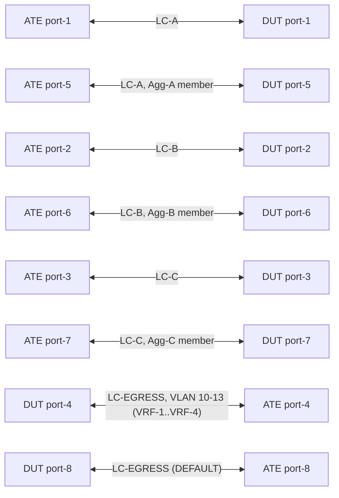

# RT-3.5: VRF Selection Policy Hardware Programming Across Multiple Linecards

## Summary

On a modular DUT, a VRF selection policy bound to several ingress interfaces must be programmed into the forwarding hardware of **every** linecard (and every forwarding integrated circuit) hosting one of those interfaces. This test builds up in stages across three ingress linecards (`LC-A`, `LC-B`, `LC-C`) and a separate egress linecard (`LC-EGRESS`):

1. **RT-3.5.1**: Baseline 2-rule VRF selection policy (one IPv4, one IPv6) bound to physical ports on three ingress linecards.
2. **RT-3.5.2**: In-place scale to 34 rules steering into 4 VRFs (`VRF-1`..`VRF-4`) across 6 ingress interfaces (one physical port and one LACP aggregate interface per ingress linecard).
3. **RT-3.5.3**: In-place rule modification propagation across all linecards without stale hardware entries.
4. **RT-3.5.4**: Physical ingress port and LACP member port flap persistence on each linecard.
5. **RT-3.5.5**: Repeated single-linecard cold reboots while traffic runs hitlessly on the remaining linecards.
6. **RT-3.5.6**: Linecard boot with concurrent policy rule and interface binding updates before the booting linecard's aggregate interface comes up.
7. **RT-3.5.7**: Simultaneous multi-linecard cold reboots (Part A) and full DUT cold reboots with configuration persistence (Part B).
8. **RT-3.5.8**: In-place policy replace and 5-iteration interface unbind/rebind churn across all 6 ingress interfaces.
9. **RT-3.5.9**: Per-linecard forwarding ASIC (`INTEGRATED_CIRCUIT`) resource utilization telemetry and cross-linecard symmetry.
10. **RT-3.5.10**: Negative configuration and forwarding checks (`RT-3.5.10.1`–`RT-3.5.10.5`).

Every traffic check is validated per ingress linecard and per address family, distinguishing VRF-steered traffic from `DEFAULT`-routed traffic by egress port/subinterface.

## Testbed type

* [`featureprofiles/topologies/atedut_8.testbed`](https://github.com/openconfig/featureprofiles/blob/main/topologies/atedut_8.testbed)

## Procedure

### Test environment setup



#### Port roles and linecard placement precondition

* Connect DUT `port1`..`port8` to ATE `port1`..`port8` respectively.
* **Ingress interfaces**: physical ports `port1`, `port2`, `port3` (from RT-3.5.1) and 1-member LACP aggregates `Agg-A` (`port5`), `Agg-B` (`port6`), `Agg-C` (`port7`) (added in RT-3.5.2, allocated via the DUT's aggregate naming).
* **Egress interfaces**: `port4` (VLAN subinterfaces for `VRF-1`..`VRF-4`, plus `port4.20` for `DEFAULT` in RT-3.5.1) and `port8` (`DEFAULT` from RT-3.5.2 onward).
* **Linecard resolution & precondition**:
  * For each port, read `/interfaces/interface/state/hardware-port` and walk `/components/component/state/parent` up to 5 hops until `/components/component/state/type == LINECARD`. If no `LINECARD` component exists, skip with `"DUT has no LINECARD components; RT-3.5 requires a modular DUT"`.
  * Verify `port1` & `port5` share `LC-A`, `port2` & `port6` share `LC-B`, `port3` & `port7` share `LC-C`, `port4` & `port8` are on `LC-EGRESS`, and `LC-A`, `LC-B`, `LC-C`, `LC-EGRESS` are four distinct linecards; otherwise skip.

#### Addressing

| DUT interface | Added in | Network instance | DUT IPv4 | ATE IPv4 | DUT IPv6 | ATE IPv6 |
| --- | --- | --- | --- | --- | --- | --- |
| `port1` (subif 0) | RT-3.5.1 | `DEFAULT` | `192.0.2.1/30` | `192.0.2.2` | `2001:db8:0:1::1/126` | `2001:db8:0:1::2` |
| `port2` (subif 0) | RT-3.5.1 | `DEFAULT` | `192.0.2.5/30` | `192.0.2.6` | `2001:db8:0:2::1/126` | `2001:db8:0:2::2` |
| `port3` (subif 0) | RT-3.5.1 | `DEFAULT` | `192.0.2.9/30` | `192.0.2.10` | `2001:db8:0:3::1/126` | `2001:db8:0:3::2` |
| `port4.10` (VLAN 10) | RT-3.5.1 | `VRF-1` | `192.0.2.13/30` | `192.0.2.14` | `2001:db8:0:4::1/126` | `2001:db8:0:4::2` |
| `port4.20` (VLAN 20) | RT-3.5.1 (removed in RT-3.5.2) | `DEFAULT` | `192.0.2.17/30` | `192.0.2.18` | `2001:db8:0:5::1/126` | `2001:db8:0:5::2` |
| `Agg-A` (subif 0; member `port5`) | RT-3.5.2 | `DEFAULT` | `192.0.2.21/30` | `192.0.2.22` | `2001:db8:0:6::1/126` | `2001:db8:0:6::2` |
| `Agg-B` (subif 0; member `port6`) | RT-3.5.2 | `DEFAULT` | `192.0.2.25/30` | `192.0.2.26` | `2001:db8:0:7::1/126` | `2001:db8:0:7::2` |
| `Agg-C` (subif 0; member `port7`) | RT-3.5.2 | `DEFAULT` | `192.0.2.29/30` | `192.0.2.30` | `2001:db8:0:8::1/126` | `2001:db8:0:8::2` |
| `port8` (subif 0) | RT-3.5.2 | `DEFAULT` | `192.0.2.33/30` | `192.0.2.34` | `2001:db8:0:9::1/126` | `2001:db8:0:9::2` |
| `port4.11` (VLAN 11) | RT-3.5.2 | `VRF-2` | `192.0.2.37/30` | `192.0.2.38` | `2001:db8:0:a::1/126` | `2001:db8:0:a::2` |
| `port4.12` (VLAN 12) | RT-3.5.2 | `VRF-3` | `192.0.2.41/30` | `192.0.2.42` | `2001:db8:0:b::1/126` | `2001:db8:0:b::2` |
| `port4.13` (VLAN 13) | RT-3.5.2 | `VRF-4` | `192.0.2.45/30` | `192.0.2.46` | `2001:db8:0:c::1/126` | `2001:db8:0:c::2` |

#### Common definitions and gates

* **Policy**: `CLUSTER_FACING_POLICY` (`type = VRF_SELECTION_POLICY`) under network instance `DEFAULT`, bound on subinterface `0` of active ingress interfaces via `apply-vrf-selection-policy`.
* **Traffic profile**: 512-byte frames at 1,000 fps, fixed count of 32,000 packets per flow per measurement window (unless continuous mode is specified in RT-3.5.5). Always assert `Tx > 0` and `Rx == Tx`.
* **Convergence gate** (using `gnmi.Watch` / `gnmi.Await`, 2-minute timeout, no `time.Sleep`):
  1. `/interfaces/interface/state/oper-status == UP` on all active interfaces and `/lacp/interfaces/interface/members/member/state/synchronization == IN_SYNC` on all aggregate members.
  2. `/network-instances/network-instance/policy-forwarding/interfaces/interface/state/apply-vrf-selection-policy == CLUSTER_FACING_POLICY` on all bound interfaces and absent on unbound interfaces.
  3. `/network-instances/network-instance/policy-forwarding/policies/policy/rules/rule/state/sequence-id` matches the expected rule sequence IDs.
  4. `/network-instances/network-instance/afts/ipv4-unicast/ipv4-entry` and `ipv6-unicast/ipv6-entry` resolve via `next-hop-group` to the expected ATE next-hop IP addresses in `DEFAULT` and `VRF-1`..`VRF-4`.
  5. Subinterface IPv4/IPv6 neighbor `link-layer-address` is present on the DUT, and `WaitForARP` (`IPv4` and `IPv6`) succeeds on the ATE.
* **Linecard boot recovery gate** (for each rebooted linecard `LC`):
  1. Watch `/components/component[name=LC]/state/oper-status` leave `ACTIVE` and return to `ACTIVE` (timeout 15 minutes).
  2. Verify `/components/component[name=LC]/state/last-reboot-time` increased past its pre-reboot value and `last-reboot-reason` is populated.
  3. Watch the physical and aggregate interfaces on `LC` reach `oper-status == UP` and LACP member `synchronization == IN_SYNC` (timeout 5 minutes).
  4. Run the full **Convergence gate**.
* **Stability check** (at the end of every subtest): verify `/system/processes/process/state/start-time` and `/components/component/state/last-reboot-time` have not changed unexpectedly from baseline (updating the baseline for intentionally rebooted linecards/chassis).

---

### RT-3.5.1 - Baseline policy programmed on three ingress linecards

* **Step 1 - Configure DUT**:
  * Configure `port1`, `port2`, `port3`, `port4.10` (`VRF-1`, `L3VRF`), and `port4.20` (`DEFAULT`).
  * Program static routes in `VRF-1` (`198.51.100.0/24 -> 192.0.2.14`, `2001:db8:100::/48 -> 2001:db8:0:4::2`) and `DEFAULT` (`198.51.100.0/24` & `203.0.113.0/24 -> 192.0.2.18`, `2001:db8:100::/48` & `2001:db8:200::/48 -> 2001:db8:0:5::2`).
  * Configure `CLUSTER_FACING_POLICY` with rule `10` (IPv4 `destination-address = 198.51.100.0/24 -> VRF-1`) and rule `20` (IPv6 `destination-address = 2001:db8:100::/48 -> VRF-1`), and bind to `port1`, `port2`, and `port3`.

#### Canonical OC

The representative JSON below illustrates the OpenConfig VRF selection policy and interface binding structure used across RT-3.5:

```json
{
  "interfaces": {
    "interface": [
      {
        "config": {
          "enabled": true,
          "name": "port1",
          "type": "iana-if-type:ethernetCsmacd"
        },
        "name": "port1",
        "subinterfaces": {
          "subinterface": [
            {
              "config": {
                "index": 0
              },
              "index": 0
            }
          ]
        }
      }
    ]
  },
  "network-instances": {
    "network-instance": [
      {
        "config": {
          "name": "VRF-1",
          "type": "openconfig-network-instance-types:L3VRF"
        },
        "name": "VRF-1"
      },
      {
        "config": {
          "name": "DEFAULT",
          "type": "openconfig-network-instance-types:DEFAULT_INSTANCE"
        },
        "name": "DEFAULT",
        "policy-forwarding": {
          "interfaces": {
            "interface": [
              {
                "config": {
                  "apply-vrf-selection-policy": "CLUSTER_FACING_POLICY",
                  "interface-id": "port1"
                },
                "interface-id": "port1",
                "interface-ref": {
                  "config": {
                    "interface": "port1",
                    "subinterface": 0
                  }
                }
              }
            ]
          },
          "policies": {
            "policy": [
              {
                "config": {
                  "policy-id": "CLUSTER_FACING_POLICY",
                  "type": "openconfig-policy-forwarding:VRF_SELECTION_POLICY"
                },
                "policy-id": "CLUSTER_FACING_POLICY",
                "rules": {
                  "rule": [
                    {
                      "action": {
                        "config": {
                          "network-instance": "VRF-1"
                        }
                      },
                      "config": {
                        "sequence-id": 10
                      },
                      "ipv4": {
                        "config": {
                          "destination-address": "198.51.100.0/24"
                        }
                      },
                      "sequence-id": 10
                    },
                    {
                      "action": {
                        "config": {
                          "network-instance": "VRF-1"
                        }
                      },
                      "config": {
                        "sequence-id": 20
                      },
                      "ipv6": {
                        "config": {
                          "destination-address": "2001:db8:100::/48"
                        }
                      },
                      "sequence-id": 20
                    }
                  ]
                }
              }
            ]
          }
        }
      }
    ]
  }
}
```

* **Step 2 - Convergence & Telemetry Stream**:
  * Run the **Convergence gate**.
  * Subscribe (`SAMPLE`, 10s interval) to `/network-instances/network-instance/policy-forwarding/policies/policy/rules/rule/state/matched-pkts` for rules `10` and `20`.
* **Step 3 - Per-Linecard Traffic & Validation**:
  * For each ingress port `N` in `{1, 2, 3}` sequentially, send 4 flows (32,000 packets each):
    * `PN-IPV4-BASE` (`dst = 198.51.100.1` -> `port4.10` in `VRF-1`)
    * `PN-IPV6-BASE` (`dst = 2001:db8:100::1` -> `port4.10` in `VRF-1`)
    * `PN-IPV4-NOMATCH` (`dst = 203.0.113.1` -> `port4.20` in `DEFAULT`)
    * `PN-IPV6-NOMATCH` (`dst = 2001:db8:200::1` -> `port4.20` in `DEFAULT`)
  * Verify `Rx == Tx` on all 4 flows, `port4.10` and `port4.20` `out-pkts` deltas in `[64000, 64640]` per window (`[192000, 193920]` cumulative across 3 ports), rule `10` and rule `20` `matched-pkts` deltas in `[96000, 96960]` cumulative, and non-empty 10s sample stream updates.

---

### RT-3.5.2 - Scale the policy in place to 34 rules, 4 VRFs and 6 ingress interfaces

* **Step 1 - Scale DUT configuration in place**:
  * Configure `Agg-A` (`port5`), `Agg-B` (`port6`), `Agg-C` (`port7`), `port8` (`DEFAULT`), and `port4.11` (`VRF-2`), `port4.12` (`VRF-3`), `port4.13` (`VRF-4`) per the [Addressing](#addressing) table.
  * Move `DEFAULT` static routes to `port8` (`192.0.2.34` / `2001:db8:0:9::2`) and delete `port4.20`.
  * Expand `CLUSTER_FACING_POLICY` to 34 rules (keeping rules `10` and `20`), for `i` in `0..15`:
    * IPv4 rule `100 + 10*i` (`100..250`): `destination-address = 198.18.i.0/24`, `action.network-instance = VRF-((i mod 4) + 1)`.
    * IPv6 rule `300 + 10*i` (`300..450`): `destination-address = 2001:db8:400:<i in hex>::/64`, `action.network-instance = VRF-((i mod 4) + 1)`.
  * Program static routes for all 32 scale prefixes in their respective `VRF-1`..`VRF-4` and in `DEFAULT` (via `port8`), and bind `CLUSTER_FACING_POLICY` to all 6 ingress interfaces (`port1..3`, `Agg-A..C`).
* **Step 2 - Per-Linecard Traffic Validation (`K = 6` active ingress interfaces)**:
  * Run the **Convergence gate**.
  * For each ingress interface `N` in `{1, 2, 3, 5, 6, 7}` (36 flows, 32,000 packets each):
    * `PN-IPV4-BASE` (`198.51.100.1` -> `port4.10`) & `PN-IPV6-BASE` (`2001:db8:100::1` -> `port4.10`)
    * `PN-IPV4-SCALE` (16 destinations `198.18.0.1..198.18.15.1` -> `port4.10..13`) & `PN-IPV6-SCALE` (16 destinations `2001:db8:400::1..2001:db8:400:f::1` -> `port4.10..13`)
    * `PN-IPV4-NOMATCH` (`203.0.113.1` -> `port8`) & `PN-IPV6-NOMATCH` (`2001:db8:200::1` -> `port8`)
  * Verify `Rx == Tx` on all 36 flows, per-port and cumulative egress subinterface `out-pkts` deltas (`port4.10`: `[80000*K, 80800*K]`; `port4.11..13`: `[16000*K, 16160*K]` each; `port8`: `[64000*K, 64640*K]`), rule `10` & `20` `matched-pkts` deltas in `[32000*K, 32320*K]`, and each scale rule (`100..250`, `300..450`) `matched-pkts` delta in `[2000*K, 2020*K]`.

---

### RT-3.5.3 - In-place rule modification leaves no stale entries

* **Step 1**: Add static routes for `2001:db8:300::/48` in `VRF-1` (`-> 2001:db8:0:4::2`) and `DEFAULT` (`-> 2001:db8:0:9::2`). Replace rule `20` `ipv6/config/destination-address` with `2001:db8:300::/48` and watch state update.
* **Step 2**: Run the **Convergence gate** and validate per-linecard traffic across all 6 ingress interfaces (`K = 6`) using `PN-IPV6-MOD` (`dst = 2001:db8:300::1` -> `port4.10`).
* **Step 3**: Restore rule `20` `destination-address` to `2001:db8:100::/48`, remove the `2001:db8:300::/48` static routes, run the **Convergence gate**, and re-verify traffic (`K = 6`) with `PN-IPV6-BASE`.

---

### RT-3.5.4 - Ingress interface flap on each linecard

* Repeat for each ingress port `F` in `[port1, port5 (Agg-A), port2, port6 (Agg-B), port3, port7 (Agg-C)]`:
  1. Set `/interfaces/interface[name=F]/config/enabled = false` and watch `F` (and its aggregate interface if `F` is a LAG member) reach `oper-status == DOWN`.
  2. Verify `apply-vrf-selection-policy` state remains `CLUSTER_FACING_POLICY` on all 6 ingress interfaces and validate traffic across the 5 remaining up ingress interfaces (`K = 5`).
  3. Set `/interfaces/interface[name=F]/config/enabled = true`, watch `F` (and its aggregate + LACP `IN_SYNC`) return to `UP`, run the **Convergence gate**, and validate traffic across all 6 ingress interfaces (`K = 6`).

---

### RT-3.5.5 - Repeated linecard reboot on each ingress linecard

* For each `(LC, REMAINING)` in `[(LC-A, {2, 3, 6, 7}), (LC-B, {1, 3, 5, 7}), (LC-C, {1, 2, 5, 6})]`, repeat for 3 iterations:
  1. Start the 24 flows on `REMAINING` ports in continuous mode and verify active transmission.
  2. Record `last-reboot-time` for `LC` and issue gNOI `System.Reboot` (`method = COLD`, `subcomponents = [LC]`).
  3. Run the **Linecard boot recovery gate** for `LC`, stop the 24 continuous `REMAINING` flows, and verify `Tx > 0` and `Rx == Tx` (zero loss on un-rebooted linecards).
  4. Reconfigure all 36 flows to fixed 32,000-packet mode, run the **Convergence gate**, and validate per-linecard traffic across all 6 ingress interfaces (`K = 6`).

---

### RT-3.5.6 - Linecard boot with concurrent policy updates

* Pre-program static routes for `2001:db8:300::/48` in `VRF-1` and `DEFAULT`.
* For each `(LC, P, M, Agg, OtherAgg1, OtherAgg2)` in `[(LC-A, port1, port5, Agg-A, Agg-B, Agg-C), (LC-B, port2, port6, Agg-B, Agg-A, Agg-C), (LC-C, port3, port7, Agg-C, Agg-A, Agg-B)]`, repeat for 3 iterations:
  1. Set ATE port `M` link state `DOWN` and watch `Agg` `oper-status == DOWN`.
  2. Issue gNOI `System.Reboot` (`COLD`) for subcomponent `LC`.
  3. Watch `LC` leave `ACTIVE`, then watch physical port `P` reach `oper-status == UP` while `Agg` is still `DOWN`.
  4. Immediately execute three sequential gNMI `SetRequest`s:
     * `REPLACE` rule `20` `destination-address` with `2001:db8:300::/48`.
     * `DELETE` `apply-vrf-selection-policy` on `OtherAgg1` and `OtherAgg2`.
     * `UPDATE` `apply-vrf-selection-policy = CLUSTER_FACING_POLICY` on `OtherAgg1` and `OtherAgg2`.
  5. Set ATE port `M` link state `UP`, watch `Agg` reach `UP` (verifying the 3 `SetRequest`s completed before `Agg` came `UP`, retrying up to 2 times if needed), and complete the **Linecard boot recovery gate**.
  6. Validate per-linecard traffic (`K = 6`) with `PN-IPV6-MOD`, then restore rule `20` to `2001:db8:100::/48`, run the **Convergence gate**, and validate with `PN-IPV6-BASE`.
* Remove `2001:db8:300::/48` static routes.

---

### RT-3.5.7 - Simultaneous multi-linecard reboot and full DUT reboot

* **Part A - Simultaneous reboot of `[LC-A, LC-B, LC-C]` (3 iterations)**:
  * Issue a single gNOI `System.Reboot` (`COLD`) with `subcomponents = [LC-A, LC-B, LC-C]`, run the **Linecard boot recovery gate** for all three linecards, and validate all 36 flows (`K = 6`).
* **Part B - Full DUT reboot (3 iterations)**:
  * Record `/system/state/boot-time`, issue chassis-level gNOI `System.Reboot` (`COLD`, empty `subcomponents`), and watch `/system/state/boot-time` increase (timeout 30 minutes).
  * Watch `LC-A`, `LC-B`, `LC-C`, and `LC-EGRESS` reach `oper-status == ACTIVE` (timeout 20 minutes).
  * Verify `VRF-1`..`VRF-4`, `CLUSTER_FACING_POLICY` (34 rules), and all 6 interface bindings persisted without re-pushing config, run the **Convergence gate**, validate all 36 flows (`K = 6`), and refresh the stability baseline.

---

### RT-3.5.8 - Policy-forwarding replace and repeated unbind/rebind

* **Step 1 - In-place Replace**: Push `gnmi.Replace` of the complete 34-rule `CLUSTER_FACING_POLICY` and all 6 interface bindings without prior `Delete`, run the **Convergence gate**, and validate all 36 flows (`K = 6`).
* **Step 2 - 5-Iteration Unbind/Rebind Churn**: Repeat 5 cycles:
  1. **Unbind**: Delete `apply-vrf-selection-policy` on all 6 ingress interfaces, watch state clear, send all 36 flows, and verify `Rx == Tx`, all `36 * 32,000 = 1,152,000` packets egress `port8` (`DEFAULT`), and `port4.10..13` `out-pkts` deltas are `< 320` (`< 1%`).
  2. **Rebind**: Re-apply `apply-vrf-selection-policy = CLUSTER_FACING_POLICY` on all 6 ingress interfaces, run the **Convergence gate**, and validate all 36 flows (`K = 6`).

---

### RT-3.5.9 - Hardware resource utilization telemetry across linecards

* **Step 1**: Discover all `INTEGRATED_CIRCUIT` components parented (within 5 hops) to `LC-A`, `LC-B`, and `LC-C`.
* **Step 2**: Subscribe (`SAMPLE`, 10s interval) to `/components/component/integrated-circuit/utilization/resources/resource/state/{name,used,free,max-limit,high-watermark}` for each discovered chip.
* **Step 3**: Unbind `CLUSTER_FACING_POLICY` from all 6 ingress interfaces, watch bindings clear, and record 3 consecutive stable 10s samples `U_unbound(IC, R)`.
* **Step 4**: Rebind `CLUSTER_FACING_POLICY` to all 6 ingress interfaces, run the **Convergence gate**, and record 3 consecutive stable 10s samples `U_bound(IC, R)`.
* **Step 5**: Verify `R_pbf = { R | U_bound(IC, R) > U_unbound(IC, R) }` is non-empty on each of `LC-A`, `LC-B`, and `LC-C`; if all three linecards share the same `/components/component/state/part-no`, verify per-linecard totals are within 10% of the 3-linecard mean; verify `used + free == max-limit` (when `max-limit > 0`), `high-watermark >= used`, sample intervals `<= 15s`, and validate all 36 flows (`K = 6`).

---

### RT-3.5.10 - Negative cases: invalid or inconsistent configuration

* **RT-3.5.10.1 - Atomic rejection of partially invalid `SetRequest`**: Push a single raw JSON `SetRequest` containing valid rule `600` (`198.19.0.0/24 -> VRF-1`) and invalid rule `610` (`300.1.1.0/24 -> VRF-1`). Verify the `SetRequest` is rejected, neither rule `600` nor `610` appears in state, and all 36 flows pass validation (`K = 6`).
* **RT-3.5.10.2 - Binding to non-existent policy**: Attempt to set `apply-vrf-selection-policy = NO_SUCH_POLICY` on `port1`. Verify the other 5 ingress interfaces remain bound to `CLUSTER_FACING_POLICY`, restore `port1` binding if needed, and validate all 36 flows (`K = 6`).
* **RT-3.5.10.3 - Rule referencing non-existent target VRF**: Attempt to add rule `700` (`198.19.1.0/24 -> VRF-GHOST`). Verify rejection (or clean up if accepted), verify the 34 valid rules remain intact, and validate all 36 flows (`K = 6`).
* **RT-3.5.10.4 - Missing route in target VRF drops traffic without fallback to `DEFAULT`**: Delete static route `198.18.0.0/24` in `VRF-1` while keeping `198.18.0.0/24 -> 192.0.2.34` in `DEFAULT`. Send 32,000 packets per ingress interface (`dst = 198.18.0.1`, matching rule `100 -> VRF-1`) and verify `Rx == 0` (100% dropped), rule `100` `matched-pkts` increases by `192,000`, and `port8` `out-pkts` does not increase (`< 320`). Restore the `VRF-1` route and validate all 36 flows (`K = 6`).
* **RT-3.5.10.5 - Deleting a VRF referenced by active policy rules**: Attempt to delete `VRF-4` while referenced by rules `130..450`. Verify `VRF-4` remains intact (or restore if accepted) and validate all 36 flows (`K = 6`).

---

### Cleanup

Registered via `t.Cleanup` so it runs even if a subtest fails:

* Stop ATE traffic and restore all ATE port link states and DUT interfaces `port1..port8` to `UP` / `enabled = true`.
* Delete policy-forwarding bindings and `CLUSTER_FACING_POLICY`, test-added static routes in `DEFAULT`, `VRF-1`..`VRF-4`, and `port4` subinterfaces `10..13`, `20`.
* Clear `aggregate-id` on `port5..port7` and delete LACP and aggregate interfaces `Agg-A`..`Agg-C`.

## OpenConfig Path and RPC Coverage

```yaml
paths:
  # Interface and VLAN subinterface configuration
  /interfaces/interface/config/enabled:
  /interfaces/interface/config/type:
  /interfaces/interface/subinterfaces/subinterface/vlan/match/single-tagged/config/vlan-id:

  # Aggregate (LACP) interfaces
  /interfaces/interface/aggregation/config/lag-type:
  /interfaces/interface/ethernet/config/aggregate-id:
  /lacp/interfaces/interface/config/name:
  /lacp/interfaces/interface/config/interval:
  /lacp/interfaces/interface/config/lacp-mode:
  /lacp/interfaces/interface/members/member/state/synchronization:

  # Interface state and counters
  /interfaces/interface/state/admin-status:
  /interfaces/interface/state/oper-status:
  /interfaces/interface/state/hardware-port:
  /interfaces/interface/state/counters/out-pkts:
  /interfaces/interface/subinterfaces/subinterface/state/counters/out-pkts:
  /interfaces/interface/subinterfaces/subinterface/ipv4/neighbors/neighbor/state/link-layer-address:
  /interfaces/interface/subinterfaces/subinterface/ipv6/neighbors/neighbor/state/link-layer-address:

  # Linecard and forwarding chip discovery, reboot recovery
  /components/component/state/parent:
    platform_type: ["PORT", "INTEGRATED_CIRCUIT"]
  /components/component/state/type:
    platform_type: ["LINECARD", "INTEGRATED_CIRCUIT"]
  /components/component/state/oper-status:
    platform_type: ["LINECARD"]
  /components/component/state/last-reboot-time:
    platform_type: ["LINECARD"]
  /components/component/state/last-reboot-reason:
    platform_type: ["LINECARD"]
  /components/component/state/part-no:
    platform_type: ["LINECARD"]
  /system/state/boot-time:

  # Hardware resource utilization
  /components/component/integrated-circuit/utilization/resources/resource/state/name:
    platform_type: ["INTEGRATED_CIRCUIT"]
  /components/component/integrated-circuit/utilization/resources/resource/state/used:
    platform_type: ["INTEGRATED_CIRCUIT"]
  /components/component/integrated-circuit/utilization/resources/resource/state/free:
    platform_type: ["INTEGRATED_CIRCUIT"]
  /components/component/integrated-circuit/utilization/resources/resource/state/max-limit:
    platform_type: ["INTEGRATED_CIRCUIT"]
  /components/component/integrated-circuit/utilization/resources/resource/state/high-watermark:
    platform_type: ["INTEGRATED_CIRCUIT"]

  # DUT stability
  /system/processes/process/state/name:
  /system/processes/process/state/start-time:

  # Network instances and static routes
  /network-instances/network-instance/config/type:
  /network-instances/network-instance/interfaces/interface/config/interface:
  /network-instances/network-instance/interfaces/interface/config/subinterface:
  /network-instances/network-instance/protocols/protocol/static-routes/static/config/prefix:
  /network-instances/network-instance/protocols/protocol/static-routes/static/next-hops/next-hop/config/next-hop:

  # Forwarding state (AFT) used to gate traffic
  /network-instances/network-instance/afts/ipv4-unicast/ipv4-entry/state/prefix:
  /network-instances/network-instance/afts/ipv4-unicast/ipv4-entry/state/next-hop-group:
  /network-instances/network-instance/afts/ipv6-unicast/ipv6-entry/state/prefix:
  /network-instances/network-instance/afts/ipv6-unicast/ipv6-entry/state/next-hop-group:
  /network-instances/network-instance/afts/next-hop-groups/next-hop-group/state/id:
  /network-instances/network-instance/afts/next-hops/next-hop/state/ip-address:

  # VRF selection policy configuration
  /network-instances/network-instance/policy-forwarding/policies/policy/config/policy-id:
  /network-instances/network-instance/policy-forwarding/policies/policy/config/type:
  /network-instances/network-instance/policy-forwarding/policies/policy/rules/rule/config/sequence-id:
  /network-instances/network-instance/policy-forwarding/policies/policy/rules/rule/ipv4/config/destination-address:
  /network-instances/network-instance/policy-forwarding/policies/policy/rules/rule/ipv6/config/destination-address:
  /network-instances/network-instance/policy-forwarding/policies/policy/rules/rule/action/config/network-instance:

  # VRF selection policy interface binding
  /network-instances/network-instance/policy-forwarding/interfaces/interface/config/interface-id:
  /network-instances/network-instance/policy-forwarding/interfaces/interface/config/apply-vrf-selection-policy:
  /network-instances/network-instance/policy-forwarding/interfaces/interface/interface-ref/config/interface:
  /network-instances/network-instance/policy-forwarding/interfaces/interface/interface-ref/config/subinterface:

  # VRF selection policy state and counters
  /network-instances/network-instance/policy-forwarding/policies/policy/state/type:
  /network-instances/network-instance/policy-forwarding/policies/policy/rules/rule/state/sequence-id:
  /network-instances/network-instance/policy-forwarding/policies/policy/rules/rule/ipv6/state/destination-address:
  /network-instances/network-instance/policy-forwarding/interfaces/interface/state/apply-vrf-selection-policy:
  /network-instances/network-instance/policy-forwarding/policies/policy/rules/rule/state/matched-pkts:

rpcs:
  gnmi:
    gNMI.Get:
    gNMI.Set:
      replace: true
      update: true
      delete: true
    gNMI.Subscribe:
      on_change: true
      sample: true
  gnoi:
    system.System.Reboot:
```

## Required DUT platform

* MFF - A modular form factor device containing `LINECARD`, `FABRIC`, and redundant `CONTROLLER_CARD` components (at least 4 distinct linecards: `LC-A`, `LC-B`, `LC-C`, and `LC-EGRESS`).
