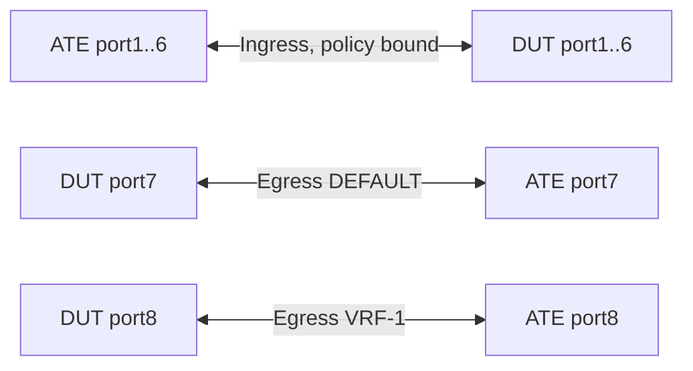

# RT-3.6: VRF Selection Policy Hardware Programming Across Multiple Linecards

## Summary

On a modular DUT, a VRF selection policy bound to ingress interfaces on several
linecards must be programmed into the forwarding hardware of every one of those
linecards, and must still be programmed after the chassis reboots. This test binds
one policy to ingress ports on at least two linecards and checks, per ingress port,
that matched traffic is steered into the VRF, before and after a chassis cold
reboot.

## Testbed type

* [`featureprofiles/topologies/atedut_8.testbed`](https://github.com/openconfig/featureprofiles/blob/main/topologies/atedut_8.testbed)

## Procedure

### Test environment setup



* DUT port1..port6 are ingress ports in `DEFAULT`; port7 is the `DEFAULT` egress
  and port8 the `VRF-1` egress.
* For each port N (1..8): DUT `192.0.2.(4N-3)/30` and `2001:db8:0:N::1/126`, ATE
  `192.0.2.(4N-2)` and `2001:db8:0:N::2`.
* Resolve the parent `LINECARD` of each ingress port (`hardware-port`, then
  `/components/component/state/parent` up to a `LINECARD`). Skip the test unless
  the ingress ports span at least 2 linecards.
* Static routes:
  * `VRF-1`: `198.51.100.0/24` and `2001:db8:100::/48` via ATE port8.
  * `DEFAULT`: `198.51.100.0/24`, `2001:db8:100::/48`, `203.0.113.0/24` and
    `2001:db8:200::/48` via ATE port7.
  * The matched prefixes are routed in both instances, so traffic that bypasses
    the policy is delivered to port7 instead of port8.
* Policy `CLUSTER_FACING_POLICY` (`VRF_SELECTION_POLICY`) in `DEFAULT`:
  * rule `10`: IPv4 `destination-address 198.51.100.0/24` -> `VRF-1`
  * rule `20`: IPv6 `destination-address 2001:db8:100::/48` -> `VRF-1`
* Bind the policy with `apply-vrf-selection-policy` to subinterface 0 of port1..6.

### RT-3.6.1 - Policy programmed on every ingress linecard

* Wait for `apply-vrf-selection-policy == CLUSTER_FACING_POLICY` in state on all
  ingress ports, and for ARP/ND.
* From each ingress port send 4 flows of 10,000 packets at 1,000 pps:
  `IPV4-MATCH` (`198.51.100.1`) and `IPV6-MATCH` (`2001:db8:100::1`) expected on
  port8; `IPV4-NOMATCH` (`203.0.113.1`) and `IPV6-NOMATCH` (`2001:db8:200::1`)
  expected on port7. Each flow's only receiver is its expected egress port.
* Verify for every flow `Tx == 10,000` and `Rx == Tx`, and that ATE port7 and
  port8 received the expected totals. A failure names the ingress port and its
  linecard.

### RT-3.6.2 - Policy programmed after chassis reboot

* Issue a gNOI `System.Reboot` `COLD` for the chassis. Wait for the boot time to
  advance, all ingress linecards to be `ACTIVE`, all ports `UP`, and the bindings
  to be present in state.
* Push no DUT configuration and no ATE configuration; only restart ATE protocols
  and wait for ARP/ND. Re-pushing ATE configuration bounces the links, which can
  re-program the policy and hide a linecard that missed it during boot.
* Repeat the traffic checks of RT-3.6.1.

#### Canonical OC

```json
{
  "interfaces": {
    "interface": [
      {
        "config": { "enabled": true, "name": "port1", "type": "iana-if-type:ethernetCsmacd" },
        "name": "port1",
        "subinterfaces": {
          "subinterface": [
            {
              "config": { "index": 0 },
              "index": 0
            }
          ]
        }
      }
    ]
  },
  "network-instances": {
    "network-instance": [
      {
        "config": { "name": "VRF-1", "type": "openconfig-network-instance-types:L3VRF" },
        "name": "VRF-1"
      },
      {
        "config": { "name": "DEFAULT", "type": "openconfig-network-instance-types:DEFAULT_INSTANCE" },
        "name": "DEFAULT",
        "policy-forwarding": {
          "interfaces": {
            "interface": [
              {
                "config": { "apply-vrf-selection-policy": "CLUSTER_FACING_POLICY", "interface-id": "port1" },
                "interface-id": "port1",
                "interface-ref": { "config": { "interface": "port1", "subinterface": 0 } }
              }
            ]
          },
          "policies": {
            "policy": [
              {
                "config": { "policy-id": "CLUSTER_FACING_POLICY", "type": "openconfig-policy-forwarding:VRF_SELECTION_POLICY" },
                "policy-id": "CLUSTER_FACING_POLICY",
                "rules": {
                  "rule": [
                    {
                      "action": { "config": { "network-instance": "VRF-1" } },
                      "config": { "sequence-id": 10 },
                      "ipv4": { "config": { "destination-address": "198.51.100.0/24" } },
                      "sequence-id": 10
                    },
                    {
                      "action": { "config": { "network-instance": "VRF-1" } },
                      "config": { "sequence-id": 20 },
                      "ipv6": { "config": { "destination-address": "2001:db8:100::/48" } },
                      "sequence-id": 20
                    }
                  ]
                }
              }
            ]
          }
        }
      }
    ]
  }
}
```

## OpenConfig Path and RPC Coverage

```yaml
paths:
  /interfaces/interface/state/hardware-port:
  /interfaces/interface/state/oper-status:
  /components/component/state/parent:
    platform_type: ["PORT", "INTEGRATED_CIRCUIT", "LINECARD"]
  /components/component/state/type:
    platform_type: ["LINECARD"]
  /components/component/state/oper-status:
    platform_type: ["LINECARD"]
  /system/state/boot-time:
  /network-instances/network-instance/protocols/protocol/static-routes/static/config/prefix:
  /network-instances/network-instance/protocols/protocol/static-routes/static/next-hops/next-hop/config/next-hop:
  /network-instances/network-instance/policy-forwarding/policies/policy/config/type:
  /network-instances/network-instance/policy-forwarding/policies/policy/rules/rule/ipv4/config/destination-address:
  /network-instances/network-instance/policy-forwarding/policies/policy/rules/rule/ipv6/config/destination-address:
  /network-instances/network-instance/policy-forwarding/policies/policy/rules/rule/action/config/network-instance:
  /network-instances/network-instance/policy-forwarding/interfaces/interface/config/apply-vrf-selection-policy:
  /network-instances/network-instance/policy-forwarding/interfaces/interface/state/apply-vrf-selection-policy:

rpcs:
  gnmi:
    gNMI.Get:
    gNMI.Set:
      update: true
    gNMI.Subscribe:
      on_change: true
  gnoi:
    system.System.Reboot:
```

## Required DUT platform

* MFF - A modular form factor device with at least 2 `LINECARD` components hosting
  the ingress ports.
