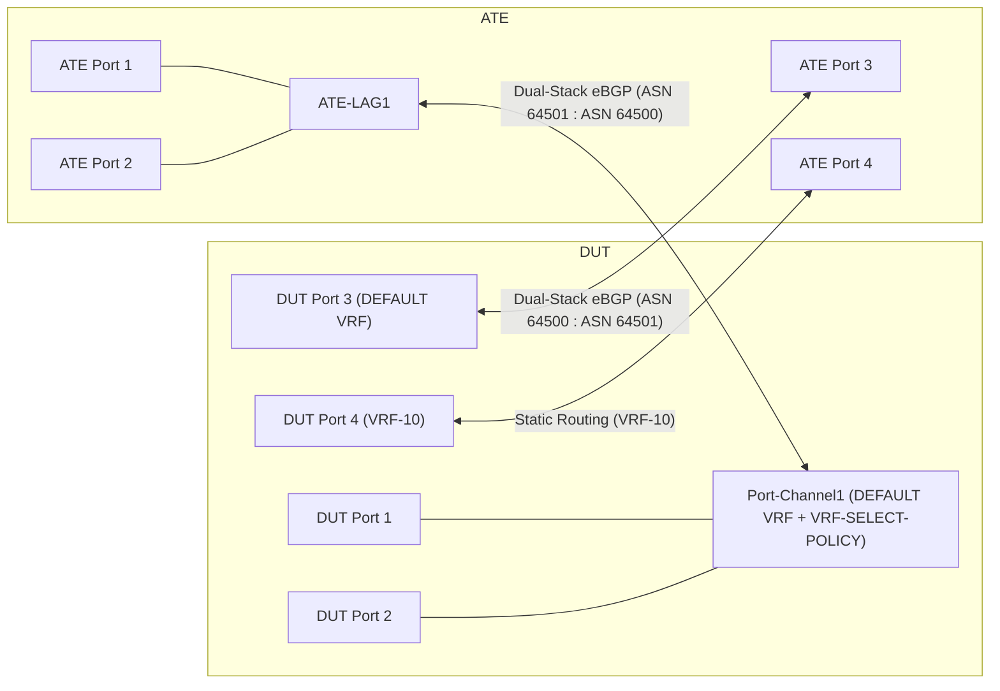

# RT-3.5: Dual-Stack eBGP Session Establishment and IPv6 NDP Resolution over LAG with Active VRF Selection Policy

## Summary

This test validates that applying an ingress VRF selection policy
(`VRF_SELECTION_POLICY`) on an aggregated Ethernet (LAG) interface in the
`DEFAULT` network instance does not disrupt link-local control-plane
protocols—specifically IPv6 Neighbor Discovery Protocol (NDP) Neighbor
Solicitation and Neighbor Advertisement (ICMPv6) packets, IPv4 ARP resolution,
and dual-stack external BGP (eBGP) session establishment.

In network deployments where a VRF selection policy is attached to an ingress
aggregate interface to steer matching transit data traffic into a non-default
L3 VRF (`VRF-10`), multicast and unicast ICMPv6 NDP packets as well as BGP
control-plane traffic must be exempted from VRF redirection and processed in
the `DEFAULT` network instance. If NDP packets are erroneously redirected by
the VRF selection policy into a non-default VRF and dropped, the IPv6 neighbor
cache entry remains stuck in the `INCOMPLETE` state and the IPv6 eBGP session
remains stuck in the `CONNECT` or `ACTIVE` state despite the underlying LAG
interface being operationally `UP`. This test verifies both control-plane
adjacency establishment (NDP `REACHABLE` state and dual-stack eBGP
`ESTABLISHED` state) and data-plane forwarding across both the `DEFAULT` VRF
and the policy-steered non-default VRF (`VRF-10`).

## Testbed type

* [`featureprofiles/topologies/atedut_4.testbed`](https://github.com/openconfig/featureprofiles/blob/main/topologies/atedut_4.testbed)

## Procedure

### Test environment setup

#### Topology



* Connect **DUT port 1** to **ATE port 1** and **DUT port 2** to **ATE port 2**.
  Configure both links as member ports of an IEEE 802.3ad LACP (or STATIC)
  aggregate interface named `Port-Channel1` on the DUT and `ATE-LAG1` on the
  ATE.
* Connect **DUT port 3** to **ATE port 3** as an egress singleton L3 interface
  in the `DEFAULT` network instance.
* Connect **DUT port 4** to **ATE port 4** as an egress singleton L3 interface
  assigned to a non-default L3 VRF network instance named `VRF-10`.

#### Device Interface and Protocol Addressing

| Device & Interface | Network Instance | IPv4 Address | IPv6 Address | BGP Role & ASN |
| :--- | :--- | :--- | :--- | :--- |
| **DUT `Port-Channel1.0`** (Members: DUT port 1, DUT port 2) | `DEFAULT` | `192.0.2.1/30` | `2001:db8::1/126` | DUT ASN `64500` |
| **ATE `ATE-LAG1.0`** (Members: ATE port 1, ATE port 2) | N/A | `192.0.2.2/30` | `2001:db8::2/126` | Peer ASN `64501` |
| **DUT port 3 (`subinterface 0`)** | `DEFAULT` | `192.0.2.5/30` | `2001:db8::5/126` | DUT ASN `64500` |
| **ATE port 3 (`subinterface 0`)** | N/A | `192.0.2.6/30` | `2001:db8::6/126` | Peer ASN `64501` |
| **DUT port 4 (`subinterface 0`)** | `VRF-10` | `192.0.2.9/30` | `2001:db8::9/126` | Static Routing |
| **ATE port 4 (`subinterface 0`)** | N/A | `192.0.2.10/30` | `2001:db8::a/126` | Static Next-Hop |

* **ATE Route Advertisements**:
  * **ATE `ATE-LAG1`** advertises IPv4 prefix `198.19.0.0/24` and IPv6 prefix
    `2001:db8:20::/64` to **DUT `Port-Channel1`** via dual-stack eBGP.
  * **ATE port 3** advertises IPv4 prefix `198.51.100.0/24` and IPv6 prefix
    `2001:db8:1::/64` to **DUT port 3** via dual-stack eBGP in the `DEFAULT`
    network instance.
* **DUT `VRF-10` Static Routes**:
  * Configure an IPv4 static route in `VRF-10` for prefix `203.0.113.0/24` with
    next-hop `192.0.2.10` (ATE port 4).
  * Configure an IPv6 static route in `VRF-10` for prefix `2001:db8:2::/64`
    with next-hop `2001:db8::a` (ATE port 4).

### RT-3.5.1: Baseline LAG, Dual-Stack eBGP, and VRF Selection Policy Configuration and Control-Plane Verification

* **Step 1 - Configure Aggregate Interface and Member Ports**:
  * Using `gNMI.Set`, configure `Port-Channel1` on the DUT with
    `/interfaces/interface/config/type` set to `ieee8023adLag`,
    `/interfaces/interface/config/enabled` set to `true`, and
    `/interfaces/interface/aggregation/config/lag-type` set to `LACP` (or
    `STATIC`).
  * Assign **DUT port 1** and **DUT port 2** to `Port-Channel1` via
    `/interfaces/interface/ethernet/config/aggregate-id`.
  * Configure dual-stack subinterface `0` on `Port-Channel1`, **DUT port 3**,
    and **DUT port 4** with their respective IPv4 addresses
    (`/interfaces/interface/subinterfaces/subinterface/ipv4/addresses/address/config/ip`
    and `prefix-length`) and IPv6 addresses
    (`/interfaces/interface/subinterfaces/subinterface/ipv6/addresses/address/config/ip`
    and `prefix-length`).

* **Step 2 - Configure Network Instances and VRF Selection Policy**:
  * Configure the `DEFAULT` network instance
    (`/network-instances/network-instance/config/type` = `DEFAULT_INSTANCE`)
    and non-default VRF `VRF-10`
    (`/network-instances/network-instance/config/type` = `L3VRF`). Bind **DUT
    port 4** subinterface `0` to `VRF-10` using
    `/network-instances/network-instance/interfaces/interface/config/interface`
    and
    `/network-instances/network-instance/interfaces/interface/config/subinterface`.
  * In the `DEFAULT` network instance, configure policy-forwarding policy
    `VRF-SELECT-POLICY`
    (`/network-instances/network-instance/policy-forwarding/policies/policy/config/policy-id`
    = `VRF-SELECT-POLICY`,
    `/network-instances/network-instance/policy-forwarding/policies/policy/config/type`
    = `VRF_SELECTION_POLICY`) with the following rules:
    * **Rule 10** (`sequence-id: 10`): Match IPv4 packets with source prefix
      `198.18.0.0/16`
      (`/network-instances/network-instance/policy-forwarding/policies/policy/rules/rule/ipv4/config/source-address`)
      and DSCP `10`
      (`/network-instances/network-instance/policy-forwarding/policies/policy/rules/rule/ipv4/config/dscp-set`),
      with action
      `/network-instances/network-instance/policy-forwarding/policies/policy/rules/rule/action/config/network-instance`
      set to `VRF-10`.
    * **Rule 20** (`sequence-id: 20`): Match IPv6 packets with source prefix
      `2001:db8:10::/48`
      (`/network-instances/network-instance/policy-forwarding/policies/policy/rules/rule/ipv6/config/source-address`)
      and DSCP `10`
      (`/network-instances/network-instance/policy-forwarding/policies/policy/rules/rule/ipv6/config/dscp-set`),
      with action
      `/network-instances/network-instance/policy-forwarding/policies/policy/rules/rule/action/config/network-instance`
      set to `VRF-10`.
  * Apply `VRF-SELECT-POLICY` to ingress interface `Port-Channel1.0` in the
    `DEFAULT` network instance using
    `/network-instances/network-instance/policy-forwarding/interfaces/interface/config/apply-vrf-selection-policy`.

* **Step 3 - Configure Dual-Stack eBGP Sessions**:
  * In the `DEFAULT` network instance, configure BGP
    (`/network-instances/network-instance/protocols/protocol/bgp/global/config/as`
    = `64500`,
    `/network-instances/network-instance/protocols/protocol/bgp/global/config/router-id`
    = `192.0.2.1`) with an unconditional `ACCEPT_ROUTE` import and export
    routing policy.
  * Configure IPv4 eBGP neighbor `192.0.2.2` and IPv6 eBGP neighbor
    `2001:db8::2` over `Port-Channel1` with
    `/network-instances/network-instance/protocols/protocol/bgp/neighbors/neighbor/config/peer-as`
    = `64501`, enabling `IPV4_UNICAST` and `IPV6_UNICAST` AFI-SAFIs
    (`/network-instances/network-instance/protocols/protocol/bgp/neighbors/neighbor/afi-safis/afi-safi/config/enabled`
    = `true`).
  * Configure IPv4 eBGP neighbor `192.0.2.6` and IPv6 eBGP neighbor
    `2001:db8::6` over **DUT port 3** with `peer-as` = `64501`.
  * Start protocols on the ATE and wait for IPv4 ARP and IPv6 Neighbor
    Discovery resolution to complete.

* **Step 4 - Control-Plane Telemetry Validation (Pass/Fail Criteria)**:
  * **LAG Operational Status**: Using `gNMI.Subscribe` (`ON_CHANGE`), verify
    that `/interfaces/interface/state/oper-status` for `Port-Channel1`, **DUT
    port 1**, **DUT port 2**, **DUT port 3**, and **DUT port 4** is `UP`.
  * **IPv6 NDP Neighbor State Verification**: Using `gNMI.Get` /
    `gNMI.Subscribe`, query
    `/interfaces/interface/subinterfaces/subinterface/ipv6/neighbors/neighbor/state/neighbor-state`
    and
    `/interfaces/interface/subinterfaces/subinterface/ipv6/neighbors/neighbor/state/link-layer-address`
    on `Port-Channel1` subinterface `0` for peer IPv6 address `2001:db8::2`:
    * **Pass**: The IPv6 neighbor entry resolves a valid MAC address in
      `link-layer-address` and its `neighbor-state` is `REACHABLE` (or `STALE`
      after reachability confirmation). Multicast/unicast ICMPv6 NDP packets
      are processed locally in the `DEFAULT` network instance and are not
      dropped by the VRF selection policy.
    * **Fail**: The IPv6 neighbor entry is missing or its `neighbor-state`
      remains `INCOMPLETE`.
  * **IPv4 ARP Neighbor State Verification**: Verify
    `/interfaces/interface/subinterfaces/subinterface/ipv4/neighbors/neighbor/state/link-layer-address`
    on `Port-Channel1` subinterface `0` resolves the MAC address of
    `192.0.2.2`.
  * **Dual-Stack eBGP Session State Verification**: Using `gNMI.Subscribe`
    (`ON_CHANGE`), query
    `/network-instances/network-instance/protocols/protocol/bgp/neighbors/neighbor/state/session-state`
    and
    `/network-instances/network-instance/protocols/protocol/bgp/neighbors/neighbor/afi-safis/afi-safi/state/active`
    in the `DEFAULT` network instance:
    * **Pass**: Both the IPv4 eBGP neighbor (`192.0.2.2`) and the IPv6 eBGP
      neighbor (`2001:db8::2`) on `Port-Channel1` (as well as `192.0.2.6` and
      `2001:db8::6` on **DUT port 3**) reach `session-state` = `ESTABLISHED`
      and `afi-safi/state/active` = `true`.
    * **Fail**: Either the IPv4 or IPv6 eBGP session remains stuck in
      `CONNECT`, `ACTIVE`, or `IDLE`.

### RT-3.5.2: Dual-Stack Data Plane Forwarding Verification for Default VRF eBGP Routes and VRF-Steered Traffic

* **Step 1 - Verify AFT Route Programming**:
  * Using `gNMI.Subscribe`, verify that eBGP-advertised prefixes
    `198.51.100.0/24` and `2001:db8:1::/64` are installed in the `DEFAULT`
    network instance AFT
    (`/network-instances/network-instance/afts/ipv4-unicast/ipv4-entry/state/prefix`
    and
    `/network-instances/network-instance/afts/ipv6-unicast/ipv6-entry/state/prefix`),
    and static prefixes `203.0.113.0/24` and `2001:db8:2::/64` are installed
    in the `VRF-10` network instance AFT.

* **Step 2 - Transmit Dual-Stack Traffic Flows**:
  * Configure and transmit 4 concurrent traffic flows from **ATE `ATE-LAG1`**
    (ATE ports 1 and 2) at 1,000 packets per second for 10 seconds (10,000
    packets per flow):

| Flow Name | IP Version | Source Address | Destination Address | DSCP | Expected VRF Lookup | Expected Egress Port |
| :--- | :--- | :--- | :--- | :--- | :--- | :--- |
| **Flow 1 (Default-IPv4)** | IPv4 | `198.19.0.1` | `198.51.100.1` | `0` | `DEFAULT` (eBGP route) | **DUT port 3** -> **ATE port 3** |
| **Flow 2 (Default-IPv6)** | IPv6 | `2001:db8:20::1` | `2001:db8:1::1` | `0` | `DEFAULT` (eBGP route) | **DUT port 3** -> **ATE port 3** |
| **Flow 3 (Steered-IPv4)** | IPv4 | `198.18.0.1` | `203.0.113.1` | `10` | `VRF-10` (Rule 10 match) | **DUT port 4** -> **ATE port 4** |
| **Flow 4 (Steered-IPv6)** | IPv6 | `2001:db8:10::1` | `2001:db8:2::1` | `10` | `VRF-10` (Rule 20 match) | **DUT port 4** -> **ATE port 4** |

* **Step 3 - Data-Plane and Telemetry Validation (Pass/Fail Criteria)**:
  * **Pass**:
    * **Flow 1** and **Flow 2** arrive at **ATE port 3** with 0% packet loss
      (all 10,000 packets per flow received).
    * **Flow 3** and **Flow 4** arrive at **ATE port 4** with 0% packet loss
      (all 10,000 packets per flow received), and zero packets from Flow 3 or
      Flow 4 leak to **ATE port 3**.
    * Policy-forwarding rule telemetry counters
      `/network-instances/network-instance/policy-forwarding/policies/policy/rules/rule/state/matched-pkts`
      and
      `/network-instances/network-instance/policy-forwarding/policies/policy/rules/rule/state/matched-octets`
      for Rule 10 and Rule 20 increment by the exact number of packets and
      octets transmitted for Flow 3 and Flow 4 respectively.
    * Interface packet counters `/interfaces/interface/state/counters/in-pkts`
      on `Port-Channel1` and `/interfaces/interface/state/counters/out-pkts` on
      **DUT port 3** and **DUT port 4** match the transmitted packet counts.
    * Throughout and after the traffic run, the IPv6 neighbor state
      (`/interfaces/interface/subinterfaces/subinterface/ipv6/neighbors/neighbor/state/neighbor-state`)
      on `Port-Channel1` remains `REACHABLE` and the IPv4/IPv6 eBGP session
      state
      (`/network-instances/network-instance/protocols/protocol/bgp/neighbors/neighbor/state/session-state`)
      remains `ESTABLISHED`.
  * **Fail**:
    * Any packet loss (> 0%) is observed on Flows 1, 2, 3, or 4, or traffic is
      misrouted to the wrong egress port.
    * Policy-forwarding `matched-pkts` counters fail to increment for steered
      flows.
    * The IPv6 eBGP session flaps or drops out of `ESTABLISHED`, or the IPv6
      neighbor state reverts to `INCOMPLETE`.

### Cleanup

* Stop all active OTG traffic flows and protocols on the ATE.
* Remove the policy-forwarding configuration (`VRF-SELECT-POLICY`), non-default
  network instance (`VRF-10`), BGP neighbors, and aggregate interface
  configuration added during the test, restoring the DUT and ATE interfaces to
  their baseline operational state.

## Canonical OC

```json
{
  "interfaces": {
    "interface": [
      {
        "config": {
          "enabled": true,
          "name": "Port1",
          "type": "iana-if-type:ethernetCsmacd"
        },
        "ethernet": {
          "config": {
            "aggregate-id": "Port-Channel1"
          }
        },
        "name": "Port1"
      },
      {
        "config": {
          "enabled": true,
          "name": "Port2",
          "type": "iana-if-type:ethernetCsmacd"
        },
        "ethernet": {
          "config": {
            "aggregate-id": "Port-Channel1"
          }
        },
        "name": "Port2"
      },
      {
        "aggregation": {
          "config": {
            "lag-type": "LACP"
          }
        },
        "config": {
          "enabled": true,
          "name": "Port-Channel1",
          "type": "iana-if-type:ieee8023adLag"
        },
        "name": "Port-Channel1",
        "subinterfaces": {
          "subinterface": [
            {
              "config": {
                "index": 0
              },
              "index": 0,
              "ipv4": {
                "addresses": {
                  "address": [
                    {
                      "config": {
                        "ip": "192.0.2.1",
                        "prefix-length": 30
                      },
                      "ip": "192.0.2.1"
                    }
                  ]
                },
                "config": {
                  "enabled": true
                }
              },
              "ipv6": {
                "addresses": {
                  "address": [
                    {
                      "config": {
                        "ip": "2001:db8::1",
                        "prefix-length": 126
                      },
                      "ip": "2001:db8::1"
                    }
                  ]
                },
                "config": {
                  "enabled": true
                }
              }
            }
          ]
        }
      },
      {
        "config": {
          "enabled": true,
          "name": "Port3",
          "type": "iana-if-type:ethernetCsmacd"
        },
        "name": "Port3",
        "subinterfaces": {
          "subinterface": [
            {
              "config": {
                "index": 0
              },
              "index": 0,
              "ipv4": {
                "addresses": {
                  "address": [
                    {
                      "config": {
                        "ip": "192.0.2.5",
                        "prefix-length": 30
                      },
                      "ip": "192.0.2.5"
                    }
                  ]
                },
                "config": {
                  "enabled": true
                }
              },
              "ipv6": {
                "addresses": {
                  "address": [
                    {
                      "config": {
                        "ip": "2001:db8::5",
                        "prefix-length": 126
                      },
                      "ip": "2001:db8::5"
                    }
                  ]
                },
                "config": {
                  "enabled": true
                }
              }
            }
          ]
        }
      },
      {
        "config": {
          "enabled": true,
          "name": "Port4",
          "type": "iana-if-type:ethernetCsmacd"
        },
        "name": "Port4",
        "subinterfaces": {
          "subinterface": [
            {
              "config": {
                "index": 0
              },
              "index": 0,
              "ipv4": {
                "addresses": {
                  "address": [
                    {
                      "config": {
                        "ip": "192.0.2.9",
                        "prefix-length": 30
                      },
                      "ip": "192.0.2.9"
                    }
                  ]
                },
                "config": {
                  "enabled": true
                }
              },
              "ipv6": {
                "addresses": {
                  "address": [
                    {
                      "config": {
                        "ip": "2001:db8::9",
                        "prefix-length": 126
                      },
                      "ip": "2001:db8::9"
                    }
                  ]
                },
                "config": {
                  "enabled": true
                }
              }
            }
          ]
        }
      }
    ]
  },
  "network-instances": {
    "network-instance": [
      {
        "config": {
          "name": "VRF-10",
          "type": "openconfig-network-instance-types:L3VRF"
        },
        "interfaces": {
          "interface": [
            {
              "config": {
                "id": "Port4.0",
                "interface": "Port4",
                "subinterface": 0
              },
              "id": "Port4.0"
            }
          ]
        },
        "name": "VRF-10",
        "protocols": {
          "protocol": [
            {
              "config": {
                "identifier": "openconfig-policy-types:STATIC",
                "name": "STATIC"
              },
              "identifier": "openconfig-policy-types:STATIC",
              "name": "STATIC",
              "static-routes": {
                "static": [
                  {
                    "config": {
                      "prefix": "203.0.113.0/24"
                    },
                    "next-hops": {
                      "next-hop": [
                        {
                          "config": {
                            "index": "0",
                            "next-hop": "192.0.2.10"
                          },
                          "index": "0"
                        }
                      ]
                    },
                    "prefix": "203.0.113.0/24"
                  },
                  {
                    "config": {
                      "prefix": "2001:db8:2::/64"
                    },
                    "next-hops": {
                      "next-hop": [
                        {
                          "config": {
                            "index": "0",
                            "next-hop": "2001:db8::a"
                          },
                          "index": "0"
                        }
                      ]
                    },
                    "prefix": "2001:db8:2::/64"
                  }
                ]
              }
            }
          ]
        }
      },
      {
        "config": {
          "name": "DEFAULT",
          "type": "openconfig-network-instance-types:DEFAULT_INSTANCE"
        },
        "name": "DEFAULT",
        "policy-forwarding": {
          "interfaces": {
            "interface": [
              {
                "config": {
                  "apply-vrf-selection-policy": "VRF-SELECT-POLICY",
                  "interface-id": "Port-Channel1.0"
                },
                "interface-id": "Port-Channel1.0",
                "interface-ref": {
                  "config": {
                    "interface": "Port-Channel1",
                    "subinterface": 0
                  }
                }
              }
            ]
          },
          "policies": {
            "policy": [
              {
                "config": {
                  "policy-id": "VRF-SELECT-POLICY",
                  "type": "openconfig-policy-forwarding:VRF_SELECTION_POLICY"
                },
                "policy-id": "VRF-SELECT-POLICY",
                "rules": {
                  "rule": [
                    {
                      "action": {
                        "config": {
                          "network-instance": "VRF-10"
                        }
                      },
                      "config": {
                        "sequence-id": 10
                      },
                      "ipv4": {
                        "config": {
                          "dscp-set": [
                            10
                          ],
                          "source-address": "198.18.0.0/16"
                        }
                      },
                      "sequence-id": 10
                    },
                    {
                      "action": {
                        "config": {
                          "network-instance": "VRF-10"
                        }
                      },
                      "config": {
                        "sequence-id": 20
                      },
                      "ipv6": {
                        "config": {
                          "dscp-set": [
                            10
                          ],
                          "source-address": "2001:db8:10::/48"
                        }
                      },
                      "sequence-id": 20
                    }
                  ]
                }
              }
            ]
          }
        },
        "protocols": {
          "protocol": [
            {
              "bgp": {
                "global": {
                  "afi-safis": {
                    "afi-safi": [
                      {
                        "afi-safi-name": "openconfig-bgp-types:IPV4_UNICAST",
                        "config": {
                          "afi-safi-name": "openconfig-bgp-types:IPV4_UNICAST",
                          "enabled": true
                        }
                      },
                      {
                        "afi-safi-name": "openconfig-bgp-types:IPV6_UNICAST",
                        "config": {
                          "afi-safi-name": "openconfig-bgp-types:IPV6_UNICAST",
                          "enabled": true
                        }
                      }
                    ]
                  },
                  "config": {
                    "as": 64500,
                    "router-id": "192.0.2.1"
                  }
                },
                "neighbors": {
                  "neighbor": [
                    {
                      "afi-safis": {
                        "afi-safi": [
                          {
                            "afi-safi-name": "openconfig-bgp-types:IPV4_UNICAST",
                            "config": {
                              "afi-safi-name": "openconfig-bgp-types:IPV4_UNICAST",
                              "enabled": true
                            }
                          }
                        ]
                      },
                      "config": {
                        "enabled": true,
                        "neighbor-address": "192.0.2.2",
                        "peer-as": 64501
                      },
                      "neighbor-address": "192.0.2.2"
                    },
                    {
                      "afi-safis": {
                        "afi-safi": [
                          {
                            "afi-safi-name": "openconfig-bgp-types:IPV6_UNICAST",
                            "config": {
                              "afi-safi-name": "openconfig-bgp-types:IPV6_UNICAST",
                              "enabled": true
                            }
                          }
                        ]
                      },
                      "config": {
                        "enabled": true,
                        "neighbor-address": "2001:db8::2",
                        "peer-as": 64501
                      },
                      "neighbor-address": "2001:db8::2"
                    },
                    {
                      "afi-safis": {
                        "afi-safi": [
                          {
                            "afi-safi-name": "openconfig-bgp-types:IPV4_UNICAST",
                            "config": {
                              "afi-safi-name": "openconfig-bgp-types:IPV4_UNICAST",
                              "enabled": true
                            }
                          }
                        ]
                      },
                      "config": {
                        "enabled": true,
                        "neighbor-address": "192.0.2.6",
                        "peer-as": 64501
                      },
                      "neighbor-address": "192.0.2.6"
                    },
                    {
                      "afi-safis": {
                        "afi-safi": [
                          {
                            "afi-safi-name": "openconfig-bgp-types:IPV6_UNICAST",
                            "config": {
                              "afi-safi-name": "openconfig-bgp-types:IPV6_UNICAST",
                              "enabled": true
                            }
                          }
                        ]
                      },
                      "config": {
                        "enabled": true,
                        "neighbor-address": "2001:db8::6",
                        "peer-as": 64501
                      },
                      "neighbor-address": "2001:db8::6"
                    }
                  ]
                }
              },
              "config": {
                "identifier": "openconfig-policy-types:BGP",
                "name": "BGP"
              },
              "identifier": "openconfig-policy-types:BGP",
              "name": "BGP"
            }
          ]
        }
      }
    ]
  }
}
```

## OpenConfig Path and RPC Coverage

```yaml
paths:
  # Interface & LAG Configuration and State
  /interfaces/interface/aggregation/config/lag-type:
  /interfaces/interface/config/enabled:
  /interfaces/interface/config/name:
  /interfaces/interface/config/type:
  /interfaces/interface/ethernet/config/aggregate-id:
  /interfaces/interface/state/counters/in-pkts:
  /interfaces/interface/state/counters/out-pkts:
  /interfaces/interface/state/oper-status:
  /interfaces/interface/subinterfaces/subinterface/config/index:
  /interfaces/interface/subinterfaces/subinterface/ipv4/addresses/address/config/ip:
  /interfaces/interface/subinterfaces/subinterface/ipv4/addresses/address/config/prefix-length:
  /interfaces/interface/subinterfaces/subinterface/ipv4/config/enabled:
  /interfaces/interface/subinterfaces/subinterface/ipv4/neighbors/neighbor/state/link-layer-address:
  /interfaces/interface/subinterfaces/subinterface/ipv6/addresses/address/config/ip:
  /interfaces/interface/subinterfaces/subinterface/ipv6/addresses/address/config/prefix-length:
  /interfaces/interface/subinterfaces/subinterface/ipv6/config/enabled:
  /interfaces/interface/subinterfaces/subinterface/ipv6/neighbors/neighbor/state/link-layer-address:
  /interfaces/interface/subinterfaces/subinterface/ipv6/neighbors/neighbor/state/neighbor-state:

  # Network Instance & Policy Forwarding Configuration and Telemetry
  /network-instances/network-instance/afts/ipv4-unicast/ipv4-entry/state/prefix:
  /network-instances/network-instance/afts/ipv6-unicast/ipv6-entry/state/prefix:
  /network-instances/network-instance/config/name:
  /network-instances/network-instance/config/type:
  /network-instances/network-instance/interfaces/interface/config/id:
  /network-instances/network-instance/interfaces/interface/config/interface:
  /network-instances/network-instance/interfaces/interface/config/subinterface:
  /network-instances/network-instance/policy-forwarding/interfaces/interface/config/apply-vrf-selection-policy:
  /network-instances/network-instance/policy-forwarding/interfaces/interface/config/interface-id:
  /network-instances/network-instance/policy-forwarding/interfaces/interface/interface-ref/config/interface:
  /network-instances/network-instance/policy-forwarding/interfaces/interface/interface-ref/config/subinterface:
  /network-instances/network-instance/policy-forwarding/policies/policy/config/policy-id:
  /network-instances/network-instance/policy-forwarding/policies/policy/config/type:
  /network-instances/network-instance/policy-forwarding/policies/policy/rules/rule/action/config/network-instance:
  /network-instances/network-instance/policy-forwarding/policies/policy/rules/rule/config/sequence-id:
  /network-instances/network-instance/policy-forwarding/policies/policy/rules/rule/ipv4/config/dscp-set:
  /network-instances/network-instance/policy-forwarding/policies/policy/rules/rule/ipv4/config/source-address:
  /network-instances/network-instance/policy-forwarding/policies/policy/rules/rule/ipv6/config/dscp-set:
  /network-instances/network-instance/policy-forwarding/policies/policy/rules/rule/ipv6/config/source-address:
  /network-instances/network-instance/policy-forwarding/policies/policy/rules/rule/state/matched-octets:
  /network-instances/network-instance/policy-forwarding/policies/policy/rules/rule/state/matched-pkts:

  # BGP & Static Routing Configuration and State
  /network-instances/network-instance/protocols/protocol/bgp/global/afi-safis/afi-safi/config/afi-safi-name:
  /network-instances/network-instance/protocols/protocol/bgp/global/afi-safis/afi-safi/config/enabled:
  /network-instances/network-instance/protocols/protocol/bgp/global/config/as:
  /network-instances/network-instance/protocols/protocol/bgp/global/config/router-id:
  /network-instances/network-instance/protocols/protocol/bgp/neighbors/neighbor/afi-safis/afi-safi/config/afi-safi-name:
  /network-instances/network-instance/protocols/protocol/bgp/neighbors/neighbor/afi-safis/afi-safi/config/enabled:
  /network-instances/network-instance/protocols/protocol/bgp/neighbors/neighbor/afi-safis/afi-safi/state/active:
  /network-instances/network-instance/protocols/protocol/bgp/neighbors/neighbor/config/enabled:
  /network-instances/network-instance/protocols/protocol/bgp/neighbors/neighbor/config/neighbor-address:
  /network-instances/network-instance/protocols/protocol/bgp/neighbors/neighbor/config/peer-as:
  /network-instances/network-instance/protocols/protocol/bgp/neighbors/neighbor/state/session-state:
  /network-instances/network-instance/protocols/protocol/config/identifier:
  /network-instances/network-instance/protocols/protocol/config/name:
  /network-instances/network-instance/protocols/protocol/static-routes/static/config/prefix:
  /network-instances/network-instance/protocols/protocol/static-routes/static/next-hops/next-hop/config/index:
  /network-instances/network-instance/protocols/protocol/static-routes/static/next-hops/next-hop/config/next-hop:

rpcs:
  gnmi:
    gNMI.Get:
    gNMI.Set:
      replace: true
    gNMI.Subscribe:
      on_change: true
```

## Required DUT platform

* FFF
